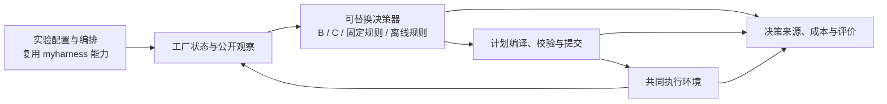

# 分析 Codex 工厂数据排程的缺陷


线程 `01a12e07-fae5-70c2-ad30-c126f1f1b178`。原始记录截止 2026-10-12T12:48:19.781Z。可见消息导出，不包含内部推理；工具原文保存在 private 原始记录，索引见 tool-index.jsonl。


## user · 2026-10-12T02:54:03.975Z · 原记录 L6

# AGENTS.md instructions

<INSTRUCTIONS>
# Personal environment notes

## GitHub CLI authentication and connectivity

- On this Mac, direct command-line HTTPS access to `github.com:443` can time out even when browser access works. Clash Verge's verified mixed proxy is `http://127.0.0.1:7897`.
- `gh` authentication for the GitHub account is stored in the macOS Keychain. Never print, copy, or persist the OAuth token in project files, logs, prompts, or shell history.
- `~/.zprofile` defines a scoped `gh` wrapper that supplies `HTTPS_PROXY=http://127.0.0.1:7897` unless an explicit proxy is already set. Git has a host-scoped global proxy at `http.https://github.com.proxy` using the same endpoint.
- If `gh` appears logged out or reports an invalid/expired token, first verify Clash Verge is running and test connectivity through port `7897`; do not assume the token expired merely because a direct request timed out.
- Diagnose in this order: proxy reachability, `gh auth status` through the proxy, `gh api user --jq .login`, then `git ls-remote origin HEAD`. Re-authenticate only if the token is still reported invalid while the proxy is working.
- When re-authentication is truly required, use GitHub's web device flow through the proxy and keep HTTPS Git credentials managed by `gh auth setup-git` and macOS Keychain.

Recorded after successful diagnosis and verification on 2026-07-19.
</INSTRUCTIONS>
<environment_context>
  <cwd>__LOCAL_PROJECT_ROOT__</cwd>
  <shell>zsh</shell>
  <current_date>2026-10-12</current_date>
  <timezone>Asia/Shanghai</timezone>
  <filesystem><workspace_roots><root>__LOCAL_PROJECT_ROOT__</root><root>__LOCAL_HOME__/.codex/visualizations/2026/10/12/01a12e07-fae5-70c2-ad30-c126f1f1b178</root></workspace_roots><permission_profile type="managed"><file_system type="restricted"><entry access="read"><special>:root</special></entry><entry access="write"><path>__LOCAL_PROJECT_ROOT__</path></entry><entry access="write"><path>__LOCAL_HOME__/.codex/visualizations/2026/10/12/01a12e07-fae5-70c2-ad30-c126f1f1b178</path></entry><entry access="write"><special>:slash_tmp</special></entry><entry access="write"><special>:tmpdir</special></entry><entry access="read"><path>__LOCAL_PROJECT_ROOT__/.git</path></entry><entry access="read"><path>__LOCAL_HOME__/.codex/visualizations/2026/10/12/01a12e07-fae5-70c2-ad30-c126f1f1b178/.git</path></entry><entry access="read"><path>__LOCAL_PROJECT_ROOT__/.agents</path></entry><entry access="read"><path>__LOCAL_HOME__/.codex/visualizations/2026/10/12/01a12e07-fae5-70c2-ad30-c126f1f1b178/.agents</path></entry><entry access="read"><path>__LOCAL_PROJECT_ROOT__/.codex</path></entry><entry access="read"><path>__LOCAL_HOME__/.codex/visualizations/2026/10/12/01a12e07-fae5-70c2-ad30-c126f1f1b178/.codex</path></entry><entry access="read"><path>__LOCAL_PROJECT_ROOT__/.aws</path></entry><entry access="read"><path>__LOCAL_HOME__/.codex/visualizations/2026/10/12/01a12e07-fae5-70c2-ad30-c126f1f1b178/.aws</path></entry></file_system></permission_profile></filesystem>
</environment_context>

## user · 2026-10-12T02:54:03.979Z · 原记录 L10

<external_codex_apps_open_page>{"page_id":null}</external_codex_apps_open_page>

## user · 2026-10-12T02:54:03.980Z · 原记录 L12

你来分析一下我们在实际的工厂数据集上面使用codex来直接做排程，有哪些缺陷与问题


## assistant · 2026-10-12T02:54:08.565Z · 原记录 L15

我先查看工作区里的工厂数据、排程结果和已有记录，结合实际案例分析直接用 Codex 排程时的缺陷与风险。


## assistant · 2026-10-12T02:54:20.515Z · 原记录 L25

我找到了已有的排程对照实验。接下来会区分实验中已经出现的问题，以及真实工厂场景尚未验证的部分；涉及 Codex 的能力边界，我也会用 OpenAI Docs 核对。


## assistant · 2026-10-12T02:55:10.257Z · 原记录 L60

最新记录确认：B 方案已经完成了 913 台设备范围的一小时直接排程。现在最突出的问题是成本和质量——后期片段平均约 10 次模型往返才提交一次计划，计划平均只推进约 27 秒；同时，工序完成数低于经典方案，换型更多。还要区分数据来源：当前使用的是 SMT2020 工厂仿真基准，不能把这次通过直接等同于真实产线验证。


## assistant · 2026-10-12T02:57:25.697Z · 原记录 L82

结合工作区里最新的一小时实验、调用账本和实现代码，我的判断是：**Codex 已经证明可以直接作出覆盖全厂的合法排程决策，但当前方案的实时性、排程质量和持续运行能力，距离生产可用还有明显差距。**

先明确范围：目前使用的是 **SMT2020 工厂仿真基准**，覆盖 913 台生产设备，并非已经接入本厂 MES、经过现场执行验证的数据闭环。[官方数据入口](https://p2schedgen.fernuni-hagen.de/downloads/simulation)

另外，我们的 B 方案要求模型直接决定任务、机台、组批、顺序和等待，不调用求解器。因此，下面的问题既包含模型的局限，也包含我们当前交互协议和实验设计的问题，不能全部归因于 Codex 本身。

现有一小时结果已经暴露了几个具体差距：

| 指标 | A：经典混合调度 | B：模型直接排程 | B 相对 A |
|---|---:|---:|---:|
| 完成生产工序 | 336 | 288 | 少 14.29% |
| 生产派工次数 | 1,138 | 1,071 | 少 5.89% |
| 换型占用，设备·小时 | 30.08 | 40.34 | 多 34.12% |
| 平均批填充率 | 94.23% | 92.50% | 低 1.73 个百分点 |
| 全部待加工队列累计等待，lot·小时 | 1,019.29 | 1,028.79 | 多 0.93% |
| 提交计划次数 | 47 | 95 | 约两倍 |

这些是已执行方案的描述性比较；运行版本存在差异，尚不能当作严格的算法优劣证明。[对比报告](__LOCAL_PROJECT_ROOT__/experiment_round2_3datasets/docs/smt_fullfab/ABC_1h_plan_comparison_20261012.md:11)

**1．最直接的障碍：决策速度跟不上工厂状态变化。**

B 整个一小时开发沿革用了 1,362 次模型尝试、约 4,467 万已知 tokens，包含恢复和收尾的累计墙钟约 24 小时 41 分钟。这个数字包含开发过程，不能当成以后每次运行的固定成本。

但即使只看后期相同协议的片段，问题仍很明显：

- 779 次调用、8.11 小时模型活动，只推进了约 35.85 分钟仿真。
- 平均每次计划提交需要 9.74 次模型往返。
- 我按账本计算，平均每次提交消耗约 **6.08 分钟模型活动时间**，计划平均只推进 **26.89 秒仿真**。

**现场接入时，机台和物料会在模型思考期间继续变化。** 如果仍按当前方式同步等待，模型算完时所依据的状态可能已经过期。现在的一小时仿真通过，并没有验证这类决策延迟造成的生产损失。[成本与时延证据](__LOCAL_PROJECT_ROOT__/experiment_round2_3datasets/docs/smt_fullfab/B_1h_results_efficiency_and_next_budget_20261012.md:17)

**2．我们让模型承担了太多机械操作，放大了成本。**

后期调用中，仅“创建草稿、封存、检查装配、读取候选”四类动作，就占了 **43.4% 的调用、43.2% 的 tokens**。这些步骤主要服务于协议和审计，并不都在作出新的排程取舍。

另外，输入占总 tokens 的 **96.77%**，输入缓存占输入仅 **0.48%**。大量成本花在反复读取计划、进度、反馈和协议上。当前工作集还按查询类别保留最后一批结果，先前读取的同类事实可能需要重新查询。

这说明，**当前成本不能直接解释为“模型思考排程必然这么贵”**。接口粒度、事实缓存和重复上下文有明显改进空间。反过来，仅增加上下文或记忆上限，也不会自动解决这些问题。[协议统计](__LOCAL_PROJECT_ROOT__/experiment_round2_3datasets/docs/smt_fullfab/B_1h_results_efficiency_and_next_budget_20261012.md:37)

**3．能生成可行计划，但全局取舍还不够好。**

排程需要同时权衡：当前开哪台机、先做哪个 lot、是否等凑批、是否值得换型，以及这些选择怎样影响后续工序。

现有结果中，B 使用过的设备比 A 更多，却完成了更少工序、付出了更多换型。这表明，**设备分配得更广，并不代表有效产出更高**。

差距还有明确位置：

- `LithoTrack_FE_95`：A 完成 30 个工序，B 完成 1 个。
- `Litho_FE_111`：A 完成 11 个，B 完成 0 个。

两个设备族合计贡献了全厂净完成差额的 **83.3%**。这值得优先逐任务复查。

不过，目前还不能断言原因一定是选错机台或排序错误：B 也启动了一些收益可能在一小时后体现的长任务。需要跟踪具体任务及后续结果，才能判断是短视决策，还是不同的时间取舍。当前也没有给出 B 距离最优解还有多远的证据。[设备族分析](__LOCAL_PROJECT_ROOT__/experiment_round2_3datasets/docs/smt_fullfab/ABC_1h_plan_comparison_20261012.md:61)

**4．滚动计划覆盖不足，容易陷入频繁补计划。**

后期 80 次提交之后，62 次因出现未覆盖需求而停止推进，16 次因计划失效而触发重排。

这不等于模型生成了 78 次违反硬约束的计划；它说明当前决策覆盖范围、前瞻能力和事件触发机制配合得不够高效。**刚完成一次昂贵的交互，很快又需要处理下一处需求。**

落到现场，还要进一步处理“重排是否打乱已经准备好的生产”：人员、物料、配方准备和已下达任务都有调整成本。现有结果没有充分验证这类计划稳定性成本。需要明确冻结区间、允许修改的范围，并评价一次改善是否值得引起这些变动。

**5．最大的正确性盲区，是数据和校验器没有表达的约束。**

我们已经有独立审计，这是必要基础。但“通过校验”的范围由实现了哪些规则决定。

本地语义核查明确记录了：

- 当前适配器没有完整的 CQT 状态、违规计数和约束。
- 433 个初始 lot 已处于 CQT 区间内，但历史起点完成时间未知。
- 1,311 个初始 lot 涉及历史机台绑定，但 WIP 文件没有足够历史机台信息。
- 原始 WIP 缺少正在加工的剩余时间、设备换型状态、维护剩余量等完整状态。
- 逐晶圆加工采用了近似表达；当前投料、交期配置也尚未与官方参考完全对齐。

因此，**模型和校验器可能一致认为合法，但真实工艺条件尚未被完整表达。** 这是数据与建模层的问题，A、B、C 都受影响；换更强模型无法补出不存在的历史事实。[语义与数据缺口](__LOCAL_PROJECT_ROOT__/experiment_round2_3datasets/docs/smt_fullfab/semantics-20261009.md:51)

**6．可靠性依赖一整套工程系统，不能只靠模型输出。**

历史上发生过模型把 64 字符哈希抄成 62 字符，导致动作被拒绝；也发生过保留、取消任务集合不一致，无法编译成计划。后来通过固定身份枚举等接口改进进行了修复。后期 779 次调用都成功，不能继续把早期错误说成当前频繁发生的问题。[历史问题与修复](__LOCAL_PROJECT_ROOT__/experiment_round2_3datasets/docs/smt_fullfab/B_V8_PROTOCOL.md)

这些经历说明：身份、版本、事务、去重和恢复应由程序保证。模型适合输出业务决策，精确状态维护需要确定性系统承接。

目前 B 还没有完整通过八小时窗口；C 的八小时实验也曾因模型通道错误中断。生产接入仍需验证超时期间如何继续执行、旧计划何时失效、恢复后怎样避免重复派工。OpenAI 的[迭代修复示例](https://developers.openai.com/cookbook/examples/codex/build_iterative_repair_loops_with_codex)同样将模型生成、程序验证、停止条件和审计记录分开处理。

**7．现有实验还不足以回答“是否值得在工厂使用”。**

一小时内，A/B/C 都只完成了同一个 lot，累计逾期和终末 WIP 也相同。这个窗口可以检查执行流程，却很难判断交付改善。

当前还缺少同版本、同初始状态、多场景重复、长窗口和现场反馈。也没有证明 C 的增益来自模型自适应：它实际使用了经典构造工具，需要与“相同工具、固定参数、不调用模型”的方案比较。

所以，要分别评价三个问题：**是否合法、排得是否更好、改善是否值得付出计算和运营成本。** 目前第一个问题已有一定证据，后两个仍未得到充分支持。

我建议接下来优先做三件事：

1. **合并机械交互，降低 B 的单位决策成本**，保留模型明确决策与独立校验。
2. **复查两个光刻设备族的具体任务选择和时间安排**，检验质量差距的真正原因。
3. **用统一版本和共同状态做配对验证，再扩长窗口**，同时计入决策延迟、计划改动和失败成本。

对于实际落地，我更倾向于让 Codex 承担规则理解、建模、异常分析和较低频的策略调整，让经过验证的调度程序承担高频派工。当前直接排程实验有研究价值，但还缺少支持其接管生产调度的质量与成本证据。

## user · 2026-10-12T03:10:59.936Z · 原记录 L89

现在的问题是需要构建一套工程系统，将模型与机械操作等等区分开来对吧


## assistant · 2026-10-12T03:11:34.127Z · 原记录 L94

对。**下一步的核心是构建一套工程系统，明确哪些需要模型判断，哪些交给确定性程序，哪些适合优化算法计算。**

可以按下面的职责划分：

| 层次 | 主要职责 | 合适的承担者 |
|---|---|---|
| 数据与状态 | 维护订单、设备、在制品、工艺约束和当前计划，管理版本与变化 | 数据库、状态服务 |
| 决策 | 理解目标和例外，提出策略、调整优先级、决定如何处理冲突 | 模型；具体组合优化可交给求解器 |
| 机械处理 | 查询、生成编号、装配计划、计算时间、格式转换、保存记录 | 确定性程序 |
| 校验与执行 | 检查约束和状态版本，提交计划，处理超时、重复请求与恢复 | 校验器、执行服务 |
| 评价 | 计算交付、等待、换型、计划改动和计算成本，比较方案 | 指标与评测系统 |

我们当前最明显的问题，就是**模型参与了太多机械处理，同时承担了大量细粒度排程决策**，导致一次计划需要很多轮交互。

例如，以后模型可以一次提交：

> 把这些任务调整到这些机台，按这个顺序执行，其余安排按既定规则保留。

程序随后自动完成编号、装配、时间计算和约束校验，只把真正需要决策的问题返回模型：

> 两个任务争用同一机台；这个调整会延误一个高优先级订单，需要重新选择。

这里有一个关键边界：**程序可以自动完成机械步骤，但不能悄悄替模型作出未经定义的业务取舍。** 如果程序负责选任务、选机台或优化排序，就要明确这是调度算法的职责，并单独评价它的贡献。

对我们的实验，可以保留两条路线：

- **直接排程研究：**模型决定具体安排，程序负责状态、编译、校验和执行。
- **生产落地：**模型理解需求、处理异常和调整策略，调度引擎负责高频计算与派工。

工程系统能够显著改善成本和可靠性。排程质量、缺失的工艺约束以及真实生产收益，仍需要分别验证。

## user · 2026-10-12T03:13:27.299Z · 原记录 L103

你先去看一下myharness里面的M0.5了解一下，我想要先进行调研获得充足的上下文之后再来考虑如何设计这套harness工程系统


## assistant · 2026-10-12T03:13:31.249Z · 原记录 L106

我先找到并阅读 myharness 的 M0.5，了解它如何开展调研、积累证据和判断上下文是否充分，再据此梳理这次排程工程系统设计前需要补齐的调研。


## assistant · 2026-10-12T03:14:35.508Z · 原记录 L143

M0.5 的核心要求已经清楚了：先定义研究问题，再从项目材料、外部资料和人工提供的材料中取证，对关键结论做证伪或交叉验证，最后整理证据和未决问题。

我们 10 月 8 日已经做过一轮“智能排程”调研。这次更需要补的是“如何支撑模型持续、可靠地参与排程决策”的工程证据；上一轮提出的模型、程序、求解器分工，也应作为待验证的假设。


## assistant · 2026-10-12T03:16:20.670Z · 原记录 L165

我已经阅读了 myharness 的 **M0.5 调研契约、五阶段工作流、Codex 运行器和六项出口门禁**，也对照了我们 10 月 8 日的排程调研记录。

按这套方法，我们现在应该先建立研究问题、证据和未决问题，再进入需求、范围与架构设计。**我前面提出的“模型—程序—求解器分工”，应暂时视为待验证的研究假设。**

M0.5 对这次工作的要求主要是：

- **先列问题，再搜资料**：围绕会影响后续设计的决策取证。
- **三类来源分别处理**：项目内部材料、外部研究与实现、用户提供的材料；缺失要明确记录。
- **关键结论必须接受挑战**：寻找反例、核对适用条件、交叉验证；多次模型投票不能替代独立证据。
- **交付证据档案和未决问题**：产出 `dossier.md`、`open-questions.md`，由独立评审检查完整性、来源、反证和移交情况。[M0.5 契约](__LOCAL_HOME__/Downloads/大模型训练营/myharness/plugins/harness-core/skills/research-discovery/SKILL.md)

这次建议将研究主题明确为：

> **面向动态工厂排程，模型参与决策所需的 harness：职责边界、状态管理、执行机制与验证方法。**

具体研究六组问题：

| 方向 | 要回答的问题 |
|---|---|
| 模型的决策层级 | 直接安排工序、生成规则、选择求解策略、离线改进算法，各自在什么条件下有效？ |
| 模型与程序的边界 | 哪些操作可以批量、自动完成？哪些步骤包含业务判断？如何证明没有隐藏代排？ |
| 状态与上下文 | 如何提供完整而精简的工厂状态？怎样处理增量变化、历史信息、查询缓存和过期计划？ |
| 持续执行与恢复 | 长任务怎样检查点恢复、避免重复执行、限制成本，并在模型超时期间维持运行？ |
| 排程与验证接入 | 工艺规则、求解器、仿真器、独立校验器如何协作？怎样发现遗漏约束和语义不一致？ |
| 效果与成本评价 | 如何区分模型贡献、工具贡献和额外算力贡献？怎样测量质量、时延、稳定性和维护成本？ |

已有实验会成为这轮调研的核心内部证据。例如，用“平均近十次往返才能提交计划”“上下文重复成本高”“光刻设备族推进差距”去检验外部方法是否真正解决我们的具体问题。

**“上下文充分”的标准，应是每个重要设计问题都有候选做法、适用条件、失败案例和证据缺口。** 查不到答案的部分，要转成明确的验证任务，不能靠推测补齐。原有调研可以复用，但不能直接视为这轮工程问题已经得到回答。[原有未决问题](__LOCAL_PROJECT_ROOT__/m0.5_research/open-questions.md)

正式调研我建议采用深入档：**六个方向、最多十二条关键论断、每条三次对抗校验，研究与独立评审合计最多六十次模型调用，失败也计入。** 参考上一轮实际约 1,051 万输入 tokens，本轮应按千万级规模预期，具体用量和金额仍不确定。

**是否按这个研究范围和规模启动？**

这项确认来自 [research-discovery 的入口要求](__LOCAL_HOME__/Downloads/大模型训练营/myharness/plugins/harness-core/skills/research-discovery/SKILL.md:45)：推荐调研规模与执行强度后，“交用户确认或覆盖”。你已经明确了先调研的方向，这里只确认本轮规模与成本；本轮流程阅读和已有材料核查已经完成。

## user · 2026-10-12T03:17:42.865Z · 原记录 L172

你是否可以考虑一下看看有没有跟我们类似的项目，如果有我们就可以大量的借鉴并吸收他们的经验来


## assistant · 2026-10-12T03:17:48.443Z · 原记录 L175

我先检索与我们场景相近的项目，重点核对它们怎样划分模型与程序职责、维护状态、处理失败，以及是否有制造排程的实际验证。这部分可以纳入 M0.5 的项目调研。


## assistant · 2026-10-12T03:19:01.654Z · 原记录 L212

已经找到几类值得研究的项目：有直接做“制造排程＋模型＋校验”的实现，也有把模型建模与求解器分开的项目，以及专门处理长任务恢复和上下文管理的框架。

相近项目也有明显边界：一个制造项目明确说明尚无外部部署；另一个排程示例会把依赖停机设备的订单排除在本轮求解之外。我们可以借鉴它们的接口和验证方法，同时核查这些简化是否适合我们的场景。


## assistant · 2026-10-12T03:24:17.411Z · 原记录 L264

源码核查也帮助排除了一处误判：一个动态车间排程项目里的 `LLM` 分支实际上按机器利用率排序，并没有调用大语言模型。它可以作为调度算法参考，但不能算“大模型排程”的先例。

我会再补查成熟排程工具这一类，重点看它们如何表达约束、验证结果和构造基准测试，这些经验同样关系到我们的 harness 能否可靠运行。


## assistant · 2026-10-12T03:25:23.191Z · 原记录 L275

**有，而且已经找到几类值得深入拆解的项目。** 我查了公开资料，并核查了部分核心源码。建议把“同类项目及其可复用机制”作为 M0.5 的一条主线，围绕我们已经遇到的问题调研。

目前最值得看的有这六组：

| 项目 | 可以借鉴什么 | 与我们场景的差距 |
|---|---|---|
| **[Smart Manufacturing Agents](https://github.com/ulisesguras/smart-manufacturing-agents)** | 最接近“制造业务＋模型＋确定性工具＋验证”的结构。排程有可复现的 `solution_id`；代码校验可以否决模型；修改次数有上限；只有通过验证的结果进入记忆。 | 当前排程器是简单的 EDD（按交期排序），演示规模很小。作者明确说明尚无外部部署，不能作为工厂落地效果的证明。 |
| **[Microsoft OptiGuide](https://github.com/microsoft/OptiGuide/tree/main/what-if)** | 模型理解问题、提出修改，程序运行优化模型，再根据真实求解结果解释和修正。适合研究**模型与求解器之间怎样交接责任**。 | 主要面向优化模型的假设分析，不是持续运行的全厂派工系统。 |
| **[OptiMUS](https://github.com/teshnizi/OptiMUS)** | 把参数、目标、约束、数学表达、代码和执行拆成阶段，并保存中间状态。适合研究**业务规则如何形成可检查的结构化产物，以及错误如何定位**。 | 重点是自动优化建模，对现场状态变化、滚动排程和执行恢复覆盖有限。 |
| **[PyJobShop](https://pyjobshop.org/stable/)** | 提供任务、资源、加工模式以及换型、阻塞、无等待等约束的明确表达。值得借鉴约束建模方式，并作为部分子问题的求解基线。 | 它是排程建模与求解库。能否覆盖我们的批处理、重入流程、CQT 和历史绑定语义，需要逐项验证。 |
| **[Deep Agents／LangGraph](https://github.com/langchain-ai/deepagents/blob/main/libs/ARCHITECTURE.md)** | 将模型循环、运行状态、检查点、上下文管理和工具执行分层。尤其值得研究：**机械步骤由运行时自动完成，长历史按需读取，避免每一步都消耗一次模型决策**。 | 通用 agent 框架不理解工厂约束；对话检查点也不能自动保证工厂状态一致。 |
| **[Temporal](https://docs.temporal.io/ai)** | 长任务的中断恢复、重试、执行记录和外部调用管理。适合研究怎样减少恢复过程中重复调用模型、重复执行操作。 | 它解决执行可靠性，不解决排程质量；外部写入仍需设计幂等性，官方也明确要求考虑重试带来的重复副作用。[说明](https://docs.temporal.io/activities) |

这里面，**Smart Manufacturing Agents 最适合研究业务闭环；Deep Agents／LangGraph 最适合研究 harness 的职责划分；OptiGuide／OptiMUS 最适合研究模型与优化程序的协作。** PyJobShop 和 Temporal 分别补充约束建模与执行恢复方面的经验。

源码核查已经发现两类值得警惕的情况：

- **名称容易造成误判。** 一个动态车间项目使用了 `LLM` 这个缩写，但其对应代码实际按机器利用率排序，没有调用大语言模型。因此不能把它计入“大模型排程”的成功案例。[源码](https://github.com/uoa-iai/MACD_CDFJSP/blob/main/PPO_model.py)
- **演示中的简化可能掩盖核心难题。** 一个排程 agent 示例会把依赖停机设备的订单排除出本轮求解。这种实现可以展示工具调用流程，却不能证明它解决了设备故障后的订单处置与滚动重排。[源码](https://github.com/niv22/Job-Shop-Scheduling-Agent/blob/main/agent.py)

结合我们现有实验，我认为调研应优先回答三个问题：

1. **模型究竟负责哪些决定？** 别人的模型是在生成排程、选择策略、修改约束，还是解释求解结果？这直接决定哪些经验能迁移到我们的实验。
2. **哪些工作可以稳定交给程序？** 重点看状态整理、候选构造、校验、提交和恢复，能否减少我们现在的机械调用与上下文重复。
3. **他们用什么证据证明系统有效？** 要查真实约束、数据规模、失败案例、延迟成本和对照实验，区分“流程跑通”“排程可行”“排程更好”。

M0.5 最有价值的产物应当是一张证据矩阵：**我们的问题 → 对方的机制 → 源码与实验依据 → 适用条件 → 在我们数据上如何验证**。随后再把借鉴内容分成“可直接复用的组件”“需要适配的实现”和“仅借鉴的设计思路”。

目前这些是资料与部分源码的初筛结果，尚未复现实验，也尚未找到公开证明能覆盖我们同等规模和约束的完整替代系统。不过，它们已经足够提供一批具体、可验证的研究起点。

## user · 2026-10-12T03:26:50.683Z · 原记录 L282

那我们应该如何启动M0.5调研


## assistant · 2026-10-12T03:26:55.024Z · 原记录 L285

我先核对 myharness 中 M0.5 的启动要求和现有调研记录，再把这次的范围、产物和通过条件整理成可直接启动的方案。


## assistant · 2026-10-12T03:27:50.383Z · 原记录 L318

这次我会按 myharness 的 `research-discovery` 技能组织调研。现有的 10 月 8 日 M0.5 是“大模型排程应用”的领域调研；本轮应另建实例，聚焦“结合我们的实验，同类系统有哪些可借鉴的工程机制”。

旧记录还提示了两个启动时要处理的问题：自动选取的论断可能集中在少数方向，调用次数上限也不能保证 token 消耗。因此，本轮应先按主题平衡候选论断，并为校验和独立评审预留预算。


## assistant · 2026-10-12T03:28:42.469Z · 原记录 L327

建议新开一轮 **“面向工厂排程的 harness 工程机制调研”**，复用已有领域调研和实验记录。核心目标是：**查清哪些机制值得借鉴、适用条件是什么、还需要验证什么，为后续设计提供证据。**

“模型与机械操作分离”先作为待验证的假设，同时比较不同职责划分的收益与代价。

**本轮固定六个问题：**

| 问题 | 重点研究内容 |
|---|---|
| Q1：模型应该负责什么？ | 直接生成排程、选择策略、生成规则、修改优化模型，各自适合什么场景 |
| Q2：机械步骤如何交给程序？ | 状态整理、候选组装、校验、提交，如何减少模型往返 |
| Q3：上下文与工厂状态如何管理？ | 权威状态、增量信息、按需查询、历史压缩，如何防止遗漏和过期 |
| Q4：正确性由谁保证？ | 约束表达、独立检查、结果溯源，以及检查器未覆盖的风险 |
| Q5：失败后如何恢复？ | 超时、重试、检查点、重复提交、预算耗尽及回退 |
| Q6：怎样证明改进有效？ | 排程质量、延迟、token、恢复成功率，以及公平的对照实验 |

首批研究对象就是前面筛出的六组：Smart Manufacturing Agents、OptiGuide、OptiMUS、PyJobShop、Deep Agents／LangGraph、Temporal。它们作为检索起点，允许根据证据增补或淘汰。

**执行顺序建议这样安排：**

1. **整理内部问题证据。** 从我们的实验提取具体失败、成本和约束缺口，区分数据问题、模型问题、工具问题及运行流程问题。
2. **拆解同类项目。** 每个项目统一记录职责边界、状态流转、关键源码、测试证据、失败处理和适用限制。README 的宣传需要源码或实验支持。
3. **选取关键论断并对抗核查。** 按六个问题平衡选取约 12 条论断，每条分别检查证据、寻找反例、审查迁移条件。没有证据的方向显式留空，不能凑数；三次模型检查也不等于三个独立来源。
4. **汇总并独立评审。** 形成 `dossier.md`、`open-questions.md`，附项目比较表、证据记录和用量账本，按 M0.5 的六项出口条件评审。未决问题明确移交 M1 或后续验证。

对每项借鉴建议，最终都必须回答：

> **它解决了我们的哪个问题？依据在哪里？什么条件下会失效？如何在我们的数据上验证？**

**推荐启动配置：**完整调研，六个主题、约 12 条关键论断、每条三次对抗检查，并发 2；额外 agent 调用总上限 **60 次，包含失败、重试和独立评审**。先完成项目拆解与论断选择，再进入集中校验，避免自动排名挤掉某些主题。

成本需要按实记录：此前同上限的一轮已记录约 **1,051 万输入 token，其中约 801 万为缓存输入子集**；这是历史参考，不是本轮报价或 token 上限。[用量记录](__LOCAL_PROJECT_ROOT__/m0.5_research/evidence/usage-ledger.json)

**你确认按这份范围和配置启动即可，也可以直接调整调用上限。**目前尚未启动本轮批量调用。

这里需要确认，是因为 [research-discovery 技能](__LOCAL_HOME__/Downloads/大模型训练营/myharness/plugins/harness-core/skills/research-discovery/SKILL.md:45) 明确要求：由 Owner 推荐调研规模与执行强度，交用户“确认或覆盖”。这次确认用于确定新一轮调研的范围与资源投入。

## user · 2026-10-12T03:30:19.096Z · 原记录 L334

来我们来讨论M0.5的成本问题，你告述我有哪些档位可以选择


## assistant · 2026-10-12T03:30:22.582Z · 原记录 L337

我会把 M0.5 的流程档位、检索规模和模型选择分开说明，并核对实际配置，避免把调用次数上限误当成 token 或费用上限。


## assistant · 2026-10-12T03:30:49.529Z · 原记录 L356

规模可以选“小、中、大、自定义”，模型也能按检索、核验、综合等阶段分别配置。我还会参考 OpenAI Docs 核对计费口径：日志里的 token 数不能直接当作这次调研的实际账单。


## assistant · 2026-10-12T03:32:30.120Z · 原记录 L383

可以选，而且**“60 次调用”只是我之前推荐的一种配置，并非 M0.5 的固定成本。** 实际上要分别选择：**调研规模**和**模型配置**。

按 myharness 的规模映射，有以下选择：

| 规模档 | 检索方向 | 来源页目标数 | 关键论断 | 每条校验次数 | 名义 agent 调用数* | 适合什么 |
|---|---:|---:|---:|---:|---:|---|
| **小档 LITE** | 2 | 4 | 6 | 1 | 约 14 | 快速了解主题、筛选项目 |
| **中档 CUSTOM** | 3 | 6 | 8 | 2 | 约 27 | 聚焦几个问题，形成初步判断 |
| **大档 FULL** | 3 | 8 | 12 | 3 | 约 49 | 深入研究，为需求与设计提供依据 |
| **自定义** | 可调 | 可调 | 可调 | 可调 | 按配置计算 | 根据我们的重点分配预算 |
| **此前建议的增强配置** | 6 | 12 | 12 | 3 | 约 56 | 覆盖这次六个工程问题，总预算拟定为 60 次 |

\* 名义调用数按“拆题 1 次＋各方向检索＋来源提取＋论断数×校验次数＋综合 1 次”计算，**未包含独立评审和重试**。来源数目前是软限制，实际可能超出，需要另外设置总调用硬上限。[规模映射](__LOCAL_HOME__/Downloads/大模型训练营/myharness/wiki/concepts/feat-m05-entry-tunable-20260627--ADR-011.md)、[运行器说明](__LOCAL_HOME__/Downloads/大模型训练营/myharness/plugins/harness-core/workflows/codex-workflow.README.md)

模型配置可以独立选择，同样的大档调研也能搭配分层模型：

| 模型配置 | 怎么分配 | 成本取舍 |
|---|---|---|
| **分层配置** | 检索、提取用轻量模型；核验、综合用较强模型 | 将预算集中在判断环节，我优先推荐 |
| **统一主力模型** | 所有阶段使用同一个主力模型 | 配置简单，但机械阶段也承担相同模型成本 |
| **关键阶段增强** | 普通阶段用主力模型；反证、迁移分析、综合用旗舰模型 | 适合少数难判断、影响大的结论 |
| **全程旗舰模型** | 所有阶段都用旗舰模型 | 单位 token 成本通常更高，总效果仍需验证 |
| **继承当前配置** | 不单独指定模型 | 方便，但不代表便宜，必须先确认实际继承的型号 |

myharness 原脚本中的 `haiku / sonnet / opus / tiered` 是 Claude 档位标签；在 Codex 中需要明确映射成实际可用的模型，不能直接照搬，也不能假设能力和价格等价。脚本会把最低档的核验、综合阶段提升到主力档标签。[实现依据](__LOCAL_HOME__/Downloads/大模型训练营/myharness/plugins/harness-core/workflows/m05-web-research.js:35)

**成本中最容易误解的地方有三个：**

- **一次 agent 调用是一段会话**，里面可能多次搜索、读文件和请求模型，因此 30 次调用不保证只花 60 次的一半。
- **论断数×校验次数是主要放大项。** 从“6 条×1 次”变为“12 条×3 次”，校验会话从 6 个增加到 36 个。
- **token、订阅额度、实际账单是不同口径。** 官方说明用量与模型、任务复杂度、上下文有关；API key 使用另按 API 价格计费，所以目前不能仅凭次数报一个可靠的人民币价格。[官方计费说明](https://learn.chatgpt.com/docs/pricing)

**结合我们当前已有的项目初筛，我现在更倾向于一个约 40 次预算的自定义首轮：**

- 保留 **6 个方向**，保证研究范围；
- 来源页目标 **8 个**，复用已核查的资料；
- 先选 **6 条最影响设计的论断**，各做 **3 次校验**；
- 名义约 **34 次**，总上限设 **40 次**，其余预留给评审和失败处理；
- 采用**分层模型配置**，根据第一轮发现再决定是否补充研究。

这样比直接铺开 12 条论断更节制，同时保留关键结论的核查深度。小档也可以选，但它更适合初筛；选择小档并不会免除 M0.5 的引用、失败留痕和出口评审要求。

## user · 2026-10-12T03:33:41.163Z · 原记录 L390

轮次使用最多的，调研需要详细，但是模型选择你告述我有哪些可以选择我来选择


## assistant · 2026-10-12T03:33:50.375Z · 原记录 L393

调研规模按前面最充分的配置：6 个方向、12 条关键论断，每条 3 次校验，总调用上限 60 次。我先核对本机可用模型及各阶段的配置方式，再列给你选择；暂不启动批量调用。


## assistant · 2026-10-12T03:34:48.172Z · 原记录 L412

好，调研采用前面最充分的配置：**6 个方向、12 条关键论断、每条 3 次校验，总调用上限 60 次，包含评审和重试。** 模型由你选择。

我核对了本机模型列表，主要有这些：

| 模型 | 定位 | 对本轮调研的适用性 |
|---|---|---|
| **GPT-6 Astra** | 能力最强，适合复杂研究与判断 | 适合深入读源码、主动证伪、分析工程迁移条件 |
| **GPT-6.1 Sol** | 新一代主力，兼顾能力与成本 | 适合承担整轮调研，尤其是大量阅读和长流程工作 |
| **GPT-6 Luna** | 快速、低成本 | 适合检索、提取和整理；我不建议单独承担本轮全部关键判断 |
| GPT-6 Sol | 上一代主力 | 可选，但本轮优先考虑 6.1 Sol |
| GPT-5.6 Sol | 更早一代主力 | 可选，可用于旧实验对照 |
| GPT-5.6 Terra | 更早一代均衡模型 | 适合较明确的任务 |
| GPT-5.6 Luna | 更早一代轻量模型 | 适合简单提取和整理 |

前三者的定位与官方说明一致；“适合本轮哪些环节”是我的建议，并非已经在我们的调研任务上完成对照测试。[官方模型说明](https://learn.chatgpt.com/docs/models)

你可以直接选择以下一种组合：

| 选择 | 检索、阅读、提取 | 对抗核验、综合、最终评审 |
|---|---|---|
| **A：全程 Astra** | GPT-6 Astra | GPT-6 Astra |
| **B：全程 Sol** | GPT-6.1 Sol | GPT-6.1 Sol |
| **C：混合配置** | GPT-6.1 Sol | GPT-6 Astra |
| **D：经济配置** | GPT-6 Luna | GPT-6.1 Sol |

供你比较成本：按当前标准速度的积分单价，**同量非缓存输入和输出，Astra 是 6.1 Sol 的 5 倍；缓存输入是 10 倍**。实际整轮消耗还取决于阅读长度、推理量及重试，不能直接按这个倍数预测。[官方价格](https://learn.chatgpt.com/docs/pricing)

本机 CLI 当前配置是 **GPT-6 Astra＋`xhigh` 推理强度**。你可以直接回复 **A、B、C、D**，或指定自己的组合；推理强度若不另选，就沿用当前的 `xhigh`。

## user · 2026-10-12T03:35:35.137Z · 原记录 L419

你查看Claude code那边有模型的选择，按照哪里来提供给我选项


## assistant · 2026-10-12T03:35:40.842Z · 原记录 L422

我先查看 Claude Code 当前配置和可见的模型选项，按那边的实际名称列给你选择。


## assistant · 2026-10-12T03:37:14.601Z · 原记录 L451

明白，你要按 **Claude Code 那边的模型档位**选择。我刚才给的是 Codex 型号，理解偏了。

我核对了本机配置和 myharness 脚本：**Claude Code 当前默认是 `opus`**。M0.5 可以这样选：

| 选项 | 拆题、检索、资料提取 | 对抗核验、综合报告 | 配置 |
|---|---|---|---|
| **1．经济分层** | Haiku | Sonnet | `tiered` |
| **2．全程 Sonnet** | Sonnet | Sonnet | `sonnet` |
| **3．关键环节用 Opus** | Sonnet | Opus | 按阶段自定义 |
| **4．全程 Opus** | Opus | Opus | `opus` |

这三类模型的定位是：

- **Haiku**：快速、节省，适合检索与信息提取。
- **Sonnet**：能力与成本均衡，适合常规分析。
- **Opus**：适合复杂推理、源码理解、证伪和综合判断。[Claude Code 官方说明](https://code.claude.com/docs/en/model-config)

有两点需要区分：

- `tiered` 是 **myharness 的组合方案**，不是一个模型。选 `haiku` 档时，脚本也会把核验和综合提升到 Sonnet，所以它实际与经济分层相同。[脚本依据](__LOCAL_HOME__/Downloads/大模型训练营/myharness/plugins/harness-core/workflows/m05-web-research.js:50)
- 官方现在另有 **Fable**，但它不在这套 M0.5 的预置档中，本机账户的可用性尚未核验，不能直接承诺可运行。

**调研规模保持你选定的详细配置。模型方面，你可以直接选 1、2、3、4。** 按你重视详细调研的要求，我建议重点考虑 **3 或 4**。

## user · 2026-10-12T03:38:36.086Z · 原记录 L458

我们也使用1．经济分层，拆题、检索、资料提取使用gpt-6 luna，对抗核验、综合报告使用gpt-6.1sol


## assistant · 2026-10-12T03:38:41.513Z · 原记录 L461

已确定：拆题、检索、资料提取用 `gpt-6-luna`；对抗核验、综合报告用 `gpt-6.1-sol`。调研继续按详细配置执行：6 个方向、12 条关键论断，每条 3 次校验，总调用上限 60 次，包含失败、重试和独立评审。我会先固化配置并检查运行器，再启动调研；独立评审也使用 `gpt-6.1-sol`。


## assistant · 2026-10-12T03:39:44.668Z · 原记录 L495

运行器已确认登录状态，支持按阶段显式指定这两个模型。我会沿用 `research-discovery` 的取证流程和 `expert-reviewer` 的独立评审要求；报告保存在新的本地 M0.5 实例中，按既有仓库格式组织。

这次会在校验前先检查六个方向的覆盖情况，避免候选论断集中在少数项目上；每个阶段的实际模型和用量也会单独记录。


## assistant · 2026-10-12T03:43:17.453Z · 原记录 L541

首次启动在调用模型前失败了：新调研目录不是 Git 仓库，CLI 拒绝启动；外层沙箱也限制了它写入运行状态。我会使用 CLI 支持的非 Git 目录运行选项，并保留调研子进程的只读沙箱。这个失败请求仍计入总调用账本，不会被记成成功。


## assistant · 2026-10-12T03:44:12.116Z · 原记录 L558

模型配置已保存。我会继续整理内部问题与外部项目的对应关系，等待这项数据范围确认。

自动审批刚刚拒绝了启动外部 Codex 调研会话，理由是提示中包含本地工厂实验统计，而现有授权没有明确涵盖向这些模型会话发送内部数据。上面的确认只涉及这部分材料的使用范围；批量调用尚未启动。


## user · 2026-10-12T03:44:17.841Z · 原记录 L561

<send_user_message_question_reply>
[{"questionItemId":"[\"request_user_input_async\",\"call_616c8275f9a248119cbd88e410f58376\",0]","question":"是否允许把本次已整理的脱敏实验汇总发送给你选定的 gpt-6-luna / gpt-6.1-sol 调研会话？内容包括设备规模、调用与 token 统计、约束缺口和必要的工程代码片段，用于判断外部项目能否迁移；不包含原始工厂明细或密钥。","answer":"允许发送上述脱敏汇总和必要代码片段"}]
</send_user_message_question_reply>


## assistant · 2026-10-12T03:45:01.306Z · 原记录 L571

已收到数据范围授权，拆题阶段现在已启动，使用 `gpt-6-luna`。我会用实验汇总中的调用开销、状态缺口和比较边界来约束检索问题，重点查找能解决这些具体问题的工程机制。


## assistant · 2026-10-12T03:46:54.062Z · 原记录 L612

六个检索方向已经确定，正在查原始论文、代码和官方文档。我也保存了 OptiGuide、OptiMUS、制造排程示例和 Deep Agents 的源码快照，后续可以按函数和文件核对具体行为。

本轮会特别检查两个容易混淆的边界：工作流检查点能否代表完整工厂状态，以及模型调用求解器后，哪些排程决定实际由谁作出。


## assistant · 2026-10-12T03:49:16.800Z · 原记录 L644

状态管理方向已有一个具体发现：Deep Agents 的摘要机制允许在归档路径为空时继续生成摘要，因此“做过摘要”不能作为历史完整保存的证明。LangGraph 的检查点则保存图运行状态，外部工厂状态是否同步还需要另外核查。

我会把这两个边界纳入后续对抗校验，避免把上下文压缩或检查点误当成完整的状态保障。


## assistant · 2026-10-12T03:54:44.274Z · 原记录 L705

六个方向的第一轮检索已完成。接下来会选取 12 组一手材料深入提取，再对关键结论各做三轮独立核验。重点会区分“项目实现了什么”“作者测试了什么”和“能否迁移到我们的工厂场景”。


## assistant · 2026-10-12T03:56:34.436Z · 原记录 L747

目前看，能借鉴的主要是不同项目中的局部机制，还没有足够证据支持直接采用一套现成系统。另一个关键边界是：如果工具内部按 EDD 等规则决定排程，它可以作为混合方案候选，但会改变我们 B 组“模型直接决策”的实验定义。


## assistant · 2026-10-12T03:58:48.054Z · 原记录 L812

OptiGuide 的材料提供了一个值得保留的反例：它的简化代码用另一个 LLM 检查生成代码，再执行求解；这与独立执行隔离、业务约束验证仍是不同层次。报告会分别记录这些边界，避免把“加了检查模型”视为验证已经充分。


## assistant · 2026-10-12T04:01:49.419Z · 原记录 L851

原源提取还暴露出两类容易混淆的“通过”：方案指纹只覆盖部分输出字段时，不能证明输入状态一致；演示测试中的模拟模型通过流程测试，也不能证明真实 LLM 改善了排程质量。这些都会进入后面的反向核验。


## assistant · 2026-10-12T04:02:59.527Z · 原记录 L882

12 组原源提取目前完成了 5 组，其余仍在继续。我已保存关键公开源码快照，并核对了 Git blob 哈希；后续核验会同时保留版本锚点和访问失败记录，避免仓库更新后结论失去依据。


## assistant · 2026-10-12T04:04:20.015Z · 原记录 L898

摘要机制的细节需要再收窄：Deep Agents 的常规摘要主要改变模型看见的历史，并不等于立即删除底层旧消息。不过，归档失败时仍可能继续摘要。因此后续应分别验证“底层是否保存”“模型能否取回”和“摘要是否遗漏关键信息”。


## assistant · 2026-10-12T04:05:43.161Z · 原记录 L920

原源提取已完成 8/12 组。约束验证方向的结论正在变得明确：PyJobShop 的 `Solution` 构造并不自动检查可行性；制造样例的确定性预检也有明确覆盖范围。我们需要为每项工厂约束记录“由谁检查、检查依赖哪些历史状态”，不能只看一个总的通过标记。


## assistant · 2026-10-12T04:07:36.142Z · 原记录 L941

原源提取已完成 10/12 组。恢复机制方面，Temporal 的重试和 LangGraph 的中断恢复都可能重新执行部分操作；能恢复工作流，不等于外部命令不会重复。报告会把“恢复后继续运行”和“继续运行且无重复副作用”作为不同的验证目标。


## assistant · 2026-10-12T04:09:24.965Z · 原记录 L966

已有 11/12 组材料完成。评测方向找到了一项相邻领域的受控研究，但它研究的是边缘计算任务调度，只能帮助我们设计对照实验，不能拿它的收益数字预测工厂效果。下一阶段会集中检验这些适用边界。


## assistant · 2026-10-12T04:10:16.130Z · 原记录 L988

12 组原源提取已全部完成，正在按你选定的 `gpt-6.1-sol` 做 36 次对抗核验，并发保持为 2。

前面已计入 20 次会话请求（含 1 次失败启动）；已知输入约 537 万、输出约 12.6 万 tokens，其中约 426 万输入为缓存。它们是可见用量记录，不能直接换算成准确账单。


## assistant · 2026-10-12T04:11:23.013Z · 原记录 L1007

核验采用“至少两次支持才纳入”的规则，访问失败或证据不足会记为未验证。更重要的是，即使源码机制被确认，也只把它作为后续需求讨论的依据；本厂收益、约束完整性和恢复效果仍需要各自的实验。


## assistant · 2026-10-12T04:13:04.793Z · 原记录 L1023

第一条论断已收到一次支持意见，同时提出了一个重要收窄：OptiGuide 的“60 秒超时”是代码中的超时包装，不能写成对任意代码都能强制终止。后续会把这类实现条件放在结论旁边，保留核验者的限制意见。


## assistant · 2026-10-12T04:15:19.713Z · 原记录 L1051

目前两次已完成的核验都支持 OptiGuide 的文件级结论，但都强调其超时机制的限制。这也提醒我们，调研报告应把“代码里有某个机制”与“这个机制提供了多强的保证”分开写，后者才真正影响工程设计。


## assistant · 2026-10-12T04:17:32.836Z · 原记录 L1082

OptiGuide 的三次核验已完成，限定结论获得支持。接下来检查分阶段建模与机械操作边界；我也在整理本地实验的引用，确保最终报告能区分原报告事实、外部项目机制，以及尚待验证的迁移假设。


## assistant · 2026-10-12T04:19:35.927Z · 原记录 L1103

前两条论断的 6 次核验已完成。OptiMUS 的阶段化状态文件值得参考，但核验明确了范围：入口保存到代码生成阶段，随后调用执行/调试函数；这些文件本身不能证明调试结果被持久化，更不能证明业务模型正确。


## assistant · 2026-10-12T04:21:02.739Z · 原记录 L1119

三次核验各有侧重：一轮核对源码与引用，一轮主动找反例，一轮检查迁移条件。目前正在核对 Deep Agents 的控制边界，尤其是哪些操作由程序触发、哪些仍要依赖模型选择工具。


## assistant · 2026-10-12T04:23:34.998Z · 原记录 L1145

Deep Agents 的两次核验都指出了配置层的风险：权限效果取决于最终实际装配的中间件和规则，替换中间件时也要重新核对。可借鉴的是明确的控制边界；是否真正生效，需要检查具体配置和执行记录。


## assistant · 2026-10-12T04:26:03.292Z · 原记录 L1172

本地规范还有一个会影响设计的前提：当前实验在模型决策时暂停仿真，尚未模拟模型思考期间工厂继续运行。后续讨论在线 harness 时，需要补上状态过期、旧计划继续执行和响应时限的定义；现有一小时结果不能替代这部分验证。


## assistant · 2026-10-12T04:27:30.732Z · 原记录 L1188

对抗核验已完成 9/36 次。制造样例的选线规则也需要精确描述：它先保留在制订单的固定产线，再对开放订单按 EDD 安排。这个顺序很重要，不能把“保持在制任务”当成普通的重新选机。


## assistant · 2026-10-12T04:29:48.048Z · 原记录 L1213

对抗核验已完成 11/36 次。制造样例的方案 ID 被确认只覆盖部分输出内容，因此它适合用于结果比对，不能单独承担完整输入版本认证。后续需求讨论需要把“方案身份”和“生成方案时的状态身份”分别说明。


## assistant · 2026-10-12T04:31:51.896Z · 原记录 L1233

前四条论断的 12 次核验已完成。现在进入状态与历史管理方向，重点检查图状态、外部工厂事实、模型可见上下文和历史归档之间的区别，以及哪些一致性责任仍需要应用自己承担。


## assistant · 2026-10-12T04:33:42.756Z · 原记录 L1251

我正在把调研结果整理成可供后续讨论的结构：每项可借鉴机制都对应本地问题、适用条件、最小验证和证伪条件。这样进入需求讨论时，可以明确选择哪些假设先验证，而不是直接依据项目名称选框架。


## assistant · 2026-10-12T04:38:14.914Z · 原记录 L1272

对抗核验已完成 14/36 次。LangGraph 的检查点还要区分逻辑快照与落盘时机：异步、同步、退出时保存等配置会影响中间状态能否经受进程故障。“有检查点”本身不足以说明某次状态已经可靠保存。


## assistant · 2026-10-12T04:39:59.587Z · 原记录 L1297

对抗核验已完成 16/36 次。摘要方向的首轮检查支持了“归档失败仍可能继续摘要”这一限定结论，并补充：摘要事件建立、状态持久化、归档完整性、检查点恢复能力是四件事，需要分别验收。


## assistant · 2026-10-12T04:42:41.658Z · 原记录 L1321

36 次对抗核验已完成一半，前六条限定论断均获得支持。报告也会明确覆盖缺口：离线规则生成等路线目前只有初检线索，尚未完成同等深度的核验，因此不能据此排除这些方案。


## assistant · 2026-10-12T04:44:29.539Z · 原记录 L1349

对抗核验已完成 20/36 次。制造样例中的确定性预检可以否决模型批准，但这个保证只覆盖预检实际生成的阻断项；弃答、后端数据能力和异常路径仍有各自边界。报告会避免把它扩写成“所有错误都能拦住”。


## assistant · 2026-10-12T04:45:32.790Z · 原记录 L1363

这一阶段剩余的重点是约束库、重试恢复和评测证据。最终报告会把各检查器覆盖的具体对象列出来，并将未覆盖的历史状态与业务语义移交为开放问题。


## assistant · 2026-10-12T04:47:04.437Z · 原记录 L1384

对抗核验已完成 22/36 次。PyJobShop 的首轮核验支持了“不自动检查解可行性”的结论，也提醒我们固定库版本和文档版本。约束表达能力、对象构造成功和最终方案验收，需要在接口中分别定义。


## assistant · 2026-10-12T04:48:46.888Z · 原记录 L1400

报告完成后，我会按 myharness 的 `expert-reviewer` 规则，用一个全新的 `gpt-6.1-sol` 会话检查 M0.5 的六项出口门禁。它会独立核对引用、反向检索记录和未决问题的移交，评审也计入这次 60 次会话上限。


## assistant · 2026-10-12T04:49:49.385Z · 原记录 L1414

对抗核验已完成 24/36 次。前八条限定论断均获得支持；后面 12 次集中检查重试、中断恢复、离线测试和跨领域评测结果，重点看这些机制能证明什么、还缺什么证据。


## assistant · 2026-10-12T04:51:48.733Z · 原记录 L1435

对抗核验已完成 26/36 次。Temporal 的两次核验都保留了一个条件：只有重试策略允许继续、并且重跑后再次走到发送步骤，才会产生重复发送风险。设备端能否去重，需要结合实际协议验证，不能由工作流框架代替证明。


## assistant · 2026-10-12T04:53:09.174Z · 原记录 L1449

重试方向的三轮核验已经完成。第三轮还指出：恢复时查询一次外部状态也不一定足够，旧尝试可能仍在执行，结果也可能尚不可见。后续恢复验证需要覆盖这种“结果未确定”的中间状态。


## assistant · 2026-10-12T04:54:54.914Z · 原记录 L1470

恢复相关的剩余核验仍在进行。报告中的验证提议会保留故障发生前后的操作身份、状态和费用，重点检查是否能够继续执行、是否重复派工，以及未知执行结果如何被处理。


## assistant · 2026-10-12T04:56:11.427Z · 原记录 L1484

中断恢复的首轮核验补充了嵌套子图的边界：不仅中断所在节点，父图中的调用节点也可能从头执行。因此，恢复行为需要按实际图结构验证，不能只看单个节点的示例。


## assistant · 2026-10-12T04:57:38.573Z · 原记录 L1500

对抗核验已完成 29/36 次。中断恢复的两轮意见一致：幂等、调整副作用位置、拆分节点都是可借鉴办法，但最终需要记录实际副作用次数来验证，尤其要覆盖嵌套和并行执行场景。


## assistant · 2026-10-12T04:59:06.469Z · 原记录 L1521

对抗核验已完成 30/36 次，进入最后两组：制造样例的离线测试能支持哪些结论，以及相邻领域论文的收益与时延数字是否被准确解读。完成后将合成报告并进入独立评审。


## assistant · 2026-10-12T05:00:22.381Z · 原记录 L1535

离线测试核验发现了一个值得借鉴的测试设计问题：制造样例的 `TestModel` 用例检查最终审批标志，但输入报告已在构造时处理过该标志。这个用例不能单独证明，真实模型输出错误标志时，运行流程能将它纠正。


## assistant · 2026-10-12T05:02:32.996Z · 原记录 L1552

对抗核验已完成 32/36 次，最后几次仍在进行。测试证据会按用途区分：流程接通、约束拦截、真实模型表现和相对基线的增量收益，各自需要不同的测试设计。


## assistant · 2026-10-12T05:04:32.464Z · 原记录 L1577

33/36 次对抗核验已完成，只剩论文评测这一组。制造样例的测试范围已得到三轮一致核对，相关限制也已补入报告素材；接下来会特别检查论文中的质量样本与时延样本是否被混用。


## assistant · 2026-10-12T05:05:48.055Z · 原记录 L1591

35/36 次核验已完成。论文中的小幅收益数字核对无误，但需要保留两点：故障场景“不显著”不等于已证明效果相同；27 次调用的时延记录来自单个留出实例，也不是完整排程的实时性证明。


## assistant · 2026-10-12T05:07:15.089Z · 原记录 L1614

36 次对抗核验已全部完成。12 条经过范围限定的论断都获得支持，核验补充的配置条件、例外和证据缺口也已保留。现在开始由 `gpt-6.1-sol` 综合报告，随后进行独立出口评审。


## assistant · 2026-10-12T05:08:59.988Z · 原记录 L1640

综合报告正在生成。我已核对完 36 次核验的检索记录，并把检索与页面访问的原始记录一并保留。最终档案会明确区分三轮核验的核心论断、作者自述，以及只做过初检的项目线索。


## assistant · 2026-10-12T05:10:29.021Z · 原记录 L1661

报告会把重点放在五类待验证问题：机械步骤合并、版本化状态读取、独立约束检查、无重复副作用的恢复，以及模型增量价值评测。每一类都会附上证据边界和证伪条件，作为后续需求讨论的输入。


## assistant · 2026-10-12T05:12:46.160Z · 原记录 L1685

综合阶段仍在整理跨项目结论。当前最明确的研究方向是先界定模型负责哪些决定、程序负责哪些可重复步骤，再分别验证状态一致性、约束覆盖和恢复语义；现有证据还不足以锁定某个框架。


## assistant · 2026-10-12T05:14:51.028Z · 原记录 L1722

综合材料已生成。我正在校对证据口径：本轮没有重跑工厂实验或完整外部测试套件，但四个核验会话确实做了公开源码片段的隔离验证，包括哈希反例和批准逻辑检查。这些会单独标注，避免混成“纯阅读”或“完整项目已验证”。


## assistant · 2026-10-12T05:17:32.464Z · 原记录 L1746

报告和未决问题清单已整理完成，机械预检通过；独立 `gpt-6.1-sol` 评审正在进行。当前已完成 57 次额外会话请求，加上这次评审为 58 次，仍留有 2 次修订或失败重试余量。


## assistant · 2026-10-12T05:19:39.138Z · 原记录 L1769

独立评审已读完两份产物，正在抽查关键证据。它重点核对制造样例的决策与指纹范围、摘要失败后的恢复边界，以及论文的质量和时延样本口径。


## assistant · 2026-10-12T05:21:36.371Z · 原记录 L1787

独立评审的三个重点抽样与报告表述一致；它也确认了在线访问失败后使用公开源码快照的证据链。目前还在完成六项门禁和失败、用量记录的最终检查。


## assistant · 2026-10-12T05:23:08.368Z · 原记录 L1802

评审正在收尾，报告正文和引用已冻结。正式结论返回后，我会把评审结果、最终会话用量和必要的修订闭环一并落档。


## assistant · 2026-10-12T05:25:25.091Z · 原记录 L1836

独立评审已给出 **APPROVED**，六项门禁全部通过，没有必须修订项。现在正在保存评审报告和最终成本记录；本轮共使用 58/60 次额外研究会话，工厂迁移与选型仍作为后续需求问题保留。


## assistant · 2026-10-12T05:26:57.094Z · 原记录 L1853

本轮 **M0.5 已完成，独立评审 APPROVED，六项门禁全部通过**。

- [详细调研报告](__LOCAL_PROJECT_ROOT__/research_harness_scheduling_20261012/m0.5_research/dossier.md)
- [9 项未决问题](__LOCAL_PROJECT_ROOT__/research_harness_scheduling_20261012/m0.5_research/open-questions.md)
- [评审与成本汇总](__LOCAL_PROJECT_ROOT__/research_harness_scheduling_20261012/m0.5_research/summary.md)

核心结论：已有值得借鉴的机制，但应先明确**模型与程序的决策归属、权威状态、约束检查和恢复边界**，再讨论技术栈。

实际使用 **58/60 次额外研究会话**；已知约 **1731 万 tokens**，其中约 **1347 万为缓存输入**，不等同于实际账单。未启动 M1 或新的工厂实验。

## user · 2026-10-12T06:20:42.467Z · 原记录 L1861

<external_codex_apps_open_page>{"page_id":null}</external_codex_apps_open_page>

## user · 2026-10-12T06:20:42.468Z · 原记录 L1863

你先给我详细讲一下这次 M0.5 的调研结果，哪些类似项目最值得借鉴，我们能吸收哪些经验，再来讨论这套 harness 应该怎么设计。


## assistant · 2026-10-12T06:20:57.976Z · 原记录 L1866

我先回读这次调研报告和核验结论，重点讲清楚哪些项目最值得借鉴、各自解决了什么问题，以及迁移到我们当前排程实验时有哪些限制。系统设计留到这些经验讲清楚之后再讨论。


## assistant · 2026-10-12T06:25:10.192Z · 原记录 L1903

最值得细讲的是三类经验：Smart Manufacturing Agents 展示了排程工具与模型如何分工；Deep Agents、LangGraph 和 Temporal 暴露了上下文、恢复与重复执行的边界；评测论文则提醒我们，要单独证明模型带来了多少增益。我会结合我们 B 实验的调用成本、历史状态缺口和缺少 C-fixed 对照这三个实际问题来解释。

## assistant · 2026-10-12T06:27:57.019Z · 原记录 L1914

这次 M0.5 最有价值的结果是：**我们找到了可以借鉴的项目，也把“能借鉴什么、哪些效果还需要自己验证”分清楚了。**

我的判断是，最值得优先研究的是 **Smart Manufacturing Agents、Deep Agents / LangGraph，以及 Temporal 的恢复机制**。PyJobShop、OptiGuide、OptiMUS 则分别帮助我们理解约束验证和模型参与优化的不同方式。评测方面，一篇边缘计算排程论文提供了很有用的对照实验方法。

目前的证据支持我们吸收这些项目的具体机制，还不足以选定一个框架整套搬过来。

这轮调研覆盖了 6 个方向、12 组资料提取、36 次对抗核验，并通过独立评审。其中执行了少量公开源码函数的隔离检查，但没有跑通这些项目的完整系统，也没有开展新的工厂排程实验。因此，下面我会区分源码确认的机制、作者报告的效果，以及对我们项目的推论。[完整调研报告](__LOCAL_PROJECT_ROOT__/research_harness_scheduling_20261012/m0.5_research/dossier.md)

**一、先看调研对我们当前问题的判断**

你之前提出“把模型与机械操作区分开来”，这个方向有充分依据。这里的机械操作，首先指创建草稿、封装结果、执行检查、读取候选等固定流程；真实设备控制还涉及另外的协议和现场验证。

我们 B 实验后期的统计很有说明力：

- 779 次模型调用，产生 80 次提交，平均每次提交约 9.74 次调用。
- 输入占 token 的 96.77%，缓存输入只占输入的 0.48%。
- `create_draft`、`seal`、`check_assembly`、`read_candidate` 四类动作，占调用的 43.4%、token 的 43.2%。

这说明：**模型反复参与固定流程、反复接收上下文，是值得优先处理的成本来源。**但 43.2% 是开销占比，尚不能承诺改造后就节省 43.2%；这些流程中的错误反馈、必要状态仍然要交给模型。[B 实验效率报告](__LOCAL_PROJECT_ROOT__/experiment_round2_3datasets/docs/smt_fullfab/B_1h_results_efficiency_and_next_budget_20261012.md)

与此同时，这轮调研发现了另外三个同样关键的问题：

第一，**检查通过的范围比“工厂全部约束正确”窄。**当前材料明确存在未实现的 CQT 时间窗口控制，以及无法恢复的历史状态：433 个初始 lot 的相关历史起点时间未知，1311 个初始 lot 缺少恢复机台绑定所需的信息。[语义报告](__LOCAL_PROJECT_ROOT__/experiment_round2_3datasets/docs/smt_fullfab/semantics-20261009.md)

第二，**恢复文件有效，还没有证明恢复后能够正确继续排程。**提交是否已经生效、是否会重复提交，必须通过继续执行和故障实验确认。

第三，**我们还没有充分识别模型本身的增益。**现有 A/B/C 实现版本不同，C 又缺少使用同一个构造器、固定参数、完全不用模型的 C-fixed 对照。因而不能直接把 C 的表现归功于模型选择参数。[A/B/C 对比报告](__LOCAL_PROJECT_ROOT__/experiment_round2_3datasets/docs/smt_fullfab/ABC_1h_plan_comparison_20261012.md)

这几个问题决定了我们应当从外部项目中学什么。

**二、哪些项目最值得借鉴**

下面的优先级，指的是对我们当前问题的学习价值，并非直接采用整个项目的推荐顺序。

| 项目 | 最值得吸收的经验 | 适用边界 |
|---|---|---|
| **Smart Manufacturing Agents** | 排程工具、模型解释、确定性检查之间的分工；篡改测试 | 小规模演示，排程决定主要由固定算法完成 |
| **Deep Agents / LangGraph** | 固定流程控制、上下文管理、检查点、中断与恢复 | 工作流状态与工厂真实状态需要另外保持一致 |
| **Temporal** | 重试、重复执行、结果确认丢失的处理思路 | 引入整个平台是否划算，尚需评估 |
| **PyJobShop** | 约束表达、求解状态、解对象之间的区别 | 约束库不会自动补齐工厂语义 |
| **OptiGuide / OptiMUS** | 模型修改优化问题、分阶段产物、执行反馈 | 更接近建模与分析助手，和逐次直接派工有差别 |
| **MEC 排程研究** | 固定底层引擎、消融、分场景评测、单独测量延迟 | 作者的仿真收益不能迁移成我们的工厂收益 |

**三、Smart Manufacturing Agents：领域最接近，值得学习它的分工与检查方式**

这个项目同时涉及工业过程优化和生产排程，业务语言与我们最接近。

它的排程路径大致是：模型调用排程工具，工具通过确定性算法生成计划，模型解释迟交、无法安排的订单和利用率风险，随后检查计划与报告的一致性。具体排程使用 EDD，也就是优先处理交期较早的订单，再选择合格产线。[项目介绍](https://github.com/ulisesguras/smart-manufacturing-agents)

它给我们的第一条经验是：**必须明确每一个排程决定由谁作出。**

在这个项目里，订单顺序和产线分配主要由程序确定。这样的分工可以成为我们混合排程路线的参考。但如果把同样的 EDD 逻辑放进 B 的工具内部，B 就已经改变了含义：原来要求模型决定的订单、机器和顺序，部分转交给了算法。

因此，“减少机械操作”和“替模型作排程决定”需要分别讨论。前者可以保留 B 的实验含义；后者属于另一种模型职责。

第二条经验是：**确定性检查应当有明确的阻断作用。**

我们核验了它的一个报告审核路径：如果程序预检已经产生阻断项，即使模型审核返回批准，最终结果也不能通过。这种逻辑值得吸收，因为已明确违反规则的结果，不应靠另一段模型解释重新获得批准。

不过，这段机制属于其 `OptimizationReport` 路径，不能直接当作全部排程约束都已覆盖的证据；“已发现的问题能阻断”与“所有问题都能发现”也是两回事。[核验器源码](https://github.com/ulisesguras/smart-manufacturing-agents/blob/main/verifier.py)

第三条经验来自我们找到的两个反例：

- **结果指纹没有完整绑定输入。**隔离检查中，把两条产线的计划范围从 72 小时改为 73 小时，安排与 `solution_id` 可以不变，但利用率发生变化。因此，结果 ID 一致不足以证明输入状态一致。
- **可重复执行的算法仍可能产生次优结果。**两订单反例中，贪心算法先把一个可上多条产线的订单安排到某条产线，挤占了另一个只能使用该产线的订单；换一种分配，两者都能准时。

这些检查只运行了抽取出的公开函数，没有验证完整系统。它们已经足以提醒我们：**结果可复现、结果来自指定工具、结果满足约束、结果质量好，是四个不同判断。**[隔离检查记录](__LOCAL_PROJECT_ROOT__/research_harness_scheduling_20261012/m0.5_research/evidence/isolated-source-checks.json)

这个项目很值得读，但其两条产线、七个订单的演示规模，与我们的 913 台机器责任范围相差很大。我们应优先吸收接口契约和反例测试方法，规模适用性需要另证。

**四、Deep Agents / LangGraph：最值得学习如何把固定流程从模型轮次中拿出来**

这一组项目与我们的调用成本问题联系最直接。

Deep Agents 区分了几种位置：模型调用前的程序控制、模型自己选择工具、工具执行前后的拦截。这给我们一个很重要的认识：

**把操作封装成工具以后，模型仍然可能需要花一轮来决定调用它；只有明确固定流程由程序推进，才真正减少了模型参与这段流程的必要性。**[Deep Agents 架构说明](https://github.com/langchain-ai/deepagents/blob/main/libs/ARCHITECTURE.md)

结合 B 实验，值得研究的是：当模型已经完整给出派工决定之后，草稿创建、编译、校验和结果整理，哪些能够连续执行；出现哪些错误时，才需要返回模型重新决策。

这里需要保持一个边界：程序不能为了让流程顺利完成，暗中补选机器、排序或批次。否则成本下降混入了职责变化，实验结果就难解释。

这组项目对上下文管理也有启发。我们核验的 Deep Agents 源码存在一种路径：原始对话归档失败后，在其他条件允许时，摘要流程仍可以继续。因此：

**摘要生成成功，并不证明原始资料已经可靠保存、以后一定能取回。**这也不意味着其他检查点里的历史必然丢失，需要分别检查各个存储位置。[摘要处理源码](https://github.com/langchain-ai/deepagents/blob/main/libs/deepagents/deepagents/middleware/summarization.py)

对我们而言，至少有四类信息要在概念上分清：

- 工厂或仿真的权威状态；
- 模型被允许看到的观察；
- 工作流执行到哪一步；
- 为节约上下文而生成的摘要。

例如，433 个 lot 的历史起点未知，这是数据事实。摘要可以记录“未知”，但不能把它补成一个推测时间后继续声称约束已经验证。

LangGraph 的检查点与中断机制，则帮助我们理解“从哪里继续”。官方文档明确说明，动态中断恢复时，节点可能从开头重新执行，中断前的普通代码也可能再次运行。所以，恢复检查点以后，外部提交是否会重复发生，需要专门处理。[LangGraph 中断文档](https://docs.langchain.com/oss/python/langgraph/interrupts)

我认为这组项目最值得吸收的是：**固定流程由谁推进、状态保存在哪里、恢复会重跑哪段代码，都要能说清楚。**是否最终采用 LangGraph，可以留到这些要求明确之后。

**五、Temporal：最值得学习“失败以后，究竟发生过什么”**

Temporal 对我们的价值，主要体现在重试和外部效果的边界。

考虑一个未来可能发生的场景：

1. 系统发送一次派工提交。
2. 目标系统已经接受。
3. 返回确认时网络中断。
4. 调用方只看到超时。
5. 恢复后再次提交。

在允许重试的配置下，Activity 的代码可能再次执行。如果目标操作不能识别重复请求，就可能产生重复效果。工作流中最终只记录一次成功，也不能自动证明目标系统只执行过一次。[Temporal Activity 文档](https://docs.temporal.io/activities)

这个例子给我们的经验是：**“没有收到成功确认”应当保留为结果待确认，不能直接等同于“没有执行”。**

而且查询一次也未必足够：旧请求可能仍在处理，或者结果尚未对查询可见。

对当前项目，这意味着恢复能力至少要经过几类实际故障点的验证：提交前失败、提交生效但确认丢失、执行记录写入前后失败。恢复后还要继续排程，核对是否重复、是否丢失动作、累计预算是否正确。

我们已有的恢复检查还没有完成这样的证明。因此，我建议优先吸收 Temporal 关于执行尝试、逻辑任务、外部效果的区分。整个平台的运维成本是否值得承担，本轮调研没有给出结论。

**六、PyJobShop、OptiGuide、OptiMUS：帮助我们扩大模型职责的选择范围**

这三个项目各自回答了不同的问题。

**PyJobShop 帮助我们理解约束与验证。**一个很具体的发现是：直接创建 `Solution(data, tasks)`，并不会验证排程可行性。对象能建立、字段结构正确，与机器冲突、工序依赖、时间窗口全部满足，需要分别确认。[PyJobShop API](https://pyjobshop.org/stable/api/pyjobshop.html)

对我们最有用的是借鉴约束表达，并逐条映射工厂语义。例如某条 CQT 规则究竟有没有进入模型，历史绑定信息缺失时还能验证哪些部分。这样，检查结果才能明确区分“通过”“违反”“未建模”“信息不足”。

**OptiGuide 展示了模型参与优化分析的另一条路线。**它让模型生成或修改代码，执行优化，再解释结果。我们可以学习提议、检查、执行、解释之间的交接，以及每个结论对应哪次求解。[OptiGuide 源码](https://github.com/microsoft/OptiGuide/blob/main/what-if/optiguide/optiguide.py)

但所核验的简化代码中的文本检查和超时机制，不能单独构成任意代码安全保证，也不能证明模型没有遗漏业务约束。

**OptiMUS 更强调分阶段建模。**参数、目标、约束、数学表达与代码分别形成产物。这个思路有助于定位错误：是需求理解错了、约束形式化错了，还是代码实现错了。[OptiMUS 入口源码](https://github.com/teshnizi/OptiMUS/blob/main/main.py)

它也提醒我们，阶段文件存在，只说明留下了某些中间产物；最终执行、调试完成和业务正确，还要有各自的证据。

因此，本轮研究仍然保留四种模型职责：

- 直接决定具体派工；
- 选择策略或调整参数；
- 离线生成规则、启发式算法；
- 修改优化模型，完成情景分析。

其中离线规则生成已经找到 LLM4Schedule 等线索，但没有达到本轮核心项目同等深度的核验。现在排除它，或宣布它最优，都过早。

**七、评测方面，最值得吸收的是“证明模型增量”的方法**

这次研究里，一篇关于边缘计算任务排程的论文，方法上的价值很高。作者在共同的底层派工引擎和工作负载下比较方案，区分稳态、突发任务和服务器故障，并单独测量模型延迟。

作者报告的结果很克制：突发场景下，一个完成率指标从 0.7573 提升到 0.7626，增加 **0.53 个百分点**；服务器故障场景中的优势没有达到统计显著。延迟测量的 27 次真实模型调用来自单个留出实例，也不足以证明整体实时性。我们核验了论文中的这些报告，没有独立复现其统计实现。[论文原文](https://arxiv.org/html/2608.19557)

对我们而言，这篇论文支持一种评测原则：**模型的价值应当按具体场景、具体职责和具体成本来判断。**

当前最明显的缺口就是 C-fixed：保留 C 的构造器和其他条件，固定参数、不调用模型。只有加入这个对照，才更容易分清：

- 工具本身贡献了多少；
- 模型调整参数增加了多少价值；
- 增加的调用成本和等待是否值得。

同时，我们现有规范是在仿真暂停期间让模型决策，模型思考时现场没有继续推进。因此，完成一小时仿真可以支持该条件下的质量分析，还不能直接说明实时运行收益。[当前实验规范](__LOCAL_PROJECT_ROOT__/experiment_round2_3datasets/docs/smt_fullfab/SPECIFICATION.md)

**八、这些研究最终给我们留下了哪些可用经验**

我认为最值得带入后续设计讨论的是五条：

1. **每个决定都要有明确归属。**固定流程可以交给程序；如果程序开始选择订单、机器和排序，就应明确记录为算法贡献。
2. **状态、观察、摘要和工作流进度分别负责。**压缩上下文之后，关键事实仍应能按版本取回；未知信息继续保持未知。
3. **检查结果必须带覆盖范围。**来源可复现、物理合法、业务语义完整、计划质量好，需要各自的证据。
4. **恢复必须验证外部效果。**能够读入恢复文件只是起点，继续执行、重复处理和预算累计都要验证。
5. **模型收益必须有同条件对照。**工具能力、模型能力、开发过程投入以及失败成本，需要分开计量。

在开始画 harness 架构之前，我建议我们先讨论一个会影响全部后续选择的问题：**这套系统首先要支持哪些模型职责，以及我们准备通过什么实验判断它们值得保留。**

这次 M0.5 已经为这场讨论提供了依据；框架选型和模块拆分，可以围绕这些明确的职责与证据要求展开。

## user · 2026-10-12T07:19:30.219Z · 原记录 L1921

来你来帮我考虑一下还有哪些内容需要继续调研的是否还需要调用M0.5流程进行继续调研


## assistant · 2026-10-12T07:19:42.484Z · 原记录 L1924

我先把已完成的结论和未决问题对照一下，判断哪些需要补充外部调研，哪些更适合靠我们自己的实验或需求讨论解决，再给你是否追加 M0.5 的建议。

## assistant · 2026-10-12T07:20:30.134Z · 原记录 L1948

已登记的 9 个未决问题里，只有一部分适合继续查外部资料。最明显的缺口是离线规则生成的核验，以及外部方法与我们全厂约束的对应关系；机械流程能省多少、恢复后能否续跑、模型有没有增益，最终需要本地实验回答。我会再对照 myharness 的 `research-discovery` 流程，确定补充调研应如何收口。

## assistant · 2026-10-12T07:29:10.701Z · 原记录 L1969

**我建议再做一轮有明确边界的 M0.5 补充调研，重点补三个缺口。**已有的机制结论可以继续使用；下一轮应当集中回答：模型还有哪些值得保留的职责、外部经验与我们的全厂问题有多匹配、现有代码究竟能复用多少。

同时，要把需要实验回答的问题单独列出来。继续查资料无法证明我们实际能节省多少 token、恢复是否正确，或者模型能提升多少排程质量。

我对照了本轮的 [9 个未决问题](__LOCAL_PROJECT_ROOT__/research_harness_scheduling_20261012/m0.5_research/open-questions.md) 和 myharness 的 [research-discovery 契约](__LOCAL_HOME__/Downloads/大模型训练营/myharness/plugins/harness-core/skills/research-discovery/SKILL.md)，建议这样处理。

**1．优先补：模型离线生成规则、启发式算法这条路线**

这是当前最明确的研究缺口。

上一轮对直接派工、调用工具、修改优化模型都有较具体的证据，但**离线生成规则**主要还停留在初步线索，没有达到同等核验深度。

这条路线可能明显改变系统需求：模型在开发阶段生成或改进规则，运行时由程序执行，模型调用频率、延迟要求和错误处理方式都会不同。但这些优势目前只是待验证的可能性。

需要继续查清：

- 模型究竟生成什么：优先级公式、规则组合、程序代码，还是参数？
- 生成过程中调用了多少次模型、进行了多少次仿真搜索？
- 作者是否把这部分离线成本计入总成本？
- 规则有没有在未参与生成的实例、规模和扰动上验证？
- 相比人工规则、传统搜索方法，增益来自哪里？
- 生成规则有没有绕过约束，或利用了测试实例的信息？

**应交付的结果：一份四种模型职责的证据对照表。**把在线成本、离线成本、泛化证据、约束保证和适用条件列清楚。

这项值得正式走 M0.5，因为它可能影响我们后面保留哪些方案，过早遗漏的代价较大。

**2．优先补：真正接近全厂排程的研究与基准**

上一轮外部项目提供了不少工程机制，但场景包括两条产线的小样例、通用优化建模和边缘计算任务排程。它们与我们的全厂场景之间，仍有一段需要补证据的距离。

下一轮应该提高领域匹配要求，重点寻找涉及下列特征的研究、模拟器和公开实现：

- 重入流程、批处理、机台资格和历史绑定；
- 时间窗口、换型、维护、在制品的剩余加工状态；
- 动态到达、故障扰动、滚动重排；
- 较大规模下的求解时间、约束覆盖和失败表现。

这里尤其需要研究两个问题。

其一，**别人如何建立可信的初始状态和评测场景。**冷启动 WIP、可继续执行的恢复快照、运行一段时间后的稳态，应该怎样区分；缺失历史信息时，哪些约束还能判定。

其二，**别人如何独立检查排程。**检查器如果与求解器共享同一套错误假设，重复运行仍然可能全部通过。我们需要找到更具体的独立验证、反例构造和约束覆盖方法。

**应交付的结果：一份“外部方法—本厂约束—迁移缺口”对照表，以及候选基线清单。**不能只记录“支持复杂约束”，要落实到具体规则、输入字段和证据。

这项也值得正式走 M0.5。它可以帮助我们判断哪些经验值得进入后续实验，哪些只适合作为概念参考。

**3．优先补：现有排程代码与 myharness 的复用能力盘点**

这一项主要读本地代码，外部资料作为补充。

我们已经有排程适配器、检查逻辑、计划归档、恢复相关代码，以及 myharness 的研究工作流。如果没有先盘点，很容易在设计时重复建设，也容易误把研究会话的编排能力当成排程运行时的完整能力。

我刚才查看的 myharness 运行器中，已经能找到并发上限、会话数量限制、超时和 usage 记录相关代码。但这些入口的存在，还不足以证明它们满足排程任务的预算、恢复和提交要求。

建议追踪一条完整调用链：

> 输入状态 → 模型观察 → 模型决定 → 编译与检查 → 提交 → 状态更新 → 记录与恢复

沿途回答：

- 哪些步骤是确定性的，哪些步骤仍需要模型作决定？
- 哪些状态是权威来源，哪些只是缓存或摘要？
- 一次提交与它使用的输入版本如何关联？
- 超时、取消、重试后，如何知道操作是否已经生效？
- 预算限制的是会话数、调用数、token，还是实际费用？
- 哪些能力已经有运行证据，哪些目前只有接口或静态检查？

**应交付的结果：一份复用清单，逐项标明“已有并验证、已有待验证、需要改造、当前缺失”，附代码位置和证据。**

它适合纳入 M0.5 的项目内部取证。源码阅读可以确认实现机制；端到端可靠性仍要留给后续实验。

**4．这些问题也重要，但应换一种方式解决**

| 问题 | 更合适的下一步 | 原因 |
|---|---|---|
| 第一版先服务离线实验，还是在线持续运行？ | 需求讨论 | 这是我们的目标选择，文献无法替我们决定 |
| 四类机械动作合并后能省多少？ | 固定输入、固定模型决定的回放实验 | 43.2% 开销占比不能直接转换为节省率 |
| C 中的模型是否带来增益？ | 同条件 C / C-fixed 对照 | 需要分离构造器与模型的贡献 |
| 恢复后会不会重复派工、丢失操作？ | 注入故障后实际续跑 | 静态恢复检查不足以证明运行正确 |
| 哪些工厂约束仍未覆盖？ | 字段与约束逐项审计，配合反例 | 外部项目不能替代我们的数据和实现证据 |
| 最终采用哪个框架？ | 明确需求和复用边界后做小规模验证 | 现在做全面框架排名容易比较错目标 |

另外有两类**条件性调研**：

- 如果第一版必须在线运行，再深入研究模型思考期间旧计划如何继续、观察如何过期、迟到结果如何处理，以及重排造成的计划变动。
- 如果允许模型生成并执行代码，再深入研究执行隔离、可修改范围、资源限制和生成代码的验证。具体候选确定后，再审计版本、依赖与许可证。

这两类可以先记录触发条件，避免提前铺开全部细节。

**5．下一轮 M0.5 应怎样控制规模**

我的建议是：**三个专题，保持原来的核验深度，缩小检索范围。**

继续使用你选定的模型分工：

- 拆题、检索、资料提取：`gpt-6-luna`
- 对抗核验、综合报告、独立评审：`gpt-6.1-sol`

一个可讨论的执行上限是 **32 次额外研究会话**：

| 环节 | 规划会话数 |
|---|---:|
| 拆题 | 1 |
| 三个专题的外部检索或内部代码取证 | 3 |
| 深入提取 | 6 |
| 最多 6 条关键论断，各做 3 次核验 | 18 |
| 综合报告与独立评审 | 2 |
| 失败重试预留 | 2 |
| **合计上限** | **32** |

这是规模建议，不是费用报价，也不意味着必须用满。每个专题可以读取多个相关来源；六条关键论断只是建议的深度核验容量，不能为了凑数制造结论。相同模型的三次核验，也仍然不能视为三份独立实证。

追加运行应使用新的 `run_id`，保留上一轮已评审产物，并明确新证据对旧结论是支持、修正还是仍无法判断。

我建议把停止条件定为：**每个专题都能说明它影响哪项选择、证据支持到哪里、剩余问题需要什么实验。**达到这个程度，就有足够依据进入需求讨论，无需等到所有未知都消失。

这轮回复完成的是追加范围评估，尚未启动新的研究会话。我的推荐顺序是：先补上述三个专题，再讨论第一版的目标与验收标准，随后安排能区分方案优劣的最小实验。

## user · 2026-10-12T07:33:14.809Z · 原记录 L1976

可以，就按这三个专题再跑一轮 M0.5，上限 32 次会话，继续用 Luna 做拆题、检索和提取，Sol 做核验、综合和评审。调研要详细，保留上一轮结果，完成后我们再讨论 harness 的设计。还有加一个大家使用大模型直接进行排程的研究也需要探究一下（这个对于我们的路线很重要，可能来决定我们是使用方案C还是B），因为加入新的专题将上限放松到45次


## assistant · 2026-10-12T07:33:21.067Z · 原记录 L1979

我会按四个专题启动新一轮 M0.5，上限改为 45 次会话，保留上一轮全部结果。新增专题会重点区分“模型直接决定派工”和“模型调用算法或调参数”，核查支持 B、C 路线的实验条件、质量、成本与失败证据；完成调研后再讨论设计。

## assistant · 2026-10-12T07:34:29.195Z · 原记录 L2006

本轮会沿用 `research-discovery` 的取证要求和 `expert-reviewer` 的独立评审。计划使用 41 次会话，另留 4 次处理失败重试或评审修订；“大模型直接排程”会分配更多原源阅读名额，并单独形成 B/C 路线证据对照。模型和脱敏资料范围沿用你已确认的设置。

## assistant · 2026-10-12T07:39:07.348Z · 原记录 L2058

四个专题已经拆好，直接排程与离线规则生成的检索正在进行。此次会追踪论文中模型的实际输出，以及后续程序是否替它补做了排序、机台选择或修复；这个区别会直接影响研究结果能否作为 B 路线的证据。

## assistant · 2026-10-12T07:40:46.984Z · 原记录 L2095

第一批线索已经包含离线生成派工规则、再由程序执行的研究。这类工作与在线调参数有相似处，但我会把它单列为第三种路线，避免并入 C 后混淆比较。接下来会重点核查直接派工研究的合法率、修复步骤和测试规模。

## assistant · 2026-10-12T07:44:13.283Z · 原记录 L2153

全厂专题目前找到的较强案例集中在光刻区域，还不能代表完整晶圆厂。我会把这些区域研究与我们使用的 SMT2020／PySCFabSim 固定版本对照，重点查初始状态、时间窗口和验证方法，避免把区域实验结果直接外推到全厂。

## assistant · 2026-10-12T07:46:13.871Z · 原记录 L2182

直接排程专题已经找到两类相关原始研究：一类让模型逐步选择可行动作，另一类要求模型直接输出完整排程。两者对程序侧过滤和验证的依赖不同，不能合并成一个“LLM 排程效果”。我会分别核验 DynaSchedBench 和 SCHEDBench，并检查作者数据能回答我们 B/C 比较中的哪些问题。

## assistant · 2026-10-12T07:48:27.959Z · 原记录 L2212

本地取证正在核对两种不同的恢复能力：myharness 的研究会话恢复，以及排程引擎的状态恢复。最终复用清单会分别列出代码实现、已有运行报告和仍需续跑验证的部分；“有恢复接口”不会直接记为“恢复已可靠”。

## assistant · 2026-10-12T07:50:17.835Z · 原记录 L2236

我已为 B/C 对照补上统一的分类标准：逐项记录工件、机器、批次、顺序、等待和非法输出修复由谁决定。这样可以区分完整排程输出、合法候选内逐步选择、优先序加解码器，以及调用构造器等路线，减少术语造成的误判。

## assistant · 2026-10-12T07:52:08.307Z · 原记录 L2257

检索阶段的外部线索已齐，正在收尾内部代码定位。下一阶段会深读 10 组材料，其中 4 组用于直接排程及其对照；报告会明确标出作者未披露的成本、失败率和实验条件，不用推测补齐。

## assistant · 2026-10-12T07:54:50.137Z · 原记录 L2287

拆题与检索的 5 次会话已完成，10 组原源提取已启动。内部发现也提示需要特别区分旧控制器与当前 V15 继承链；后续会按实际调用关系核查，避免把旧版本的接口或测试当成当前运行证据。

## assistant · 2026-10-12T07:56:53.031Z · 原记录 L2310

深读会把“原始输出可行率”和“修复后的可行率”分开记录，也会检查质量指标是否只统计成功样本。这一点很关键：如果程序修复或丢弃了失败结果，最终质量就不能全部归因于模型直接排程。

## assistant · 2026-10-12T07:58:29.066Z · 原记录 L2334

DynaSchedBench 的原源提取提出了一个重要区别：它的 “Tool” 变体主要让模型查询候选信息、模拟动作后再自行选择，未必等同于我们由构造器生成安排的 C。后续核验会继续确认这一点，报告也会按实际职责比较，而不是按论文中的 “Direct / Tool” 名称分类。

## assistant · 2026-10-12T08:02:24.425Z · 原记录 L2359

公开代码中已找到候选筛选、机台适配和失败回退分支。这些会影响“模型直接排程”的职责边界；但分支存在不代表论文实验实际触发过它们。我正在固定相关源码版本，后续核验会把代码行为与论文运行证据分开。

## assistant · 2026-10-12T08:05:10.428Z · 原记录 L2386

一篇以 “GenAI 排程系统” 为名的论文出现了需要纠正的分类：初步检索把它归为模型辅助算法，但正文提取显示其本地系统主要通过词典解析、程序修改和 GA 求解。这个案例不能仅凭名称算作 B 或 C，我会核验其实际流程及与 ChatGPT、DeepSeek 比较的条件。

## assistant · 2026-10-12T08:08:15.320Z · 原记录 L2409

SCHEDBench 的提取记录显示，其主实验要求模型一次性生成静态完整排程，随后验证；我们的 B 则允许多轮工具反馈和增量提交。因此，它能提供整表生成的失败证据，但其总体可行率不能直接作为我们 B 方案的预期成功率。这个差异会进入最终对照表。

## assistant · 2026-10-12T08:10:53.828Z · 原记录 L2427

离线规则生成的材料已经读到具体实验设置。EoH 的排程实验与其装箱实验使用不同预算口径，公开代码也有后续版本变化；我会分别记录生成成本、运行成本和代码版本，避免把一个任务上的低成本结论移用到另一个任务。

## user · 2026-10-12T08:41:10.172Z · 原记录 L2453

继续任务，从断开的地方


## assistant · 2026-10-12T08:41:18.667Z · 原记录 L2458

我会从已保存的进度继续，先检查正在运行的提取会话，避免重复启动。四个专题和 45 次会话上限保持不变，上一轮结果也会继续保留。

## assistant · 2026-10-12T08:47:15.273Z · 原记录 L2500

断开前的 15 次拆题、检索和提取会话都已完成，结果已保存。接下来进入 Sol 的交叉核验。

有两处发现尤其值得核实：有论文标题使用“GenAI”，但文中系统似乎主要靠词典和遗传算法排程；另一些“离线规则生成”研究在测试时仍会调用模型继续搜索。我会把它们纳入正式核验，并把计划用量从 41 次调整到 44 次，在 45 次上限内保留一次复审余量。


## assistant · 2026-10-12T08:51:05.178Z · 原记录 L2538

核验会重点查清“谁在作排程决定”。例如，模型从程序筛过的候选里选动作、调用工具获取信息、让构造器生成计划，这三种方式对 B/C 的意义不同。

报告会分别保留论文实验结果、当前代码行为和我们已有的运行记录，避免把不同版本或不同条件下的证据拼成结论。


## assistant · 2026-10-12T08:54:04.714Z · 原记录 L2563

我也在整理断点续接和审计记录：已完成阶段、启动参数、模型用量、来源版本及后续步骤都会落盘。若再次中断，可以先核对已有结果，避免重跑和重复消耗会话。

本轮不会新增工厂排程实验；源码中“存在某项能力”和实际运行中“证明该能力有效”会明确分开。


## assistant · 2026-10-12T08:58:30.674Z · 原记录 L2585

第一条实现核验已找到具体反例：DynaSchedBench 即使开启了“模型选机台”，某些被接受的输出仍会让程序补选机台，多样本投票打平时也可能由程序决定动作。

因此，报告不能笼统称它为“模型直接排程”，需要注明适用的代码分支。我会保留这张反对票及源码依据，综合时按实际决定权收窄结论。


## assistant · 2026-10-12T09:00:38.438Z · 原记录 L2629

已有一次核验超过 10 分钟时限，已按失败记录，不计为有效判断，也不会自动重跑。其余核验继续进行，最终会话统计会包含这次失败；如果有效证据不足，报告会保留“未验证”，不会为了凑齐结论补成支持。


## assistant · 2026-10-12T09:03:01.743Z · 原记录 L2651

对 B/C 的比较还有一个关键限制：论文中的“一次输出完整排程”和我们当前“逐步读取状态、校验、修正、再提交”的 B，交互条件不同。综合报告会把这一差异列清楚，不能直接用前者的可行率判断后者是否可行。


## assistant · 2026-10-12T09:06:45.971Z · 原记录 L2680

DynaSchedBench 的实现归属已形成明确核验结果：两份有效核验都推翻了原先过宽的表述，另一次超时。它仍有可借鉴的“从候选中逐步选动作”分支，但是否由模型决定最终机台，必须检查具体路径，不能只看配置开关。


## assistant · 2026-10-12T09:08:32.627Z · 原记录 L2703

DynaSchedBench 的表格核查目前支持一个有限观察：工具版消耗了更多 tokens，表中平均完工时间差距没有改善。但原文没有交代清楚对应模型、失败样本和完整计费口径，因此这还不足以证明“工具无用”，更不能当作 B 优于 C 的证据。


## assistant · 2026-10-12T09:13:29.091Z · 原记录 L2733

接下来在核对 SCHEDBench 的“直接生成整张排程”实验，重点是可行率的统计分母、未能解析的输出如何处理，以及固定机台路线的 JSP 能否说明柔性机台分配能力。这些边界会直接影响它对我们 B 路线的参考价值。


## assistant · 2026-10-12T09:18:33.473Z · 原记录 L2763

SCHEDBench 的第一份核验已确认一个重要口径：15.2% 是 13 个模型各自在全部 1,132 个实例上的总体可行率再取平均，不是六类任务等权平均；不可解析的输出也留在分母里。

这个结果能说明该论文协议下的困难，但不能直接套到我们当前使用的模型、工厂约束或多轮反馈流程上。


## assistant · 2026-10-12T09:21:37.867Z · 原记录 L2786

目前三类研究需要分开看：直接输出排程、逐步选择具体动作，以及生成规则后交给算法排程。它们各自解决的问题、约束保障和成本位置不同。

本轮会据此整理“哪些经验可借鉴”，同时把尚不足以决定 B/C 的证据缺口留下。


## assistant · 2026-10-12T09:25:48.955Z · 原记录 L2823

Cambridge 那篇“GenAI 排程系统”的第一份核验支持纠正初读分类：论文明确描述的是词典处理、MATLAB 修改模型/程序，再由遗传算法排程；这些内容不足以证明本地流程调用了大语言模型。

它可以提供建模和约束表达方面的参考，但暂不能作为直接 B 或模型驱动 C 已成功的证据。其余两份核验还在检查是否存在遗漏的 LLM 实现说明。


## assistant · 2026-10-12T09:29:30.030Z · 原记录 L2846

最终报告会保留两层阅读方式：前面集中回答哪些项目值得借鉴、对 B/C 有什么影响；后面附上原始提取、每次核验、反例和访问失败记录。这样既便于讨论，也能追溯结论的依据。


## assistant · 2026-10-12T09:31:38.342Z · 原记录 L2876

前四项关键命题的 12 次核验已结束：SCHEDBench 的统计口径、Cambridge 项目的分类纠正得到三份支持；DynaSchedBench 的实现归属原命题被反例推翻，已保留收窄范围；其表格数值的有限描述得到支持。

现在进入离线规则生成、工厂动态仿真和本地复用代码的核验。


## assistant · 2026-10-12T09:34:19.928Z · 原记录 L2920

离线规则生成这一部分，核验重点是“测试时还做了什么”：规则是否真的冻结、是否继续调用模型搜索、训练成本和部署成本是否分开报告。这个区别很重要——它决定我们能否把论文成绩当作廉价运行规则的证据。


## assistant · 2026-10-12T09:37:14.436Z · 原记录 L2943

SeEvo 的第一份核验确认：论文里的“测试一代”是一次规则演化过程，不能理解为“运行一次冻结规则”，更不能等同于“一次 API 调用”。所读代码的测试模式也存在模型调用路径。

这支持继续研究它的规则生成方法，但部署时延、零调用运行和冻结规则泛化，还需要另外的证据。


## assistant · 2026-10-12T09:43:54.185Z · 原记录 L2994

SeEvo 的三份核验现在都支持上述限制。报告会保留它已有的整解耗时和相对 API 费用结果，同时明确：这些指标不能替代冻结规则的单次派工时延。

接着核对 EoH，重点区分它在不同任务上的生成成本，避免把装箱实验的调用次数误算成排程成本。


## assistant · 2026-10-12T09:47:15.413Z · 原记录 L3024

EoH 的首份核验发现了一处需要纠正的引用：2,000 次模型查询出自装箱结果段落，不能作为流水车间排程的生成成本。初稿把位置写成“摘要”也不准确，这张反对票会保留。

它“由模型生成启发式、由搜索算法形成具体序列”的机制判断有原源支持；排程任务的实际生成账单仍需单独核实。


## assistant · 2026-10-12T09:51:15.789Z · 原记录 L3047

EoH 这一处也说明了为什么要保留逐项核验：路线机制可能有依据，引用位置或成本归属仍可能出错。最终报告会分别说明“哪句话被推翻”和“哪些机制仍可借鉴”，不会把整篇研究简单标成有效或无效。


## assistant · 2026-10-12T09:53:35.306Z · 原记录 L3070

18 次核验尝试已经结束，其中 2 次超时，失败记录均已保留。剩下的 9 次核验集中在三个问题：静态排程收益能否保留到动态仿真中、myharness 的恢复边界，以及当前 B 代码是否确实把排程决定留给模型。随后再做综合和独立评审。


## assistant · 2026-10-12T09:58:15.089Z · 原记录 L3107

光刻排程案例目前的两份核验支持“静态结果比动态结果乐观”这一有限结论，也补出了重要条件：它研究的是一个工厂的光刻区域，静态与动态实验的缓冲设置还有差异。

值得借鉴的是动态评估和多指标校验的方法，不能把那组收益数字直接预测成我们全厂排程的收益。


## assistant · 2026-10-12T10:02:51.438Z · 原记录 L3144

myharness 的首份源码核验已确认一个复用边界：所读 CLI/runtime 会为每次运行创建新状态，未实现加载旧工作流并跨进程恢复；README 也明确写了这个限制。

我们这次依靠阶段产物继续研究，和底层适配器原生支持工作流恢复是两回事。报告会区分这两层能力。


## assistant · 2026-10-12T10:07:58.224Z · 原记录 L3181

现在只剩当前 B 代码路径的三次核验。前面的材料已经能区分外部项目的主要决策方式；这一步会核对我们自己的读取、组装、编译、校验和提交环节，检查程序有没有补入模型未明确作出的排程决定。


## assistant · 2026-10-12T10:49:19.097Z · 原记录 L3206

当前 B 路径的首份核验支持一个积极但有限的结论：在指定导入和哈希条件下，模型明确给出排程内容并选择候选，组装器和编译器主要负责复制、校验和拒绝非法输入，未发现这条路径替模型补排程的反例。

这为复用现有机械处理部分提供了依据，但还不能证明历史运行与当前源码逐项一致，也不能据最终合法计划反推模型原始输出的合法率。


## assistant · 2026-10-12T10:50:35.281Z · 原记录 L3225

核验阶段已结束，共 27 次尝试、23 份有效结果、4 次超时。最后两次 B 代码核验也超时了，因此该命题保留为“未验证”：已有一份支持性的源码检查，但不会把它升级成已充分确认的复用能力。

我会按这个实际结果完成综合报告，并保留一次会话余量用于必要的复审；总上限仍是 45 次。


## user · 2026-10-12T10:51:11.763Z · 原记录 L3232

超时的重试一下


## assistant · 2026-10-12T10:51:42.653Z · 原记录 L3237

可以。我会重试这 4 次超时，保留原失败记录，并先处理证据缺口最大的 B 代码核验。

综合会话已经启动；若重试全部 4 次，再按新结果重新综合并评审，本轮上限需要从 45 次提高到 49 次。


## user · 2026-10-12T10:55:03.437Z · 原记录 L3250

<send_user_message_question_reply>
[{"questionItemId":"[\"request_user_input_async\",\"call_f3d20641b9f045cf9734a9b145e3676d\",0]","question":"是否将本轮上限从 45 次提高到 49 次，以重试全部 4 次超时，并重新综合、独立评审？当前综合会话已启动，仍计入用量。","answer":"提高到 49 次，完成全部重试和重新综合（推荐）"}]
</send_user_message_question_reply>


## assistant · 2026-10-12T10:55:11.851Z · 原记录 L3253

收到，本轮上限调整为 49 次。我会保留四次超时记录，逐项重试，再用补齐的证据重新综合并做独立评审。


## assistant · 2026-10-12T10:57:23.281Z · 原记录 L3295

重试已按原命题和原核验角色准备好，不会重新跑整批 27 次核验。其中两次涉及本地 B 排程代码的决策归属，会优先处理。原来的超时仍计入会话和用量记录，重试成功也不会抹去失败记录。


## assistant · 2026-10-12T11:00:16.258Z · 原记录 L3339

报告会保留两个层次的状态：原核验为什么没有完成，以及重试后证据支持什么结论。尤其是 B 代码，即使静态核验通过，也仍要区分“代码这样实现”与“历史工厂实验确实运行了这个版本”。


## assistant · 2026-10-12T11:02:19.983Z · 原记录 L3367

预算和报告记录已调整完成：49 次会话包括原四次失败、四次重试、两次综合和一次独立评审。当前综合完成后就启动重试，最终报告采用重试后的综合结果。


## assistant · 2026-10-12T11:05:45.026Z · 原记录 L3407

四项重试已经启动，两项 B 代码核验正在检查实际导入链、自动补字段、候选选择和提交路径。它们会分别找反例，重点确认工具是否在这条路径上替模型做了具体排程决定。


## assistant · 2026-10-12T11:07:56.357Z · 原记录 L3434

最终报告还会明确标出两处已发现的修正：DynaSchedBench 的部分“接受输出”路径仍由程序选机台或处理平票；EoH 的“2,000 次查询”属于装箱实验，不能当作排程成本。重试会继续按原命题核查，保留支持和反对证据。


## assistant · 2026-10-12T11:09:52.114Z · 原记录 L3452

B 代码的两项重试都已完成，均支持原先限定的静态结论：模型明确给出排程字段并选择候选，组装和编译路径负责检查、拒绝非法输入。具体部署版本、运行效果和完整物理约束仍需单独验证；这些边界会保留在报告中。


## assistant · 2026-10-12T11:11:08.223Z · 原记录 L3480

补核还确认了一个需要明确披露的边界：环境会自动推进虚拟延迟节点，物理生产机台则按显式计划执行。因此报告会把模型决定、编译检查和环境推进分别说明，避免把模拟器的工作都算到模型头上。


## assistant · 2026-10-12T11:14:29.242Z · 原记录 L3520

四次重试全部完成，没有再次超时。B 代码的证据缺口已补齐；另外两项重试再次确认了原命题需要修正的地方。现在已用 47 次会话，接下来用剩余两次完成重新综合和独立评审。


## assistant · 2026-10-12T11:15:38.897Z · 原记录 L3535

重新综合会重点区分两件事：这次补齐了“谁在做具体决定”的代码证据，但没有新增 B/C 的性能实验。路线判断仍取决于同条件比较，尤其是固定策略 C-fixed、完整约束、失败重试和真实耗时的核算。


## assistant · 2026-10-12T11:17:54.575Z · 原记录 L3563

调用记录也已核对：四项重试都沿用 Sol，没有发现额外派生的研究会话。原四次超时的用量仍标为未知，不会按零成本处理；报告会同时保留原始尝试和重试后的状态。


## assistant · 2026-10-12T11:20:09.698Z · 原记录 L3583

项目比较会按“能借鉴什么”来组织：EoH/SeEvo 的规则生成与评价流程、DynaSchedBench 的逐步动作机制、SCHEDBench 的合法率统计，以及光刻研究的动态评测边界。不同协议下的结果会分开呈现，避免直接拼成 B/C 排名。


## assistant · 2026-10-12T11:22:31.934Z · 原记录 L3603

最终综合正在整理结论和未决问题。报告会把“已找到可复用的代码机制”与“还需实验证明的收益”分开，随后由独立评审检查引用、反例、失败记录和问题去向。


## assistant · 2026-10-12T11:27:09.686Z · 原记录 L3657

重新综合和报告已生成，机械检查通过：上一轮的 379 个文件保持不变，授权源码也未修改。报告覆盖四个专题，并列出 12 个仍待解决的问题。现在启动最后一次独立评审，检查这些结论是否有充分证据支撑。


## assistant · 2026-10-12T11:28:44.180Z · 原记录 L3674

独立评审已启动，会直接抽查外部原文和本地代码。重点是确认报告没有把单次整表结果外推为本厂多轮排程结论，也没有把源码存在、运行成功和收益证明混为一谈。


## assistant · 2026-10-12T11:30:45.558Z · 原记录 L3697

未决问题中，最影响后续设计的是：C-fixed 能否解释 C 的表现、历史状态缺失如何影响约束判断，以及恢复后怎样核对提交效果和累计预算。报告已给这些问题标明后续去向，本轮仍停留在调研范围。


## assistant · 2026-10-12T11:34:02.783Z · 原记录 L3717

评审已读完两份报告，正在抽查引用和实现。关于 B 的结论目前仍限定为：指定条件下，静态代码把生产计划的决定留给模型；历史部署是否对应这些代码、实际运行质量如何，仍是待验证问题。


## assistant · 2026-10-12T11:36:13.628Z · 原记录 L3739

评审已独立复算文件哈希：上一轮 379 个文件，以及本轮授权读取的 346 个源码和测试文件均无变化。会话账本也核对为 48 次已结束加当前评审，共 49 次，原四次超时记录完整保留。


## assistant · 2026-10-12T11:38:22.850Z · 原记录 L3768

评审已重新打开 DynaSchedBench、SCHEDBench、EoH 和光刻研究的原文，核对关键数字及其适用范围。接下来会根据最终评审意见收尾；若有文档修正，会连同修正记录一起交付。


## assistant · 2026-10-12T11:41:25.563Z · 原记录 L3791

报告也保留了排程评测的几个不同口径：输出能否解析、原始方案是否满足约束、经过修复后是否可行，以及最终是否成功提交。这些分母不混用，后续比较 B/C 才能看清收益来自模型还是工具。


## assistant · 2026-10-12T11:44:17.833Z · 原记录 L3809

独立评审通过：六项门禁全部通过，没有必须修正项。四次重试都已成功，最终用量为 49 次会话。我正在完成最后的结账和归档，将报告、未决问题及评审记录一起交付。


## assistant · 2026-10-12T11:46:15.337Z · 原记录 L3830

四次超时均已重试成功，重新综合和独立评审也已完成，**六项门禁全部通过**。

- 共使用 **49/49 次会话**：Luna 15 次、Sol 34 次。
- 上一轮成果、原超时记录和中间综合全部保留。
- B 主链的限定静态决策归属得到补充支持；但现有证据仍不足以判定 B/C 胜负，C-fixed 等缺口继续保留。

材料已归档：

- [完成摘要与用量统计](__LOCAL_PROJECT_ROOT__/research_harness_scheduling_20261012_round2/m0.5_research/summary.md)
- [完整调研报告](__LOCAL_PROJECT_ROOT__/research_harness_scheduling_20261012_round2/m0.5_research/dossier.md)
- [12 个未决问题](__LOCAL_PROJECT_ROOT__/research_harness_scheduling_20261012_round2/m0.5_research/open-questions.md)

本轮尚未启动 harness 设计或新的工厂实验。

## user · 2026-10-12T11:53:36.416Z · 原记录 L3838

<external_codex_apps_open_page>{"page_id":null}</external_codex_apps_open_page>

## user · 2026-10-12T11:53:36.419Z · 原记录 L3840

来，你先给我详细讲一下这一轮的调研结果，尤其是大模型直接排程的研究，对我们选择方案 B 还是 C 有什么影响，哪些项目和经验最值得借鉴，讲清楚之后我们再讨论 harness 的设计。


## assistant · 2026-10-12T11:53:47.765Z · 原记录 L3843

我会先核对本轮最终报告和评审结论，重点讲清“直接排程”研究里模型实际做了哪些决定、这些证据如何影响 B/C 选择，以及最值得借鉴的项目和方法。


## assistant · 2026-10-12T11:56:27.808Z · 原记录 L3871

目前最影响路线判断的两点是：有些“直接排程”项目实际上由程序补选机台或裁决动作；而单次输出整张排程表的结果，也不能直接代表我们这种多轮反馈的 B。我会分别讲它们提供了什么支持、又暴露了什么问题。


## assistant · 2026-10-12T12:01:30.719Z · 原记录 L3906

本地结果还有一个关键缺口：现有 C 缺少“同一个构造器、固定参数、不调用模型”的对照，所以还分不清收益来自算法还是模型选参数。B 的后期调用中，约 43% 与机械操作有关；这值得优化，但还不能当作已经能省下的成本。


## assistant · 2026-10-12T12:10:35.862Z · 原记录 L3911

我的判断是：**这一轮调研支持我们继续保留 B，也明确了 C 必须补上的证据；目前还不足以选定唯一的生产路线。** 同时，值得把“模型离线生成规则、程序在线执行”单独列为第三条候选路线。

最重要的发现有三点：

- **大模型直接排程确实有研究基础，但“直接”的程度差别很大。** 一次输出整张计划、逐步选择具体动作、输出优先级后交给程序安排，不能混在一起评价。
- **我们现有 B 的高成本，包含大量工程交互开销；现有 C 的效果，也包含构造算法的贡献。** 两边都需要把模型本身的增量价值分离出来。
- **无论选 B 还是 C，工厂状态、约束语义和执行环境不准确，都会使结果失真。** 换一条模型路线不能消除这些共同问题。

下面的结论来自本轮论文、源码核验和已有实验报告分析。本轮没有新增工厂对照实验；上一轮结果完整保留，最终报告已通过独立评审。

**先把我们讨论的 B、C 和第三条路线说清楚。**

| 路线 | 模型具体负责什么 | 程序具体负责什么 |
|---|---|---|
| **B：直接排程** | 明确选择工件、机台、批次、顺序、开始条件和等待 | 查询、机械编译、校验、拒绝非法输入、保存和执行 |
| **C：选择工具或策略参数** | 选择构造方法、权重、策略参数 | 根据这些参数，形成具体的工件和机台安排 |
| **离线生成规则** | 在研究或优化阶段生成、改进优先级公式或程序 | 后续运行规则，计算分数并形成安排 |

例如，“把 A、B 两个工件组批安排到 M3，并等待某条件满足后启动”，属于 B 的具体决定；“提高交期权重，让构造器重新生成计划”，属于 C。

**使用工具本身并不会把 B 变成 C。** 查询机器状态、检查计划冲突，都可以服务于 B。真正影响分类的是：机台、批次、顺序等具体选择，最后由谁决定。

---

**关于直接排程，DynaSchedBench 最接近我们关心的多轮、逐步决策，但也最能说明归属审计为什么重要。**

它的基本方式是：环境先形成可选动作，给动作编号，模型根据状态选择动作。在部分分支中，模型选定的动作确实能够直接确定工件与机台，所以它为“模型逐步做具体排程决定”提供了真实参考。[DynaSchedBench 论文](https://arxiv.org/html/2605.27566v1)

但本轮进一步读代码后，发现不能简单地把整个系统都算成模型直接排程：

- 候选集合经过程序过滤、截断，模型看到的是已经加工过的选择空间。
- 某些被接受的输出缺少机台时，模拟器会补选机台。
- 多个有效输出出现平票时，程序可能按环境评分决定最终动作。
- 只有一个合法动作时，可能直接绕过模型；开始时间、空闲推进等也有环境贡献。

因此，“开启模型选机功能，而且输出被成功接受”，不足以证明该次机台选择完全来自模型。[本轮核验的固定版本代码](https://github.com/dsbx7/DynaSchedBench/blob/08975bf4a0473c5dff9177393bc6743db9ddc946/src/dsbx/Agents/LLMScheduler/policy.py)

这些程序机制可以有工程价值。我们需要做的是分别确认：**模型贡献了什么，候选生成和裁决程序又贡献了什么。**

论文还有一组很值得注意的成本结果：

| 70 个选定实例上的变体 | 平均 makespan gap，越低越好 | 总 tokens |
|---|---:|---:|
| Direct | 2.0% | 375.2 万 |
| CoT | 1.9% | 401.6 万 |
| 加工具 | 2.0% | 1,261.4 万 |

这里的 gap 相对于“已观察到的最好排程”，并非已经证明的最优解。加工具版本的 tokens 约为 Direct 的 **3.36 倍**，但这张表的平均 gap 没有改善；部分分位数存在改善，所以也不能据此说工具普遍无效。[论文表 3 及相关结果](https://arxiv.org/html/2605.27566v1)

对我们的影响是：

1. **支持继续研究逐步 B。** 模型可以在明确动作空间里承担具体选择。
2. **查询、试算、思考轮次需要证明收益。** 增加调用次数不自动带来更好的计划。
3. **不能把这里的 Direct 与 Tool 当成我们的 B 与 C。** 如果工具只提供信息，最终仍由模型选择具体动作，它仍可能属于 B。

这是本轮对 B 最有参考价值的外部项目，但尚没有证据表明它的结果可以直接迁移到我们这种全厂规模和约束组合。

**SCHEDBench 给出的主要警示，是一次性生成完整排程的可靠性。**

它让 13 个 API 模型，对六类问题中的 1,132 个实例分别作答一次，生成完整安排，然后进行解析和约束验证。主实验中：

- 跨模型的平均总体可行率为 **15.2%**。
- 表现最好的被测模型 GPT-5.5，总体可行率为 **55.9%**。
- 不可解析的输出也计入失败分母。
- 目标函数质量只在可行输出上计算，所以必须同时看可行率和质量。[SCHEDBench v2](https://arxiv.org/html/2608.00991v2)

这说明：**能够生成一张看起来完整、格式正确的排程表，距离满足全部约束还有很大差距。**

但它不能直接否定我们的 B，原因很具体：

- 它测试的是单次整表生成，我们的 B 允许查询、校验反馈和多轮增量修改。
- 它的 JSP 子问题预先指定机台，不能代表柔性车间的机台分配，更不能代表我们的全厂组批、绑定和等待问题。
- 不同模型、不同问题家族的表现差异很大；总体均值不代表每类任务都同样困难。
- 数字属于论文测试的模型版本和协议，不能直接套到我们使用的模型。

我们最值得吸收的是它的评价方法：**把“可解析”“满足约束”“目标质量好”分别计分。**

如果只统计最终成功提交的计划，就会看不到模型最初犯了多少错误、用了多少次反馈才修好、多少失败最终被回退机制接管。这些恰恰会影响 B 的成本和可靠性。

**还有一类标题很像“生成式 AI 排程”的项目，需要谨慎分类。**

例如 Cambridge 的 GenAI FJSP 案例，披露的主要流程是：

> 词典与关键词处理 → 结构化需求表达 → 修改 MATLAB 数学模型或遗传算法程序 → 遗传算法形成排程。

我们没有从披露材料中建立其本地 LLM 的具体职责，因此不能把它列成已经验证成功的“LLM 直接排程”案例。[原论文](https://doi.org/10.1017/S0890060425100152)

它仍值得借鉴：需求如何映射到约束、修改如何被追踪。但它不能为 B 或我们既定的 C 提供明确胜负证据。这个案例提醒我们，后续看项目要沿实际调用链追踪，不能只按标题分类。

---

**EoH 和 SeEvo 最值得借鉴的地方，是把模型的工作放到规则生成与改进阶段。**

这条路线可能改变我们对“模型一定要在线参与每次排程”的预设。

**EoH：模型生成启发式程序，搜索算法形成最终安排。**

在它的流水车间实验中，模型生成启发式描述及程序，例如改变加工时间矩阵、选择扰动作业；具体排列由引导局部搜索等算法形成。因此，最终成绩包含生成程序、搜索器、邻域操作和评价机制的共同贡献。[EoH 论文](https://arxiv.org/html/2401.02051v3)

对我们的启发是：模型可能先产生一套有效规则，再让程序重复运行。如果规则能够冻结，并在未参与开发的新实例上继续有效，就有机会把生成成本摊到很多次运行中。

但当前还不能说它已经证明“排程成本很低”：

- 本轮纠正了一个容易误用的数字：论文中的 **2,000 次查询属于装箱实验**，不能当作流水车间规则生成的成本。
- 它所覆盖的流水车间和目标，与我们的重入、组批、资格绑定、时间窗约束有明显距离。
- 还需要区分模型生成的规则究竟带来了多少收益，以及固定搜索器本身贡献了多少。

**SeEvo：规则生成之外，还包含测试阶段的继续适应。**

它由模型生成规则代码，再由程序计算优先级、环境完成具体选择。一个关键细节是：论文的测试阶段仍有一代规则演化；读取到的代码在测试模式下也继续进行反思、交叉、自进化和评价。[SeEvo v2](https://arxiv.org/html/2410.22657v2)

因此，不能把它的测试成绩理解成“规则已经冻结，应用阶段完全不调用模型”。一代演化也不等于一次 API 请求。

我们应该借鉴两种能力，并分别评价：

- **冻结规则的泛化能力**：新场景直接执行，不再调用模型。
- **新场景中的适应能力**：允许模型继续改规则，同时计算新增成本与时间。

测试时适应本身是合理路线，只是它回答的问题与“冻结规则能不能通用”不同。

我的判断是：**离线规则生成值得作为独立候选保留。** 它可能减少在线模型交互，但这种优势需要用冻结后的效果、合法性和成本摊销来证明，不能从论文名称或运行阶段名称推出来。

---

**回到我们的实验，B 已经有有限的可运行证据，但现有成本不能全部归因于排程推理。**

已有的一小时仿真运行报告记录了：

- 责任范围覆盖 913 台机器，实际派工涉及 841 台。
- 95 次提交、1,071 次派工。
- 构造器和求解器调用为 0。

本轮对指定 V15/V14 代码链的静态核验，也支持一个有条件的结论：生产任务、机台、批次、顺序和等待条件由模型显式提供，组装器和编译器主要负责复制、展开与拒绝非法输入；通过检查后，还需要模型明确选择候选并提交。

不过，环境仍负责物理就绪检查和部分虚拟事件推进；当前代码核验也没有完成与历史运行版本的逐文件绑定。它支持我们继续研究 B，尚不证明长期质量、经济性或现场实时部署能力。[本轮工程核验与适用范围](__LOCAL_PROJECT_ROOT__/research_harness_scheduling_20261012_round2/m0.5_research/dossier.md)

成本方面，后期 V14、V15 阶段的统计尤其值得看：

- 779 次模型调用，形成 80 次提交。
- 已知输入输出合计约 **2,720 万 tokens**。
- 创建草稿、封存、组装检查、读取候选四类机械操作，涉及 **338 次调用，占 43.4%**；对应 tokens 占 **43.2%**。[B 运行及效率报告](__LOCAL_PROJECT_ROOT__/experiment_round2_3datasets/docs/smt_fullfab/B_1h_results_efficiency_and_next_budget_20261012.md)

这支持一个很重要的判断：

**我们应该先区分“模型决定排程所需的成本”和“让模型逐步搬运、封装、读取结果的成本”，再评价 B 的经济性。**

但 43.2% 只是这些动作对应的消耗份额，不能承诺直接节省 43.2%。部分反馈仍需要模型阅读，合并操作后的效果也尚未实测。

同样，开发期的调试、恢复和协议修改成本，应该与稳定运行成本分开。拿 B 的整个开发过程，去除以 C 的一次运行成本，得不出公平的路线成本差异。

**C 当前最关键的缺口，是缺少 C-fixed。**

我们的 C 已有明确机制：模型选择参数、调用构造器，再决定提交；具体任务由构造器安排。历史报告也明确没有调用 CP 求解器。

但还缺一个必要对照：

> 使用同一个构造器、同样的状态和观察、同样的构造预算，将参数预先固定，运行时不调用模型。

这就是 C-fixed。

它能回答一个目前无法回答的问题：**C 的表现，究竟有多少来自模型选参数，有多少来自构造算法本身？**

- 如果 C 稳定优于 C-fixed，而且收益覆盖模型成本与延迟，就支持模型在线选择策略。
- 如果两者差不多，构造器可能已经解释了大部分效果，模型在线参与的必要性就需要重新评估。

现有 A、B、C 一小时结果也不足以排出胜负：版本存在差异，主交付指标相同，而且都只完成了一个 lot。对于长流程工厂，这个窗口对长期效果的区分能力有限。

所以，本轮对路线选择的影响是：**B 需要证明具体决策的增量价值；C 需要证明参数选择的增量价值。**

---

**另外两个专题说明：我们可能首先受到工厂语义和执行真实性的限制。**

光刻区域的 CP 加离散事件仿真研究很有启发。它把资格、顺序相关换型、光罩及辅助资源等因素纳入调度和执行评价。

在匹配平方迟交指标的条件下，论文报告的 CP1、CP2 静态效率收益约为 **6.5%、5.5%**，动态仿真中约为 **1%、2%**。两种设置还有缓冲参数差异，因此不能把差额全部归因于随机扰动；该研究也只是单厂光刻区域案例。[光刻 CP/DES 研究](https://link.springer.com/article/10.1007/s10696-026-09666-5)

它给我们的经验是：**静态计划上的优势，必须经过动态执行检验。** 资源冲突、等待、故障和重新排程可能明显改变最终收益。这对 B、C 和传统算法都成立。

我们自己的语义报告还保留着具体缺口：

- 433 个初始 lot 的 CQT 时间窗历史起点未知。
- 1,311 个初始 lot 缺少历史机台绑定信息。
- 冷启动 WIP 不包含完整的在制加工、设备换型状态和维护剩余状态。
- 当前适配器中的 CQT 约束尚未实现。[批准的内部语义报告](__LOCAL_PROJECT_ROOT__/research_harness_scheduling_20261012_round2/m0.5_research/evidence/internal-sources/semantics-20261009.md:55)

这意味着，某些“检查通过”只覆盖已经实现、已有足够状态的约束。未知历史不能靠默认值变成已知合规，B 与 C 共享同一个缺陷检查器时，也可能一起得到过于乐观的结果。

还有一个直接影响路线选择的条件：**当前实验允许仿真在模型思考期间暂停。** 它主要评价暂停条件下的决策质量；一小时仿真不代表一小时现实时间。如果未来要求工厂继续运行、模型在限定时间内更新计划，那么壁钟时间和状态过期会成为更严格的约束。

**工程复用方面，我们已有基础，但不能把研究编排能力直接视作排程运行保障。**

本地显式增量计划、拒绝式编译、候选检查、独立提交和回放记录，都值得保留。它们让我们有机会减少机械交互，同时保留 B 的具体决策职责。

myharness 的调用计数、并发控制、结构校验和失败归档也可以借鉴。但本轮检查的指定原生路径，每次仍新建运行状态，未建立跨进程工作流恢复。已有落盘记录，不等于已经证明中断后能够安全续跑；这个结论仅限于本轮读到的路径。

---

**如果按“最值得我们花精力借鉴”的顺序，我会这样排。**

| 优先对象 | 最值得吸收的经验 | 迁移时要守住的边界 |
|---|---|---|
| **DynaSchedBench** | 逐步动作表示、候选信息组织、模型与程序的决定归属审计 | 过滤、补选、裁决和回退的贡献要单列 |
| **SCHEDBench** | 可解析率、约束可行率、目标质量分层评价；失败保留在分母里 | 单次整表成绩不能代替多轮 B 的评价 |
| **我们已有的 B/C 工程链** | 显式决定、机械编译、检查与提交分离、完整记录 | 静态代码存在不等于历史部署和恢复都已验证 |
| **EoH、SeEvo** | 用实际评价结果改进规则；区分生成、适应与执行成本 | 冻结执行与测试时继续演化要分开 |
| **光刻 CP/DES、SMT2020/PySCFabSim 相关材料** | 动态执行、辅助资源、初始历史状态和约束语义 | 区域案例与基准结构不能替代全厂验证 |

上一轮的 OptiGuide、OptiMUS、LangGraph、Temporal、PyJobShop 仍有借鉴价值：分别帮助我们理解需求到模型的转换、执行与检查、持久化恢复和约束表达。但它们主要提供**工程机制参考**，不能直接作为“C 优于 B”的证据；目前也不需要据此提前锁定技术栈。

**我现在对 B/C 的取舍建议，是保留候选，并明确什么结果会支持哪条路线。**

- **支持扩大 B 职责的证据**：在同状态、同约束、同观察和可比预算下，模型的具体决定带来稳定质量增量，同时满足合法性和响应期限。
- **支持 C 的证据**：使用相同构造器时，模型在线调参稳定优于 C-fixed，且收益足以覆盖调用成本、延迟和失败。
- **支持离线规则路线的证据**：规则冻结后，在未参与开发的新场景上，不新增模型调用仍保持合法性和质量，生成成本能够合理摊销。
- **支持减少在线模型参与的证据**：C 与 C-fixed 接近，B 也没有明显增量，而传统方法已达到目标。

这些比较还应保留强传统算法作为对照，并统一计入原始错误、检查拒绝、重试、回退、最终质量和真实耗时。

因此，我会继续投入 B 的验证，同时把 **C-fixed 和冻结规则对照**补进路线判断。后续讨论 harness 时，需要让它能够公平检验这些候选，并清楚记录模型和程序各自的贡献；现在的研究还没有给出把系统预先锁死在 B 或 C 上的依据。

完整材料见：[本轮详细调研报告](__LOCAL_PROJECT_ROOT__/research_harness_scheduling_20261012_round2/m0.5_research/dossier.md)；[仍需解决的 12 个问题](__LOCAL_PROJECT_ROOT__/research_harness_scheduling_20261012_round2/m0.5_research/open-questions.md)。

## user · 2026-10-12T12:14:38.990Z · 原记录 L3918

来，那我们现在讨论 harness 应该怎么设计。结合 myharness 和现有排程代码，先讲清楚模型决策与机械操作怎么划分、哪些能力可以复用，以及怎么支持 B、C 和离线规则的公平对照，先讨论方案，不急着写代码。


## assistant · 2026-10-12T12:14:46.347Z · 原记录 L3921

我会先对照 myharness 和现有排程代码，把模型决定、程序处理和执行环境各自的职责理清，再讨论可复用能力，以及 B、C、离线规则如何共用一套公平的评测流程。这一轮只讨论方案，不改代码。


## assistant · 2026-10-12T12:16:00.133Z · 原记录 L3949

代码里已经有一条可以沿用的边界：模型显式选择生产任务，程序负责组装、校验和提交记录。草稿创建、封存、读取这类步骤可以考虑合并成一次程序操作；机台补选、批次形成、候选择优则要保留明确的决策归属。这样可以改善 B 的交互效率，同时保留它作为“模型直接排程”的实验含义。


## assistant · 2026-10-12T12:19:37.800Z · 原记录 L3969

我建议让 **B、C 和离线规则共用状态、校验、执行和评价流程，只替换“产生排程决定”的部分**。myharness 放在外层，负责组织实验和模型调用；现有排程代码构成内层，负责工厂语义、计划处理与仿真执行。

这样，我们可以改善工程效率，同时保留判断模型价值所需的对照条件。下面是结合现有代码提出的讨论方案，还没有修改代码。

**一、首先要把职责分成三类，不能只分成“模型”和“程序”。**

除了模型决策与机械操作，还要单列**算法决策和物理环境行为**。否则，程序做出的选择很容易被记成模型能力。

| 操作 | 应如何归属 | 在 B 中如何处理 |
|---|---|---|
| 选择工件、机台、组批成员、机器内顺序 | 排程决策 | 模型显式决定 |
| 决定主动等待、开始下界、取消或替换任务 | 排程决策 | 模型显式决定 |
| 按交期排序、补选最早可用机器、自动组批 | 算法决策 | 不能藏在机械处理里；使用后应单独标记路线 |
| 分页查询、单位转换、精确复制、组装完整计划 | 机械操作 | 程序自动完成 |
| 检查资格、冲突、冻结任务、状态版本 | 约束检查 | 程序检查并返回结果，不替模型改计划 |
| 加工完成、设备故障、物理上尚未就绪 | 环境行为 | 由共同执行环境处理 |
| 在多个计划中选“最好”的一个 | 排程决策 | B 由模型选择；C 按其明确声明的策略处理 |
| 日志、哈希、预算记账、提交回执 | 机械操作 | 程序自动完成 |

这里有一个很实用的判断标准：

> **如果一个步骤在多个可行生产安排之间作了取舍，它就在参与排程决策。即使它完全确定、没有调用模型，也应记录为算法贡献。**

例如：

- 校验发现 M3 不符合资格，然后拒绝：属于检查。
- 校验发现 M3 不符合资格，自动改成 M4：属于修复和重新决策。
- 工件未就绪，执行器暂不启动：属于物理执行。
- 为凑批而主动多等十分钟：属于排程决策。

业务目标、硬约束和未知历史的处理方式，也应由实验配置确定。模型可以调整 C 的内部搜索权重，但不能同时修改最终评价自己的业务指标。

**二、模型应围绕“观察、提出决定、处理反馈、确认提交”工作，机械步骤由程序连续执行。**

现有 B 把创建草稿、提交片段、封存、检查、读取候选、选择提交拆得很细。这有利于追踪来源，但也带来了大量模型往返。

我建议新协议保留决策边界，把机械步骤合并。例如一次 B 修订可以是：

1. 模型读取公开状态，必要时查询细节。
2. 模型提交一份明确的增量决定：保留什么、取消什么、新增什么，以及受影响机台的完整顺序。
3. 程序连续完成组装、封存、编译和检查，返回候选编号、变化摘要与问题清单。
4. 模型根据反馈修改，或者明确选择这个候选提交。
5. 程序再次核对当前状态，提交并记录回执，然后推进环境。

**这里减少的是模型操作文件和协议的次数，具体生产选择仍然来自模型。**

例如，模型没有必要手工复制长哈希、创建草稿 ID，或为了获得同一份候选连续查询多层路径。程序可以生成这些身份信息，并把它们绑定到原始模型请求；模型只需选择准确的候选引用。

不过，以下操作仍不能自动做：

- 因缺少机台而补一个机台；
- 因缺少顺序而按交期排序；
- 因当前方案非法而自动寻找替代安排；
- 因有多个候选而自动提交评分最高者。

现有 V14 明确要求封存、检查、提交来自不同的后续模型输出。因此，上述合并需要形成**新协议版本**，保留旧版本作为对照，不能直接把历史运行解释成已经采用了这个机制。[现有交互协议](__LOCAL_PROJECT_ROOT__/experiment_round2_3datasets/src/smt_fullfab/B_candidate_paths_v14/workflow/interaction.py:69)

此外，“自动保留未提及任务”也要谨慎。可以让模型使用明确的“保留其余任务”操作，但不能由程序猜测遗漏意味着保留还是取消。现有增量编译已经提供了显式保留、取消、替换和新增的基础。[增量编译器](__LOCAL_PROJECT_ROOT__/experiment_round2_3datasets/src/smt_fullfab/plan_delta.py:118)

**三、整体结构可以保持简单：外层编排，内层运行，可替换决策器。**



各部分的职责可以这样确定：

- **外层编排**：选择场景、路线、模型、预算和重复次数，启动与停止运行，收集结果。
- **状态与观察**：维护权威工厂状态，生成各路线允许读取的公开信息，区分事实、预测和未知。
- **决策器**：根据观察生成决定。B、C、规则程序在这里不同。
- **计划处理**：把明确决定转换为统一计划，检查约束和版本，管理候选与提交。
- **执行环境**：按共同物理规则推进，不替某条路线偷偷补排。
- **记录与评价**：保存原始输出、转换过程、执行事实、失败和资源消耗。

myharness 的 M0.5 流程适合研究组织。排程运行时应有自己的事件循环，不必在每次派工时重复拆题、检索、核验、综合。

起步可以采用单机模块化运行：现有 Python 排程代码继续承担领域逻辑，myharness 的编排和调用能力通过明确接口连接。是否引入更复杂的工作流框架，可以等恢复、并发和部署要求明确后再判断。

**四、现有能力不少，值得复用的是稳定语义和机制，而不是把某次实验的整个 host 原样搬过去。**

| 能力 | 现有基础 | 建议怎么复用、补什么 |
|---|---|---|
| 模型调用、模型映射、并发、调用数限制、取消、结构校验 | myharness workflow runtime | 提取通用调用接口；补齐失败用量和累计预算语义 |
| 公开观察、预测与未知信息标记 | `observation.py` | 作为共同观察出口；补约束和公开信息覆盖清单 |
| 查询、分页、会话锚点 | `delta_session.py`、V14 interaction | 保留精确查询和版本绑定；减少重复搬运 |
| 显式增量计划与拒绝式编译 | `plan_delta.py` | 作为 B 的关键基础；保持“不补排、不自动修复” |
| 构造算法与参数接口 | `constructive_tool.py` | 同时服务 C 和 C-fixed，确保两者使用相同实现 |
| 计划提交、物理就绪检查、事件推进 | `environment.py` | 作为所有路线的共同执行入口 |
| 提交意图、回执、日志、快照、回放 | V14/V15 journal、host、恢复代码 | 抽取通用机制；补任意中断点恢复与提交结果核对 |
| 物理审计、来源审计、结果指标 | 现有检查链及规范 | 保留并加强独立性，明确未覆盖约束 |

几个重要边界需要保留：

- myharness 当前读取到的运行路径，每次创建新的运行状态，尚不能直接当作通用断点续跑引擎。[运行器实现](__LOCAL_HOME__/Downloads/大模型训练营/myharness/plugins/harness-core/scripts/lib/codex-workflow-runtime.mjs:191)
- `constructive_tool.py` 已经明确自己负责构造具体计划，并且不提交、不推进仿真，适合作为独立的算法接口。[构造工具](__LOCAL_PROJECT_ROOT__/experiment_round2_3datasets/src/smt_fullfab/constructive_tool.py:1)
- 当前快照检查验证的是状态恢复一致性，不能直接证明继续运行和重复提交处理都正确。[恢复检查](__LOCAL_PROJECT_ROOT__/experiment_round2_3datasets/src/smt_fullfab/recovery_check.py:26)

这些属于“已有实现基础，仍需提取和验证”，不能统一标成已经完成的生产能力。

**五、三条路线应使用不同的决策入口，最终进入相同的计划和执行接口。**

| 决策器 | 接收什么 | 产生什么 | 最终生产安排归谁 |
|---|---|---|---|
| **B** | 公开观察、已有计划、检查反馈 | 明确的计划增量及候选选择 | 模型 |
| **C** | 同权限观察、工具结果 | 构造器参数、工具调用及候选选择 | 模型决定策略，构造器决定具体安排 |
| **C-fixed** | 同权限观察 | 固定参数下的构造结果 | 构造算法 |
| **冻结离线规则** | 规则允许使用的公开特征 | 规则执行后形成的具体安排 | 规则程序与其宿主算法 |
| **传统 A** | 同权限观察 | 传统算法形成的安排 | 传统算法 |

这里需要统一的是**计划表达、检查和执行语义**，不必强迫每条路线使用相同的对话步骤。

离线规则尤其需要两段分开：

- **生成阶段**：模型生成或改进规则，在开发场景中评价。
- **执行阶段**：冻结规则、特征定义、宿主算法与版本，运行时不再调用模型。

如果新场景中允许继续让模型改规则，就另设“允许适应”的实验组，单独记录调用和时间。

还需要记录规则的作用范围。例如，模型生成的规则只负责给工件打分，而宿主算法负责选机和组批，那么后两项贡献属于宿主算法，不能全部归到生成规则上。

**六、公平对照要同时回答两个问题：模型增加了什么，以及整套系统是否值得用。**

这两个问题需要不同的比较方式。

**第一类是控制变量比较，用来识别模型增量。**

最必要的是：

- C 对比 C-fixed：同构造器、同构造预算，比较在线选参数是否有价值。
- 模型生成规则对比人工规则：同特征、同宿主算法、同评价预算，比较生成规则的增量。
- B 新交互协议对比旧协议：尽量保持模型和决策职责一致，检验机械步骤合并的效果。
- B 如接入自动修复或回退，单独列成实验组，保留原始 B 的结果。

对于具体决策，还可以保存一组固定观察状态，让不同决策器从相同状态提出方案。这适合分析差异来源，但不能替代完整运行。

**第二类是端到端比较，用来判断实际效用。**

让 A、B、C、C-fixed 和冻结规则从相同初态出发，各自运行完整窗口，比较质量、失败和总成本。

各路线执行不同动作后，后续状态自然会分化。公平性要求同初态、同外生事件生成规则、同观察权限和同评价标准，不要求后续每一步都看到相同状态。

至少要固定这些条件：

| 条件 | 具体要求 |
|---|---|
| 工厂与约束 | 相同数据版本、初态、语义版本和约束覆盖范围 |
| 观察权限 | 相同可获得事实；隐藏未来随机结果和其他路线答案 |
| 业务目标 | 相同指标、权重、窗口、冻结要求与未完成任务处理 |
| 评价划分 | 开发、调参、最终测试分开，测试结果不回流选规则 |
| 预算 | 明确模型、查询、构造、仿真试算和总壁钟预算 |
| 失败处理 | 提前规定超时、非法输出、修复、回退和提前终止的记分方式 |

**相同调用次数并不代表相同成本。** B 一次输出具体计划，C 一次可能触发较重的构造过程，冻结规则则没有在线模型调用。更适合同时报告资源约束下的结果，以及质量随成本变化的关系。

研究阶段采用的 Luna/Sol 分层配置，也不应自动变成排程运行配置。为了先看清 B/C 的职责差异，主对照建议使用相同模型版本与档位；分层用模再作为单独变量。

现有规范已经有按事件身份绑定外生抽样的机制，值得保留。但组批改变后，事件身份也可能改变，不能仅凭“同种子”就声称各路线遇到了完全相同的随机过程。[现有问题规范](__LOCAL_PROJECT_ROOT__/experiment_round2_3datasets/docs/smt_fullfab/SPECIFICATION.md)

**七、评价和恢复必须由程序掌握，不能靠模型自述。**

每次决定至少应能追溯出以下链条：

> 使用了哪个观察 → 谁提出了哪些选择 → 程序做了哪些转换 → 检查发现什么 → 实际提交什么 → 环境执行了什么 → 消耗多少资源。

不需要把全部记录反复塞回模型上下文。完整证据保存在外部，模型只读取当前决定需要的信息；摘要用于导航，不能覆盖权威状态。

评价建议分开报告四组结果：

- **原始决定质量**：解析失败、原始约束违反、遗漏和状态过期。
- **处理过程**：检查拒绝、修改次数、程序修复、回退和最终接受率。
- **运行效果**：完整窗口成功率、累计迟交、吞吐、WIP、未计划等待及动态执行违规。
- **资源消耗**：模型输入输出、缓存、算法计算、试算、壁钟、失败与重试成本。

失败运行不能因为只运行了一小段、累计迟交较少，就被排在完整运行之前。主报告应并列展示完成率和质量，并采用预先确定的失败处理方式。未知用量也要保留未知，不能按零计。

离线规则还应分开列出生成成本、部署后执行成本、额外适应成本，再按预计使用次数讨论摊销。

恢复则应区分三种情况：

- **尚未提交**：恢复观察、草稿、候选和累计预算；重新调用模型算新的一次尝试。
- **已经提交且有回执**：恢复已执行事实，不能再次提交同一效果。
- **发出了提交，但结果未知**：先核对执行记录，不能直接重试或宣称未发生。

现有 journal、提交意图和回执提供了基础，但还需要验证完整链条。日志文件存在或回放成功，都不能单独保证“不重复执行”。

另外，约束检查应明确区分“通过、违反、无法判定”。CQT 历史起点、机台绑定等缺口必须保留；尚未实现的约束不能出现在“全部通过”的结论中。独立审计也需要从执行记录重新检查关键事实，避免简单调用同一套检查函数而共享同一个错误。

**我建议第一版方案先确定四个边界。**

1. **共同工厂语义与观察接口**：明确哪些事实已知、哪些是预测、哪些未知。
2. **决策器与机械处理接口**：所有生产选择有归属，机械步骤可以合并。
3. **共同提交、恢复与预算接口**：每次运行都有可核对的实际状态和累计消耗。
4. **共同实验协议**：至少支持 A、B、C、C-fixed、冻结规则，并保留失败和成本。

运行模式上，先以现有的“仿真暂停期间决策”为第一阶段，完成职责和对照验证；再单独加入“模型思考时工厂继续运行”的模式，明确旧计划继续执行、状态过期和迟到结果的处理。

这套设计最需要先验证的取舍是：**能否把 B 的交互缩减到真正需要模型判断的节点，同时让 C 和离线规则进入完全相同的执行、审计与评价流程。** 这个边界清楚之后，具体类名、目录结构和框架选择会容易得多。

## user · 2026-10-12T12:21:30.190Z · 原记录 L3976

现在先不着急设计，你来帮我考虑一下如何将项目归档（包括codex会话里面的关键内容都归档）


## assistant · 2026-10-12T12:21:52.176Z · 原记录 L3981

我先盘点项目目录、已有调研与实验产物，以及 Codex 会话可读取的内容，再给你一套归档方案，区分原始证据、关键结论和恢复工作所需的信息。现在只做盘点和建议，不移动、删除文件，也不归档会话。


## assistant · 2026-10-12T12:22:34.638Z · 原记录 L3993

项目根目录目前没有 Git 仓库，材料分散在实验、三次调研和运行证据目录中。归档需要补一份总索引和版本清单。涉及 Codex 会话的保留方式，我会按 `openai-docs` 技能核实可用入口，避免把侧边栏“归档会话”误当成内容备份。


## user · 2026-10-12T12:28:31.350Z · 原记录 L4039

继续工作


## assistant · 2026-10-12T12:28:55.673Z · 原记录 L4044

继续盘点。第二轮实验目录约占 48 GB，调研报告本身很小，归档应分别保存原始证据和便于阅读的项目索引。另外，有些 README 保留的是较早的状态截面，需要在索引中标明日期，避免以后把旧状态误认为最新结论。


## assistant · 2026-10-12T12:45:31.277Z · 原记录 L4069

我建议把这次归档做成一个**能独立理解、能追溯证据、能接续工作的阶段快照**。既保存项目文件，也把 Codex 会话中的需求、决定、修正和未决问题整理出来。

目前只完成了只读盘点，没有移动、修改或归档任何文件和会话。

**盘点发现，有几件事需要特别处理。**

| 当前情况 | 对归档的影响 |
|---|---|
| 首轮实验约 518 MB；第二轮实验约 48 GB，其中 `runs` 约 47 GB | 报告和原始证据应分开组织，完整备份仍需保留运行材料 |
| 项目根目录没有 Git；第二轮实验子目录有 Git | 仅保存一个仓库无法覆盖整个项目 |
| 第二轮仓库有 4 项已跟踪修改、128 项未跟踪条目 | 只保存 Git 提交会漏掉现有工作 |
| 外部依赖 myharness 也有本地改动 | 必须记录实际使用的文件版本，不能只记 commit |
| 已定位至少 8 个相关 Codex 会话，包括一个已归档会话 | 会话归档范围要包含历史会话和附件 |
| 部分 README 明确保留较早的状态截面 | 需要新增“最新状态入口”，保留旧报告原文 |

因此，我建议保存**一份方便阅读的知识档案，加一份完整证据备份**。

**1．知识档案负责回答：项目做到哪里、结论是什么、为什么这样判断。**

这部分体积小，适合日常阅读和版本管理。建议包含：

| 文档 | 内容 |
|---|---|
| 项目总览 | 目标、研究阶段、目录地图、推荐阅读顺序 |
| 当前状态 | 已完成、失败、未验证、尚未启动的工作 |
| 项目时间线 | 从早期实验、三数据集实验、全厂续作，到两轮 harness 调研的演变 |
| 决策记录 | 用户要求、预算授权、路线选择及其理由、后续是否被替代 |
| 结论与证据索引 | 每项重要结论对应哪份报告、运行记录和代码版本 |
| 未决问题 | C-fixed、工厂语义缺口、长期效果、恢复与实时性等 |
| 续作说明 | 新会话先读什么、从哪里继续、哪些操作会产生新费用或改变证据 |
| 会话索引 | 会话标题、ID、时间、关键内容、相关文件与原始记录位置 |

尤其要区分项目的不同阶段：

- 第二轮三数据集实验的验收；
- 后续 SMT2020 全厂实验的完成情况；
- B 一小时运行的局部成果；
- M0.5 调研完成；
- harness 方案讨论。

**这些阶段的“完成”不能合并成“整个项目已经完成”。**

**2．Codex 会话建议同时保存“原始记录、可读对话、关键内容提炼”。**

三者用途不同，都值得保留。

**原始记录**用于追溯。我已经定位到了相关本地 JSONL 会话记录，也找到了一个历史会话引用的原始任务附件。后续应按会话 ID 收集记录、附件和相关子会话，保存来源路径、导出截止点和校验和。

**可读对话**用于阅读。按时间整理用户消息、助手可见答复，以及重要工具调用和结果。庞大的工具输出可以链接到原始记录，但要明确省略范围，不能把摘要冒充完整转录。

**关键内容提炼**用于接续工作。每个会话都提取：

- 用户真正要求完成什么；
- 用户给出的约束、授权和预算变更；
- 得出了哪些有证据支持的结果；
- 哪些判断后来被修正或推翻；
- 遇到什么失败、如何处理、是否验证成功；
- 留下了哪些问题，以及关联文件在哪里。

每条重要记录都应带上**会话 ID、消息或事件位置、时间、相关文件、当前状态**，而不只是写一段无法回查的总结。

目前识别到的主要会话包括：

- 《完成半导体排程三方案对照实验》
- 《Read Codex goal objective》
- 《推进 SMT2020 全厂排程实验》
- 《修复 B 记忆超限与重复读页并恢复排程》
- 《查看另一个 Codex 会话进度》
- 《检查 Codex 会话是否偏移》
- 当前《分析 Codex 工厂数据排程的缺陷》
- 一个已归档、包含原始任务附件的历史会话

这只是目前确认的范围，正式归档时还应检查关联子会话与早期路径，不能仅依赖最近会话列表。

**3．会话提炼最重要的是保留“状态”，避免把讨论升级为决定。**

例如，本会话应这样记录：

| 内容 | 应标记的性质 |
|---|---|
| Luna 做拆题、检索、提取，Sol 做核验、综合、评审 | 用户批准的本轮调研配置 |
| 调研上限从 45 次提高到 49 次 | 用户明确授权，有适用范围 |
| 现有证据尚不能判定 B/C 胜负 | 有限定条件的研究结论 |
| 共用排程内核、可替换决策器等建议 | 助手提出的讨论草案，尚未定稿 |
| 当前先考虑归档，不急着设计 | 当前工作方向 |

同样，历史上的“允许继续运行”“预算豁免”，应保存其对应实验和时间范围。归档后的续作说明不能自动把它们解释成对所有未来实验的无限授权。

失败、被反驳的论断、超时重试、中间综合版本也都保留，通过索引说明后续变化，不改写旧记录。

**4．完整证据备份要覆盖 Git 之外的内容。**

建议完整保存：

- 原始输入、数据来源与许可证说明；
- 代码、配置、提示词、依赖锁定文件；
- Git 历史、未提交修改和未跟踪文件；
- 冻结源码、运行目录、原始模型请求与响应；
- 计划、轨迹、检查点、草稿数据库、提交回执；
- 失败记录、恢复链、预算与用量账本；
- 各轮调研的检索、提取、核验、重试、综合和评审材料；
- Codex 会话原始记录及其引用附件；
- 实际使用的 myharness 脚本快照、版本和相关本地差异。

**特别是那约 47 GB 的运行材料，不能因为体积大就默认视为缓存。** 其中哪些可重建、哪些包含不可重现的原始模型输出，需要按已有证据清单判断。

已有说明也明确指出，重新生成报告可能改变时间戳与哈希。因此归档期间应复制和核验现有材料，不通过重跑实验或重生成报告来“补齐”旧证据。[现有保存与复现说明](__LOCAL_PROJECT_ROOT__/experiment_round2_3datasets/README.md)

原始目录结构尽量保留。对于绝对路径和指向外部目录的引用，新增路径映射与依赖清单，不直接修改被冻结文件。

**5．推荐的组织方式，是新增归档入口，保留历史目录。**

下面是建议结构，尚未创建：

```text
归档知识包/
├── README.md                 # 总入口
├── PROJECT_STATE.md          # 截止时点的项目状态
├── TIMELINE.md               # 阶段与关键事件
├── DECISIONS.md              # 决定、授权、修正与适用范围
├── EVIDENCE_INDEX.md         # 结论到证据的映射
├── OPEN_QUESTIONS.md
├── RESUME.md                 # 新会话接续指南
├── conversations/
│   ├── index.json
│   └── 各会话的可读对话与关键内容
└── manifests/
    ├── 文件与校验和清单
    ├── 代码及外部依赖版本
    └── 会话导出范围与缺失项
```

完整原始材料另做备份包，与这个知识包互相引用。先保留本地私有原件，以后需要分享时再制作脱敏副本；认证文件和密钥不纳入项目归档。

当前会话仍在继续，应保存明确截止点的快照，之后追加增量，不能把一次导出称为永久完整。

**6．Codex 侧边栏的“归档”，放到内容保存之后处理。**

官方文档说明，会话归档会把持久化日志移入归档目录。因此它主要是会话管理动作，本身不构成独立备份。[OpenAI 官方说明](https://learn.chatgpt.com/docs/app-server#archive-a-thread)

我建议执行顺序是：

1. 确定归档截止时间和纳入范围。
2. 保存原始文件、会话与附件，记录仍在变化或缺失的部分。
3. 整理知识档案，逐条绑定证据。
4. 核验文件数量、大小、校验和、关键引用及恢复材料。
5. 在另一存储位置保存完整副本，并抽查能否独立读取。
6. 最后再决定哪些旧会话移入 Codex 的归档区。

归档验收可以用一个实际标准：**换一个新会话，只看归档入口，就能准确说明项目现状、找到关键证据，并知道下一步能做什么、不能把什么当成已完成。**

我建议先做这个“阶段归档”，完整保留截至目前的研究和实验。harness 的讨论放入“未定稿方案”，以后继续设计时另开新的阶段记录。

## user · 2026-10-12T12:47:04.081Z · 原记录 L4076

来吧，你来统筹，使用低成本的子agent来完成归档与git（低成本子agent的工作记得抽出检验避免不合格）


## assistant · 2026-10-12T12:47:15.810Z · 原记录 L4079

我来统筹执行：让低成本子 agent 分别整理项目状态、会话关键内容和 Git 归档方案；原始记录保全、最终整合和验收由我负责。我会抽查它们引用的原文与文件，重点防止漏掉失败记录、误写完成状态，或把讨论草案当成已批准方案。

