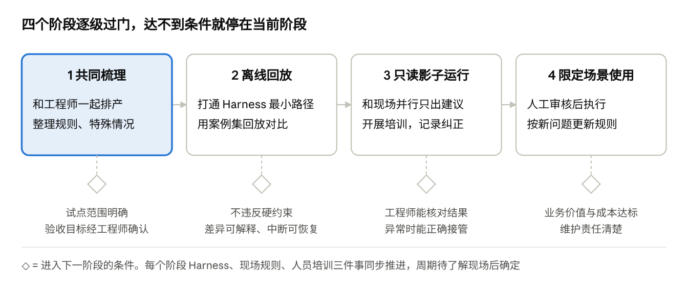

# 作品说明：半导体智能排程 Agent 的 Harness 工程与现场落地

2026-10-13 · 鄢澳勇

这是我面向半导体研发与生产场景的 AI Agent 开发所做的作品说明。作品本身是一个公开的 [GitHub 仓库](https://github.com/yanaoyong/llm-scheduling-harness-research)：用大模型 Agent 探索半导体全厂智能排程，包含实验代码、运行记录、调研和决策过程。这份文档说明我从中形成的工程判断，以及如果负责这类 Agent 的开发与落地，我会怎样做。

## 我从职业经历中得到的判断

我做过冷轧专家排产、企业知识库交付、法律政策 RAG，也持续建设自己的 Harness（组织 Agent 上下文、工具、任务和状态的支撑工程），并分发给公司人员使用。这些经历让我形成了四个判断：

- **关键规则往往只在专家头脑里。** 冷轧项目已有 MES，但部分排产判断仍靠专家经验。我和专家一起梳理判断、写成 C++ 规则和数据库配置，再和现场人员一起测试。系统能不能用，取决于这些规则有没有被梳理出来。
- **上下文需要设计。** 知识库项目里，甲方服务只给有限的上下文空间，我靠拆分任务、组织知识和分配模型来适应。给什么信息、什么时候给，直接决定了结果。
- **先定位问题出在哪个环节。** 法律 RAG 结果不对时，原因可能在信息缺失、检索、推理或评价。不分清环节就改，往往改错地方。
- **工具存在不等于被使用。** 在个人 Harness 里，知识工具建好了，Agent 仍会绕开它自己搜索。我改了工具入口和任务委派前的信息供给，复测才看到改善。

由此，我认为一个合格的大模型应用工程师要同时做两件事：

1. **Harness 工程化。** 让 Agent 在可检查、可接续、可评估的条件下工作，而不是靠通用 Agent 偶尔跑通。
2. **Agent 落地。** 一方面和现场工程师一起创造 Agent 能工作的环境，包括规则、特殊情况和数据；另一方面培训使用者，让他们会提任务、会管理上下文、会核对结果。

## 作品概览：半导体全厂智能排程探索

我用 Codex 辅助推进这项探索，场景是公开的 SMT2020 半导体全厂仿真：913 台生产设备，包含重入工序、批处理、工序资格等约束。我比较了三种方式：A 经典算法（CP-SAT 求解器加启发式）、B 由模型直接决定排程、C 由模型调用排程工具。

目前已经做到的：B 在一个开发场景中完成了一小时的仿真窗口，承担全部 913 台设备的排程责任：95 次计划提交、1,071 次派工。所有派工都能追溯到模型的明确决定，求解器调用为 0，物理与来源审计全部通过。项目仍在进行，长窗口和公平对照是下一步。

在这个项目里，代码和实验运行大部分由 Codex 完成。我负责提出问题、决定优先级和取舍、规定交接内容和验收点，并审查结果是否真的证明了想证明的东西。例如，早期试验只让 2 台设备参与决策、其余 911 台固定，我认为这样三种方案都没有决策空间，比较没有意义，于是把目标改为全厂能力对比。

| 半导体 AI Agent 开发关注的方向 | 作品中的对应 |
| --- | --- |
| Agent 工作流架构与多智能体协同 | 诊断与实施分开的会话、带状态的跨会话交接；调研中一个模型拆题检索、另一个核验评审 |
| 安全可控、系统稳定 | 工具不得替模型做核心决策；先写提交意图再提交，结果未知不重发；失败记录完整保留 |
| 效能评估与 A/B 测试 | A/B/C 三种方式同场景比较；全部尝试的成本统计；用“同工具、不调模型”的对照检验模型增益（计划中） |
| 理解工程师工作流、场景落地 | 冷轧排产中与专家梳理规则的经历；本文第二条线的现场共建与培训方案 |

## 第一条线：Harness 工程化

### 为什么通用 Agent 跑通还不够

用 Codex 推进排程时，第一次尝试因为上下文组织、任务分配等问题失败了，我调整之后才推进成功。最典型的是全厂 B 方案的一段经历：它运行了近两小时还没有提交第一个计划，后来又停在仿真第 803.25 秒。

我当时做了四件事：把判断标准从“进程还在跑”改为“有没有可核对的有效产出”；另开会话专门诊断；规定恢复顺序；停掉旧会话，把诊断结论、草稿和检查点交给新会话，并以“下一个有效计划”作为验收点。诊断发现，问题不是模型能力不够，而是协议设计：记忆字段超长会连带让合法的查询也被拒收，下一轮只看到报错和旧记忆，又去重读上一页。Codex 随后把两者分开处理，并在提示中直接写明“已读到第 12 页、下一页是 13”。恢复后出现了第二个有效计划，又经过多轮修订，才完成一小时窗口。

代价也很清楚：整个开发过程用了 1,362 次模型尝试、约 4,467 万 tokens；后期每次提交平均要 9.74 次调用，其中 96.77% 的 token 是输入，大量是重复的上下文。我的结论是：**通用 Agent 能跑通，但如果上下文供给、进度记录、任务交接都靠人临场修正，就既不稳定也不经济。** 这些要变成 Harness 的工程职责。

### 我会建设什么

| 工程问题 | 做法 | 怎样判断有效 |
| --- | --- | --- |
| 任务拆分与交接 | 每个任务写清输入、输出、依赖和验收点；交接时带上草稿、检查点和未完成事项 | 接手方能否直接继续，有没有重复或遗漏 |
| 上下文供给 | 进度和已确认事实由程序提供，不靠模型自己记；规则按版本管理 | 重复读取是否减少，必要约束有没有丢 |
| 工具接口 | 查询、生成、检查、提交分开；纯机械步骤合并成一次操作 | 每次提交的调用次数和成本下降，决策质量不变差 |
| 状态与恢复 | 候选、检查结果、已提交动作单独保存；从检查点接续，结果未知先核实 | 中断后能否正确接续，有没有重复执行 |
| 失败反馈与权限 | 校验失败附带可修订的原因；只读、建议、执行分级授权 | 同类失败是否重复出现，每个动作能否追溯来源 |

**各自的职责。** 模型负责需要灵活判断的部分：理解任务、权衡候选、根据反馈修订。确定性程序负责能精确核对的部分：状态、约束校验、版本和提交记录，但不能悄悄替模型做决定。求解器作为基线或工具。人负责确认目标优先级、现场规则和关键取舍，审核后再执行。

**用实验选方案。** 我没有因为 B 取得进展就锁定路线，而是先补充“用大模型直接排程”的调研，再讨论怎样公平比较。模型直接排、模型调工具、离线生成规则这几条路线，要在同一套状态、校验和评价流程下比较；还要和“同样工具、不调用模型”的版本对照，才知道模型是否带来额外价值。最终选哪条，看质量、成本、响应时间和人工负担。

## 第二条线：Agent 落地

技术上跑通的 Agent，到了现场仍可能给出“合法但不能用”的建议，原因通常是缺少现场规则，或者使用者不知道该给它什么信息。所以落地要两头推进。以下是我入职后的做法，方法来自冷轧排产和个人 Harness 的经历。

### 创造环境：和排产工程师一起整理规则

1. **观察。** 选一个边界清楚的设备组或重排任务，跟着排产工程师完成几轮正常排产，记录他看哪些信息、按什么顺序判断、为什么这样安排。
2. **一起排。** 同一份输入，让 Agent 给出建议，和工程师的方案并排比较。重点追问特殊情况：插单、设备停机、质量挂起、临时资格变化，以及工程师什么时候会打破常规。
3. **复盘差异。** 方案不一致时，先判断原因：信息缺失、规则没表达出来、目标冲突、模型推理错误，还是工具问题。没有共识的情况记为待确认案例，由业务负责人裁决，不让聊天里的一句话直接变成长期规则。
4. **沉淀。** 每条规则写成一张规则卡：适用范围、条件与例外、冲突时谁裁决、验证案例、负责人。硬约束进入程序校验；经验和历史案例进入知识库；实时状态来自 MES 等业务接口；一次性例外由任务入口填写。

交付物是规则与例外清单、经工程师确认的案例集、数据接口说明。案例集同时就是 Harness 回放测试的验收依据。

### 培训使用者：重点是上下文工程

使用者需要学会几件事：

- **说清任务。** 目标、范围、时限、不可改动的安排，以及“只要建议”还是“需要执行”。
- **给对信息。** 选用确认过的状态快照；说明停机、插单等变化；区分确认事实、假设和一次性例外。
- **管理上下文。** 新任务开新任务；延续任务时只带目标、关键约束、已完成动作和未决问题，不把整段聊天反复粘贴。
- **核对与纠正。** 检查建议的依据和取舍；指出具体哪里不对；条件变化后让系统重新检查旧方案。
- **移交。** 交代当前状态和未完成事项，接手的人不会重复执行。

例如某组设备临时停机，需要调整本班未开工批次：使用者选择确认过的状态快照，指定交期目标和冻结安排，只要待审核建议。恢复时间未知就标为“待确认”，不让 Agent 去猜；一旦确定，告诉系统变化，系统刷新状态、重新检查之前的候选。

**问题不都归到使用者。** 我会记录哪些建议被拒绝、使用者反复补充什么信息、多少次需要人工接管。必要信息总漏填，就改表单和默认值；Agent 没用上已给的信息，就改供给方式；缺规则，就补规则卡。只有确实是用法问题，才加进培训。每次改动用同一组案例比较前后。培训是否有效，看受训者能否独立完成新案例、发现异常并说明依据。

## 推进方式

我会选一个真实排程任务，让 Harness、现场规则和人员培训围绕它同步推进。每一步是否继续，由验收条件决定，而不是时间表。

三件事互相提供输入：现场规则决定 Harness 要检查什么；Harness 的运行记录暴露哪里要改入口或补培训；使用中遇到的问题又回到规则和工程上。达不到条件就停在当前阶段，定位是哪一层的问题再改。

## 当前进展与边界

排程项目仍在进行。已经完成的是一个场景的一小时仿真开发窗口；模型直接排程是否优于经典算法、更长时间窗口的表现、成本和实时性，都还待验证，也还没有在真实工厂运行过。我把这些边界与失败记录一起完整保留在仓库里。现场规则共建和人员培训是我入职后的计划。

## 附录：作品导览

全部资料都在 [GitHub 仓库](https://github.com/yanaoyong/llm-scheduling-harness-research)，不需要运行实验也能阅读。

| 想看什么 | 位置 |
| --- | --- |
| 项目进展、仍有效的失败和限制 | `docs/PROJECT_STATE.md` |
| B 一小时窗口的结果、成本和效率分析 | `source_snapshot/experiment_round2_3datasets/docs/smt_fullfab/` |
| 排程 Agent 的运行代码（提交、恢复、预算） | `source_snapshot/experiment_round2_3datasets/src/smt_fullfab/` |
| Harness 路线调研与未决问题 | `source_snapshot/research_harness_scheduling_20261012_round2/m0.5_research/` |
| 停滞与恢复过程的原始记录（含我的原话与 AI 的实现） | `docs/career-application/INTERVIEW_MATERIALS.md` 与 `evidence/2026-10-13/` |
| 98 个开发会话的可读导出 | `conversations/` |
