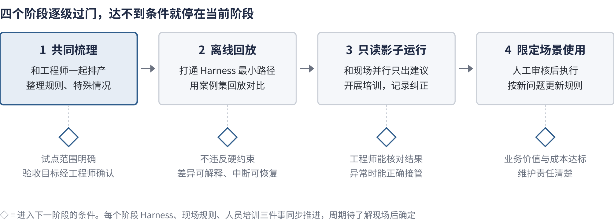

# 项目说明：半导体智能排程 Agent 的 Harness 工程与现场落地

2026-10-20 · 鄢澳勇

这是我面向半导体研发与生产场景的 AI Agent 开发所做的项目说明。项目本身是一个公开的 [GitHub 仓库](https://github.com/yanaoyong/llm-scheduling-harness-research)：用大模型 Agent 探索半导体全厂智能排程，包含实验代码、运行记录、调研和决策过程。这份文档说明我从中形成的工程判断，以及如果负责这类 Agent 的开发与落地，我会怎样做。与 10-13 版相比，这一版补充了排程 Harness 已经建成的部分和中间遇到的问题。

## 我从职业经历中得到的判断

我做过冷轧专家排产、企业知识库交付、法律政策 RAG，也持续建设自己的 Harness（组织 Agent 上下文、工具、任务和状态的支撑工程），并分发给公司人员使用。这些经历让我形成了四个判断：

- **关键规则往往只在专家头脑里。** 冷轧项目已有 MES，但部分排产判断仍靠专家经验。我和专家一起梳理判断、写成 C++ 规则和数据库配置，再和现场人员一起测试。系统能不能用，取决于这些规则有没有被梳理出来。
- **上下文需要设计。** 知识库项目里，甲方服务只给有限的上下文空间，我靠拆分任务、组织知识和分配模型来适应。给什么信息、什么时候给，直接决定了结果。
- **先定位问题出在哪个环节。** 法律 RAG 结果不对时，原因可能在信息缺失、检索、推理或评价。不分清环节就改，往往改错地方。
- **工具存在不等于被使用。** 在个人 Harness 里，知识工具建好了，Agent 仍会绕开它自己搜索。我改了工具入口和任务委派前的信息供给，复测才看到改善。

由此，我认为一个合格的大模型应用工程师要同时做两件事：

1. **Harness 工程化。** 让 Agent 在可检查、可接续、可评估的条件下工作。对模型的限制要少，让它能看到完整情况、自己做判断；但一定要有托底：程序校验、独立审计、成本上限和可恢复的状态。不能靠通用 Agent 偶尔跑通。
2. **Agent 落地。** 一方面和现场工程师一起创造 Agent 能工作的环境，包括规则、特殊情况和数据；另一方面培训使用者，让他们会提任务、会管理上下文、会核对结果。

## 项目概览：半导体全厂智能排程探索

场景是公开的 SMT2020 半导体全厂仿真：913 台生产设备，包含重入工序、批处理、工序资格等约束。我比较了三种方式：A 经典算法（CP-SAT 求解器加启发式）、B 由模型直接决定排程、C 由模型调用排程工具。

10-13 时，B 在一个开发场景中完成了一小时仿真窗口，承担全部 913 台设备的排程责任，但代价很高。之后我把排程 Agent 的支撑工程重做了一遍，形成了一个**初步可用的排程 Harness**：模型仍然自己决定排程，程序负责校验、审计和成本封顶。在一小时仿真窗口里，模型请求从最初的 1,362 次降到 12～67 次（取决于多久重排一次），两种设置都通过了事先登记的质量底线和独立审计。

在这个项目里，代码和实验运行大部分由 AI 编程工具完成。我负责提出问题、决定优先级和取舍、规定交接内容和验收点，并审查结果是否真的证明了想证明的东西。例如，早期试验只让 2 台设备参与决策、其余 911 台固定，我认为这样三种方案都没有决策空间，比较没有意义，于是把目标改为全厂能力对比。

| 半导体 AI Agent 开发关注的方向 | 项目中的对应 |
| --- | --- |
| Agent 工作流架构与多智能体协同 | 一个模型负责安排任务和验收、另一个负责实现；诊断与实施分开的会话、带状态的跨会话交接 |
| 安全可控、系统稳定 | 工具不替模型做核心决策；提交前程序校验，失败附带可修订的原因；每条运行独立审计；失败记录完整保留 |
| 效能评估与 A/B 测试 | 事先登记质量底线、样本和终点；按模拟小时封顶请求和 token；全部尝试计入成本；快照格式做过 A/B |
| 理解工程师工作流、场景落地 | 冷轧排产中与专家梳理规则的经历；本文第二条线的现场共建与培训方案 |

## 第一条线：Harness 工程化

### 为什么通用 Agent 跑通还不够

最早用通用 Agent 推进全厂 B 方案时，它运行了近两小时还没有提交第一个计划，后来又停在仿真第 803.25 秒。诊断发现问题不在模型能力，而在协议设计：记忆字段超长会连带让合法查询也被拒收，下一轮只看到报错和旧记忆，又去重读上一页。修正后才完成一小时窗口，但整个过程用了 1,362 次模型尝试、约 4,467 万 tokens，其中 96.77% 是输入，大量是重复的上下文。

我的结论是：**通用 Agent 能跑通，但如果上下文供给、进度记录、任务交接都靠人临场修正，就既不稳定也不经济。** 这些要变成 Harness 的工程职责。

### 建成过程中解决的三个问题

**1. 上下文：先改写法，不先删内容。** 早期为了装进上下文，只给模型一部分状态，它看不全就反复查资料，有一次连续 10 次调用都在读资料、没有提交计划。完整状态原样放进去又太大，约 75.6 万 token。我的做法是不删信息、只改表示：重复的工步定义去重、同类机组合并、编号写成区间，可以逐字段还原。完整状态压到约 10 万 token，模型一次就能看到全部当前情况。

**2. 模型看不到可排的工作。** 原来的输入按工序层数挑选，评估也只看"有没有在排队"，三组实验的缺计划等待都是 0，看起来很好。实际上有物理上可以加工、却没人分配的工序。现在输入包含所有可开工、未被预留的工序，加上一段物理时间窗口内即将可开工的工序；评估新增"可避免空闲"，由独立审计重新计算。指标要能暴露问题，否则一切看起来都正常。

**3. 一有空缺就叫模型，调用太多。** 原来只要出现一台空闲设备就触发重排，15 分钟仿真要调用 56～69 次；调等待参数也没用，问题出在触发规则本身。现在改成**周期重排与滚动计划**：每隔固定时间重排一次，计划覆盖未来一段时间，空周期不调用模型；只有计划失效、最晚开工时间到期等少数情况才提前触发。提交也从"提议、确认"两步合并为一步，开工时间默认"料到、设备空闲就开工"，模型不必反复改写时间。

结果：一小时仿真窗口里，每 15 分钟重排一次需要 12 次请求，每 5 分钟一次需要 67 次；后者排得更满，但成本约为前者的 4.3 倍。两种设置都比离线参考计划开工更多、空闲更少。这个结果只有每档一条运行，模型版本和起点也与早期不同，只能说明量级；质量与经典算法的公平比较还没有做。

### 还要建设什么

| 工程问题 | 做法 | 现在的进展 |
| --- | --- | --- |
| 上下文供给 | 状态由程序提供，完整、紧凑、可还原 | 已建成，一小时窗口验证 |
| 工具接口 | 查询、校验、提交分开；提交一步完成 | 已建成 |
| 失败反馈与审计 | 校验失败附可修订原因；每条运行独立审计 | 已建成 |
| 成本与触发 | 周期重排、滚动计划、按模拟小时封顶 | 已建成；重排周期待选 |
| 状态与恢复 | 检查点接续，结果未知先核实 | 部分建成；长时间运行和中断恢复待验证 |

**各自的职责。** 模型负责需要灵活判断的部分：理解任务、权衡候选、根据反馈修订。确定性程序负责能精确核对的部分：状态、约束校验、版本和提交记录，但不能悄悄替模型做决定。求解器作为基线或工具。人负责确认目标优先级、现场规则和关键取舍，审核后再执行。

**用实验选方案。** 模型直接排、模型调工具、离线生成规则这几条路线，要在同一套状态、校验和评价流程下比较；还要和"同样工具、不调用模型"的版本对照，才知道模型是否带来额外价值。最终选哪条，看质量、成本、响应时间和人工负担。

## 第二条线：Agent 落地

技术上跑通的 Agent，到了现场仍可能给出"合法但不能用"的建议，原因通常是缺少现场规则，或者使用者不知道该给它什么信息。所以落地要两头推进。以下是我入职后的做法，方法来自冷轧排产和个人 Harness 的经历。

### 创造环境：和排产工程师一起整理规则

1. **观察。** 选一个边界清楚的设备组或重排任务，跟着排产工程师完成几轮正常排产，记录他看哪些信息、按什么顺序判断、为什么这样安排。
2. **一起排。** 同一份输入，让 Agent 给出建议，和工程师的方案并排比较。重点追问特殊情况：插单、设备停机、质量挂起、临时资格变化，以及工程师什么时候会打破常规。
3. **复盘差异。** 方案不一致时，先判断原因：信息缺失、规则没表达出来、目标冲突、模型推理错误，还是工具问题。没有共识的情况记为待确认案例，由业务负责人裁决，不让聊天里的一句话直接变成长期规则。
4. **沉淀。** 每条规则写成一张规则卡：适用范围、条件与例外、冲突时谁裁决、验证案例、负责人。硬约束进入程序校验；经验和历史案例进入知识库；实时状态来自 MES 等业务接口；一次性例外由任务入口填写。规则卡也可以来自 Agent：它在例外场景中做出、经程序校验和工程师确认的决定，可以沉淀下来，下次由程序直接处理，模型只处理新的情况。

交付物是规则与例外清单、经工程师确认的案例集、数据接口说明。案例集同时就是 Harness 回放测试的验收依据。

### 培训使用者：重点是上下文工程

使用者需要学会几件事：

- **说清任务。** 目标、范围、时限、不可改动的安排，以及"只要建议"还是"需要执行"。
- **给对信息。** 选用确认过的状态快照；说明停机、插单等变化；区分确认事实、假设和一次性例外。
- **管理上下文。** 新任务开新任务；延续任务时只带目标、关键约束、已完成动作和未决问题，不把整段聊天反复粘贴。
- **核对与纠正。** 检查建议的依据和取舍；指出具体哪里不对；条件变化后让系统重新检查旧方案。
- **移交。** 交代当前状态和未完成事项，接手的人不会重复执行。

例如某组设备临时停机，需要调整本班未开工批次：使用者选择确认过的状态快照，指定交期目标和冻结安排，只要待审核建议。恢复时间未知就标为"待确认"，不让 Agent 去猜；一旦确定，告诉系统变化，系统刷新状态、重新检查之前的候选。

**问题不都归到使用者。** 我会记录哪些建议被拒绝、使用者反复补充什么信息、多少次需要人工接管。必要信息总漏填，就改表单和默认值；Agent 没用上已给的信息，就改供给方式；缺规则，就补规则卡。只有确实是用法问题，才加进培训。每次改动用同一组案例比较前后。培训是否有效，看受训者能否独立完成新案例、发现异常并说明依据。

## 推进方式

我会选一个真实排程任务，让 Harness、现场规则和人员培训围绕它同步推进。每一步是否继续，由验收条件决定，而不是时间表。

三件事互相提供输入：现场规则决定 Harness 要检查什么；Harness 的运行记录暴露哪里要改入口或补培训；使用中遇到的问题又回到规则和工程上。达不到条件就停在当前阶段，定位是哪一层的问题再改。

## 当前进展与边界

排程项目仍在进行。已经建成一个初步可用的排程 Harness，并在一小时仿真窗口中通过质量底线和独立审计。还没有做到的是：更长时间窗口和中断恢复的验证、每种设置更多次的重复运行、与经典算法的公平比较，以及在真实工厂运行。我把这些边界与失败记录一起完整保留在仓库里。现场规则共建和人员培训是我入职后的计划。

## 附录：项目导览

全部资料都在 [GitHub 仓库](https://github.com/yanaoyong/llm-scheduling-harness-research)，不需要运行实验也能阅读。

| 想看什么 | 位置 |
| --- | --- |
| 改造前后的对照（问题、改动、成本与质量） | `docs/updates/2026-10-20/` |
| 排程 Harness 的代码与设计决定 | `docs/updates/2026-10-17/project/experiments/harness_v6_20261017/` |
| 早期 B 一小时窗口的结果、成本和效率分析 | `source_snapshot/experiment_round2_3datasets/docs/smt_fullfab/` |
| Harness 路线调研与未决问题 | `source_snapshot/research_harness_scheduling_20261012_round2/m0.5_research/` |
| 停滞与恢复过程的原始记录 | `docs/career-application/INTERVIEW_MATERIALS.md` 与 `evidence/2026-10-13/` |
| 开发会话的可读导出 | `conversations/` 与各期 `docs/updates/` |
