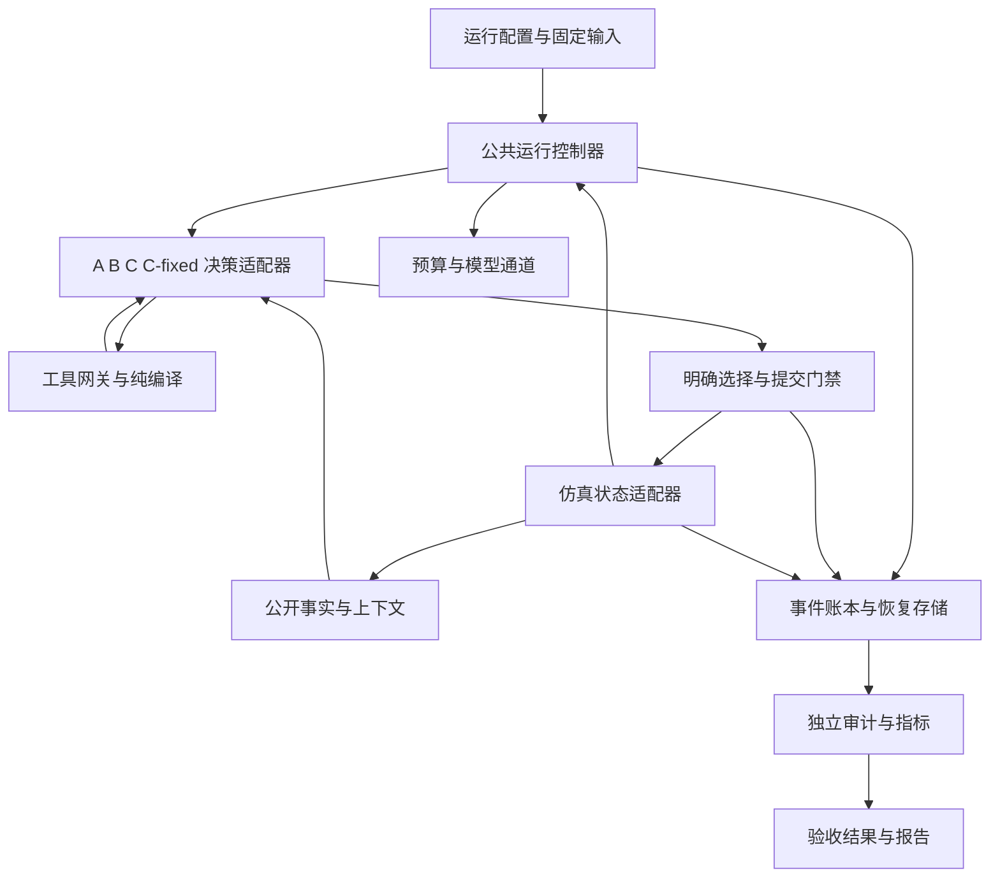
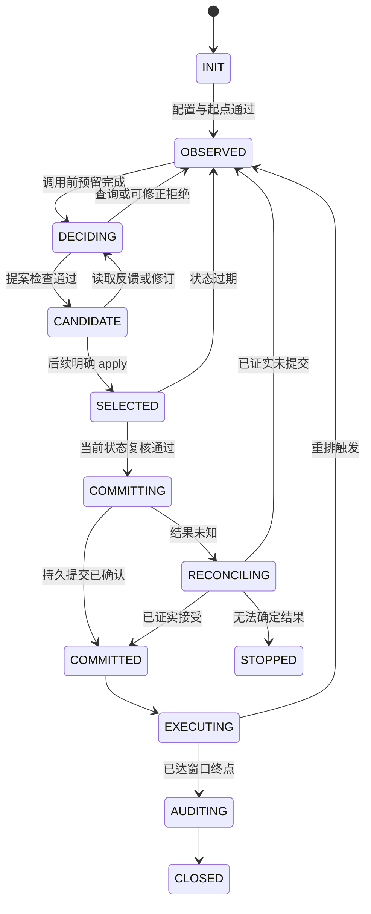

# 智能排程 Agent Harness 设计方案

日期：2026 年 10 月 13 日。版本：设计草案 v1。范围：SMT2020 开发环境中的运行、工具、校验、恢复和评测体系。

本方案将现有排程能力整理为一套可重复运行的公共内核，由 A、B、C 和 C-fixed 决策适配器使用。核心改动是把机械操作放回程序，将模型接口收敛到业务动作，以版本化事实和持久事务连接观察、决定、提交与执行，并用独立证据生成验收结果。

近期交付目标是：固定版本可以从头完成开发窗口，也能在已定义中断点恢复；B 的普通小修订减少到 2—3 次模型往返；所有排程决定、失败、资源消耗及声明边界可以追溯。质量优势和实时上线能力分别验收，不由工程运行通过自动推定。

本次交付仅为设计文档。文中的新目录、接口、阈值和测试均为实施规格，不表示已经实现或执行，也不启用任何模型调用、实验预算或现场控制。

阅读定位：模块职责见第 4 节，数据契约见第 5 节，运行流程见第 6 节，工具接口见第 7 节，恢复见第 9 节，实施顺序见第 13 节，验收标准见第 14 节。第 16 节提供研究出处和现有文件映射。

## 1 目标与适用范围

### 1.1 本版目标

1. 统一 A、B、C 的观察、提交、物理执行、资源记录和验收协议，保留各方案的实际决定者。
2. 让 B 可以直接提交完整增量；大型初始计划保留分块通道，普通修改不必经过多轮机械操作。
3. 将工厂事实、计划决策、工作记忆和私有恢复状态分开，减少重复输入并防止跨版本引用。
4. 将提交、执行回执、恢复位置及累计预算纳入可对账的运行状态。
5. 从固定证据自动生成状态与报告，区分运行成功、约束可行、语义覆盖、质量、成本和时延。
6. 建立离线回归、故障注入、固定版本实跑和配对实验的分级验收。

### 1.2 本版默认条件

| 项目 | 设计默认值 | 改变条件时的处理 |
| --- | --- | --- |
| 执行环境 | 项目修订的离散事件仿真器 | 新物理语义使用新版本和新实验组 |
| 时间模型 | 模型思考期间暂停仿真 | 在线持续推进另建协议，不能沿用本版实时性结论 |
| 生产范围 | 由输入 manifest 指定完整责任范围；当前基准为 913 台生产设备 | 不用筛掉困难设备或工序的方法降本 |
| 首个正式工程入口 | 冷启动的全新一小时开发运行 | 共同在加工快照分支在独立验收后启用 |
| B 职责 | 模型明确决定任务、机器、批组、顺序、开始条件和等待 | 引入算法补排或择优时登记为新的混合方案 |
| C 职责 | 模型选择预注册工具、参数和候选；算法生成具体安排 | 工具选择和算法贡献分别记账 |
| 新运行的实现版本 | 一次运行绑定固定代码、依赖、协议和配置 | 开发期迁移另记段；冻结评测运行禁止中途升级 |
| 现场连接 | 本版不接 MES、PLC 或真实设备 | 需要权威状态接口、效果对账和现场业务验收 |

### 1.3 不以本版通过推定的结论

本版允许在明示的开发语义下比较方案。CQT、历史绑定和初始在加工状态缺口需要单独解决；本版通过不代表完整复现官方 AutoSched、不代表所有真实产线约束均覆盖，也不代表模型优于经典算法。离线生成规则保留为后续独立研究路线，暂不扩展主运行接口。[S01][S02][S06]

## 2 设计依据与当前基线

### 2.1 两轮调研如何转化为设计

既往会话《分析 Codex 工厂数据排程的缺陷》明确采用先调研、再设计的顺序。第一轮的六个方向是模型职责、模型与程序边界、状态与上下文、持续执行与恢复、排程验证、效果与成本；第二轮补充直接排程、离线规则生成、工厂语义与现有实现审查。[S01][S02]

| 调研来源 | 采纳的机制 | 本项目的具体落点 | 证据边界 |
| --- | --- | --- | --- |
| Deep Agents | 将固定控制流程与模型选择分开；按需提供工具和上下文 | 运行状态机、少量业务工具、结构化反馈 | 不凭工具可见性推定权限，不把摘要成功等同原文归档成功 |
| LangGraph | 检查点、节点写入、线程与历史状态分别管理 | 区分运行、观察、调用和恢复位置 | 图状态持久化不自动包含工厂权威状态；动态中断可能重入节点 |
| Temporal | 有副作用的尝试需要幂等身份和效果核实 | 提交意图、回执、UNKNOWN 对账和故障注入 | 借鉴恢复机制，不直接引入整个平台或声称设备命令恰好执行一次 |
| Smart Manufacturing Agents | 确定性预检可以阻断模型认可的错误；跟踪实际排程者 | 强制校验与字段归属账本 | 其 EDD 等算法贡献不能归给模型，演示效果不外推至全厂 |
| PyJobShop | 约束表达、结果对象和可行性检查分别处理 | 语义覆盖表、独立物理检查 | 不以对象构造成功认定可行，不假设库覆盖本厂全部约束 |
| OptiGuide 和 OptiMUS | 需求、模型、代码、求解和解释分阶段留痕 | C 的工具调用来源和算法结果可追溯 | 本版不开放模型任意生成并执行代码的通道 |
| 第二轮路线研究 | 按实际决定字段划分 B、C 和离线规则生成 | 同工具 C-fixed 消融、原始输出失败分母 | 当前研究不足以确定唯一生产路线 |

上述是对已保存调研的采纳，不是对外部项目当前版本的新认证。具体限定命题、源码快照和反例保留在两轮 dossier 中。

### 2.2 当前代码和运行证据

代码基线为仓库 `experiment_round2_3datasets` 的提交 `6929dd8cb624d95b85d374e6a697025b93af4fc5` 加本地工作区。设计检查时 `progress` 中已有未提交变化，因此不能仅用 Git 提交号代表运行证据。附录记录关键输入文件的内容指纹；历史运行仍以各自冻结 manifest 为准。

| 能力 | 已有内容 | 本版处理 |
| --- | --- | --- |
| 公共观察 | `observation.py`、`interface.py` 的公开观察、无损分页和精确身份 | 保留完整可达性，增加实体版本和事件增量 |
| 纯增量编译 | `plan_delta.py`、`delta_session.py` 已有完整 delta 检查、四锚绑定和后续 apply | 复用纯函数；补模型入口、来源绑定和公共运行接入 |
| B 长任务交互 | V14 的草稿、分块、精确查询、反馈与工作记忆 | 保留大计划路径，为小修订增加原子提案入口 |
| 持久记录 | `B_delta_durable_v5.py` 和 V14 journal 中已有 SQLite、哈希、调用与提交记录 | 收敛到公共状态契约；原历史格式使用只读适配器 |
| 共同执行 | `environment.py` 校验并执行明确计划，暴露未覆盖需求、失效和边界 | 保留物理语义；增加可靠提交与执行持久化适配层 |
| 成本与隔离 | `budget.py`、监督模型通道及进程守卫 | 拆开通用资源账户与历史专项预算逻辑；保持隔离 |
| 独立检查 | 来源、物理、机会审计，流式指标和快照 | 保留并扩展独立路径；增加覆盖状态和统一验收产物 |
| 实验能力 | A、B、C 各有一条保存的一小时开发轨迹 | 可作回放与反例基线，不能代替固定版本的新实跑 |

### 2.3 需要解决的具体问题

- B 的 V14 与 V15 后期片段中，80 次提交用了 779 次模型调用，平均 9.74 次每提交；输入占已知输入加输出的 96.77%。四类机械动作占 43.4% 的调用次数，该比例是改造线索，不是已实现节省率。[S03]
- 当前 `working_set` 按查询类别保留最近一批响应，实体之间容易相互挤出。全局原件仍可读取，但重找事实增加交互成本。[C03]
- 当前交互提示保留多轮修复叠加的规则；新版本应由单一协议定义生成工具说明和校验规则，保留业务约束而清理重复解释。[C03]
- C 的历史复查曾误读后来追加的全局账本，最终依靠与原哈希一致的历史前缀完成复核；审计入口需要绑定不可变范围。[S04]
- 当前 `STATUS.json` 的阶段描述与旧 B 一小时门槛字段不一致，需要统一生成状态，而不是让不同文件分别维护结论。[C16]
- B 的一小时结果包含多段开发恢复；A24、C8 的历史失败分别揭示经典构造容量和模型通道恢复问题。新体系需要覆盖这些失败类型。[S03][S04]
- 初始 WIP 的 CQT 历史起点、历史设备绑定和在加工余量有缺口。未建模和资料未知应保留不同状态。[S06]

## 3 共同约束与决定归属

### 3.1 不变量

| 编号 | 必须保持的规则 |
| --- | --- |
| I01 | 模型只能读取本运行公开工厂事实、本方案历史和允许的工具结果；不能读取私有随机结果、其他臂计划或保留测试答案 |
| I02 | 每个生产派工均关联一个已提交计划、任务和明确的生产决定来源 |
| I03 | B 的编译和查询不补选机器、批次、顺序、等待、开始条件，不以默认值修复模型计划 |
| I04 | B/C 的检查候选和选择 apply 来自不同的模型输出；程序不替模型选择最新、最好或唯一候选。A/C-fixed 的选择由冻结策略明确记录 |
| I05 | 提交时复核当前状态和计划版本；旧候选即使曾经检查通过，也不能跨观察直接执行 |
| I06 | 已开工任务和冻结承诺按共同物理语义保留；版本更新不改写已发生事件 |
| I07 | 生产责任范围保持完整；等待必须有限且明确，未覆盖需求和失效事件立即暴露 |
| I08 | 提交、派工、工序完成、lot 全路线完工分别记录；提交成功不等于时间或生产进展 |
| I09 | 失败、拒绝、超时、未知结果及费用全部入账；恢复不清零累计消耗 |
| I10 | UNKNOWN 不等于未执行，缺失数据不等于零，未建模约束不等于通过 |
| I11 | 每个验收结论绑定运行、版本、窗口、语义范围和证据；不能仅信任模型解释或 `result.status` |
| I12 | 代码升级、协议变化、初始化变化和回退策略变化必须显式版本化；不回写历史成功或失败 |

### 3.2 四种决策适配器

| 适配器 | 决定者 | 可用能力 | 禁止混记的贡献 |
| --- | --- | --- | --- |
| A | 固定经典控制策略与算法 | 与 C 共用已登记的构造器和优化器，经公共提交入口执行 | 不能把局部 CP 结果称为全厂最优 |
| B | 模型 | 事实查询、计划增量编译、候选读取、明确 apply、工作笔记 | 隐藏排序、算法补排、自动修复或自动 fallback 不能计为模型决定 |
| C | 模型选择策略与候选，算法安排具体任务 | B 的只读能力，加登记的经典构造与优化工具 | 权重变化、工具调用或采用候选本身不证明质量增益 |
| C-fixed | 开发阶段冻结的调用策略与参数，算法安排具体任务 | 与 C 相同工具、观察和经典资源上限，不调用模型 | 用于测量模型自适应选择的增量，不能事后按测试结果挑固定参数 |

执行器负责物理就绪、已提交任务的实际启动、外生事件和虚拟延迟推进；这些环境行为不记作模型生产决定。工具生成、过滤、截断、修复、回退的每条分支均有 `decision_owner` 和 `transformation_kind`，B 基准中出现算法生产决定即不满足 B 归属。

## 4 模块职责与依赖



图中控制器只推进程序状态，不替 B 选择生产动作。独立审计只读固定证据，不调用模型或排程算法。

| 模块 | 职责和权威边界 | 输入与输出 | 现有代码起点 |
| --- | --- | --- | --- |
| M01 运行配置 | 绑定数据、语义、代码、模型、策略、资源和评测窗口，拒绝不完整配置 | `RunManifest` → 已验证配置 | `source_audit.py`、冻结 manifest 与 runner 配置 |
| M02 公共控制器 | 持有单运行写权限，调度状态转换、故障处置、边界和终止；不排生产顺序 | 状态与反馈 → 下一程序阶段 | `controller_delta_v4.py`、V15 host、共同 controller |
| M03 工厂适配器 | 唯一持有私有物理状态，建立公开观察，验证和执行已选计划 | 状态与计划 → 观察、提交回执、执行事件 | `environment.py`、`observation.py`、快照模块 |
| M04 事实与上下文 | 实体版本、变化集、索引、精确读取、失效规则和上下文装配 | 公开观察与执行反馈 → `ContextBundle` | `interface.py`、V14 查询与 working_set |
| M05 决策适配器 | 根据 arm 暴露能力，保存模型原输出或经典策略决定 | `ContextBundle` → 明确提案或选择 | A hybrid、B interaction、C controller |
| M06 工具与候选 | 参数检查、权限检查、纯编译、经典工具调用及候选登记 | 工具请求 → 结果、错误和候选 | `plan_delta.py`、`delta_session.py`、构造器、优化器 |
| M07 模型与预算 | 调用前预留、模型进程监督、原始请求响应归档、用量结算 | 已绑定请求 → 成功、失败或未知尝试 | `budget.py`、`model_transport_supervised.py`、进程守卫 |
| M08 存储与恢复 | 保存不可变对象、顺序事件、运行头、提交身份、在途尝试和恢复证明 | 事务与对象 → 可核对的持久状态 | durable store、V14 journal、stream snapshot |
| M09 审计与指标 | 独立重建来源、物理、机会、成本及业务指标，输出覆盖范围 | 固定 `EvidenceManifest` → `AuditResult` 和 `Metrics` | `audit.py`、流式审计、metrics |
| M10 评测与发布 | 配对场景、版本一致性、失败分母、消融、验收与状态投影 | 注册实验和审计 → `AcceptanceResult`、状态、报告 | 现有离线审计脚本与报告流程 |

建议未来新增 `src/smt_fullfab/harness/` 作为公共控制层，内部分成 `contracts`、`runtime`、`facts`、`tools`、`adapters`、`store`、`recovery`、`evaluation`。第一批实现以适配现有纯函数为主，历史 V7—V15 冻结包不移动、不批量改名。该目录在本次交付中不创建。

依赖方向固定：工具和编译器不导入模型通道；模型进程不持有仿真器或存储写句柄；审计器不使用运行器的最终通过标志计算自身结论。共享的是已版本化数据契约，不是让生产判断与独立判断共用同一个判定函数。

## 5 数据契约与状态身份

### 5.1 四类状态

| 状态 | 内容 | 可见范围 | 恢复规则 |
| --- | --- | --- | --- |
| 私有工厂状态 | 队列、在加工、setup、绑定、维护、事件堆、随机身份和物理时钟 | 仅仿真适配器与受控审计 | 从固定快照加完整事件后缀恢复 |
| 公开事实状态 | 当前已知实体属性、公开预测、观察事件、责任范围 | 本臂策略和模型 | 精确值及实体版本恢复，预测与实测标记不同 |
| 决策状态 | 基准计划、草稿、候选、模型原始字段、选择与提交关系 | 本臂可读，模型不能改写持久历史 | 已接受内容精确恢复；失效候选保留但不可应用 |
| 运行控制状态 | 当前阶段、在途调用、累计预算、写入所有者、证据头和终止原因 | 可信运行器；模型只见必要的只读余量 | 不依靠模型文字记忆重建 |

模型工作笔记属于决策辅助信息，不能成为事实或恢复权威。模型记忆超长只拒绝记忆更新，合法业务动作应独立处理；不得因笔记失效要求重新完成已保存的查询或草稿。

### 5.2 标识与版本

| 字段 | 含义 |
| --- | --- |
| `experiment_id` | 已注册实验及 arm 配置集合 |
| `run_id` | 一条独立试验轨迹，恢复时保持不变 |
| `segment_id` | 同一运行的启动或恢复段，不能重置运行预算 |
| `episode_id` | 一次公开观察下的决策过程 |
| `state_revision` | 私有物理状态及已提交计划的版本，由宿主维护；查询、记笔记或预算事件不单独改变它 |
| `context_ref` | 宿主签发的公开上下文引用，绑定该 episode 的完整事实与基准计划 |
| `request_id` | 一次业务工具意图的去重身份；相同 ID 不允许不同载荷 |
| `attempt_id` | 一次实际模型或经典工具尝试；失败重试也有新 attempt |
| `candidate_ref` | 指向准确候选、编译结果和来源的不可变引用 |
| `commit_id` | 一次明确 apply 所对应的提交身份，由宿主持久登记 |
| `event_seq` | 运行内严格递增事件序号，恢复不重置 |

`context_ref` 和 `candidate_ref` 可使用短的不可猜测句柄，持久表必须映射完整哈希、run、episode 和版本。模型选择原样句柄，宿主只做确定映射；禁止模糊匹配、相近候选替换或默认最新候选。新协议不要求模型反复抄写全部长哈希，但审计必须可以从原始输出的句柄重建精确选择。

当前四锚 `base_plan_sha256`、`problem_sha256`、`state_sha256`、`source_sha256` 保留在内部契约；新入口增加明确的 `protocol_version`、`semantic_profile_id` 和宿主状态修订号。原始文件字节哈希与规范 JSON 哈希分别存储；固定编码、数值类型和序列化版本，不直接混比不同规范得到的摘要。[C01][C02]

物理状态头与工作流事件头分别维护。查询或保存候选会追加事件，但不因此让同一观察下的候选过期；提交和真实物理变化才更新相应状态版本。数据库事务同时核对正确的物理头、计划版本和写者身份，不能把所有日志追加都当作工厂变化。

### 5.3 主要对象

| 对象 | 必需内容 |
| --- | --- |
| `RunManifest` | 数据与初态指纹、代码与依赖指纹、arm、模型及推理配置、语义、时间模式、随机身份规则、目标、窗口、资源上限、工具能力表、失败与重试政策 |
| `ContextBundle` | 当前引用、公开时刻、基准计划引用、完整目录引用、变化集、必须处理的重排原因、精确事实页、已读版本、候选和草稿引用、资源余量摘要 |
| `DecisionProposal` | 原始输出引用、明确计划增量或算法工具参数、上下文引用、请求身份、决定者及字段来源 |
| `Candidate` | 输入锚点、精确 delta 或算法输出、编译计划、检查结果、覆盖缺口、来源和版本，不含自动选择 |
| `CommitReceipt` | commit 身份、候选和选择来源、预期与实际状态版本、accepted/rejected/unknown、事件边界和原因 |
| `ExecutionFeedback` | 提交是否接受、推进区间、派工和完成摘要、失效任务、未覆盖需求、下一触发原因、完整事件引用 |
| `EvidenceManifest` | 固定对象指纹、运行事件范围、trace 边界、模型原始字节、资源账本范围、历史父链和语义覆盖 |
| `AcceptanceResult` | 运行完成、来源、物理、机会、语义、成本、恢复、质量和时延分别判定，并附证据指纹 |

已提交计划继续使用明确的 lot、step、visit、operation、machine、batch、机器内顺序、`not_before`、有效期、冻结期和 hold。`all_pending_except` 等集合保留只能来自模型显式声明，集合域绑定准确基准版本，机械展开过程入账。未声明的缺省保留不允许。

### 5.4 语义覆盖对象

每项约束同时记录实现状态和本次可判定状态，例如：

```json
{
  "constraint": "cqt",
  "implementation": "not_implemented",
  "evidence_availability": "partial",
  "verdict": "not_evaluated",
  "scope": "declared_development_profile",
  "reason": "Historical timer starts and runtime semantics require a separate implementation"
}
```

实施状态取 `implemented`、`partial`、`not_implemented`；判定取 `pass`、`fail`、`undetermined`、`not_evaluated`、`not_applicable`。`not_applicable` 必须有业务依据，不能用它排除困难约束。物理审计通过仅覆盖其中已实现且可判定的部分。

## 6 运行流程与状态转换

### 6.1 正常决策循环

1. **初始化**：校验 manifest、依赖、数据、运行身份和预算；取得唯一写入租约。冷启动与共同快照分支使用不同入口。
2. **建立观察**：从权威状态构建公开观察，生成新 episode 和 context，载入本臂已有决定与可复用事实。
3. **调用策略**：A 和 C-fixed 执行冻结策略；B 和 C 在资源预留及原始请求落盘后调用模型。初始上下文由宿主交付，避免为取得同一观察额外调用一次模型。
4. **读取与提案**：模型可批量查询事实，然后提出完整增量或分块计划；C 可请求经典工具。程序检查、登记候选并返回准确反馈。
5. **明确选择**：B 和 C 在收到检查反馈后的另一条模型输出中选择候选。检查失败不产生可应用候选；不会自动修复或换候选。
6. **提交复核**：校验模型来源、能力范围、冻结承诺、当前状态版本和候选身份，持久化提交身份；任何状态变化都可使候选过期。
7. **提交计划**：由公共事务入口登记接受结果和新计划状态，返回回执。此时尚不能声称新增派工或时间推进。
8. **执行推进**：仿真器执行明确安排和共同物理事件，到首个重排触发点或窗口终点停止；执行事件可靠持久化。
9. **反馈与下一轮**：报告真实推进、失效和需求，继承合法历史事实并建立新观察。到终点后关闭运行证据，再进行全窗审计与验收。

### 6.2 运行状态机



图示为业务状态，工具请求和尝试另有子状态。任意活动阶段均可因用户停止、资源不足、证据故障或不可恢复错误进入 `STOPPED`；终止原因分别记录。`CLOSED` 表示证据封存完成，不能单凭该状态认定验收通过。

### 6.3 重排触发和无进展

沿用统一触发规则：未覆盖的合法需求、工艺跳步或返工导致计划失效、计划到期、周期边界及窗口终点。物理故障、维修、运输等事件先按共同内核处理；是否立即重排由已冻结的触发协议决定，三臂使用同一规则。不能为了降低模型调用数延后原本必须暴露的需求。

`ExecutionFeedback` 必须同时给出 `commit_accepted`、`advanced_seconds`、`dispatch_count_delta`、`completed_operations_delta` 和 `stop_reason`。零推进提交允许作为一次真实结果保留；程序不能把它算成有效生产进展。

无进展监控分两类：

- **协议无进展**：同版本重复请求、同一错误或相同草稿状态反复出现。先提供原件引用和明确错误，再按冻结的次数与资源阈值停止；必要的跨页查询不按重复错误处理。
- **生产无进展**：多次提交没有推进或长期显式等待。记录等待、未计划工序和停滞原因，允许模型修订；到阈值仍无法推进则保留失败或停滞结果。不能由程序补排、编造 hold 或跳过事件取得进展。

阈值在开发集调试后写入 manifest，正式运行中不根据某个 arm 的表现临时放宽。

首版建议默认：同一 context 下，三次相同错误及规范化请求、且无已接受决定变化时停止该决策过程；连续三次接受计划后仍零推进，且停止原因、需求集合与有效安排均未变化时停止运行。不同实体的必要查询不计入这两个计数。原始错误和中间状态完整保留，阈值不能通过换 request ID 或重启清零。

### 6.4 起点与分支

`start_new`、`resume_run` 和 `fork_scenario` 是三个不同的宿主操作。

- `start_new` 建立新运行和新预算账户，输入是登记的初态。
- `resume_run` 使用同一 run、旧预算及完整历史；只有 segment 变化。
- `fork_scenario` 从共同物理快照建立新的配对运行，明确共同预热来源、在加工状态、旧计划处置和首个周期锚点。各臂的私有物理起点完全一致，不继承其他实验臂的模型记忆和策略答案。

共同快照中的已开工任务由物理层继续，冻结承诺作为共同初始条件保留；未开工的可变任务必须按协议由各臂明确处置。首个新计划前能否推进及周期锚点固定为 T0，必须单独验证，不能把现有同运行恢复入口直接当作配对分支入口。[S07]

## 7 模型工具接口

### 7.1 接口原则

下表是拟议的 `scheduling-harness-v1` 契约，不是当前工具名称的承诺。模型只提供业务选择和精确引用；宿主负责绑定 run、attempt、原始请求响应、协议版本及资源记录。宿主可以补技术元数据，不能补生产决策。

能力限制由工具网关和模型进程边界实际执行，不能仅靠提示词。评测模型的原生 shell、任意文件和外部检索通道按协议禁用；若通道无法证明隔离，该运行不通过来源与信息公平性验收。只读调用的追踪 ID 可以由宿主生成，改变候选、笔记或提交状态的请求必须有稳定的 request 身份。

正常小修订使用四类能力：读取当前上下文、按实体查询、提交增量、选择应用。首轮上下文通常已经随提示交付，因此无需强制调用 `get_context`。每次模型输出只能包含查询请求或一个提案或一个 apply；禁止在同一输出中提案后自动应用。只读查询可以批量执行，必须绑定同一个 context。

### 7.2 共同工具

| 工具 | 模型提供的必需参数 | 返回值 | 状态影响与拒绝规则 |
| --- | --- | --- | --- |
| `get_context` | `context_ref`，可选 `since_context_ref` | 当前或指定历史公开上下文、变化集、完整目录与重排原因 | 只读；不能自动切换到新状态执行旧请求，增量断档明确返回 |
| `read_entities` | `context_ref`、`queries[]`；每项含实体类型、精确 IDs 或固定目录 cursor、视图规格 | 完整原字段、实体版本、原顺序、来源引用、分页信息 | 只读；无质量排序，引用错误拒绝整项，不返回猜测实体 |
| `read_artifact` | `artifact_ref`、精确路径、`value/page/text`、offset、count | 本运行公开原件的准确值或切片 | 只读且访问控制；不能读取私有快照、其他臂证据、任意文件路径 |
| `propose_delta` | `context_ref`、`request_id`、完整 `delta` | 候选引用、编译计划引用、变更摘要、检查结果、未覆盖项或结构化错误 | 持久保存原输出并原子登记候选；不执行计划、不选候选 |
| `apply_candidate` | `context_ref`、`request_id`、精确 `candidate_ref` | accepted/rejected/unknown 回执；随后由控制器返回执行反馈 | 需要晚于检查的独立模型输出；同请求同载荷只返回原结果，不重复提交 |
| `write_notes` | `context_ref`、`request_id`、模型原文笔记、预期笔记版本 | 新笔记版本或明确拒绝 | 只改变工作笔记，不写工厂事实、计划、预算或验收结论 |

`read_entities` 默认读取指定实体的完整字段。为了减少输入，可显式请求字段投影；响应必须列出投影字段、原件引用及缺失状态，不能把未返回字段当不存在。每个批量查询项有独立结果状态，整批 envelope 仍绑定同一观察版本。

`propose_delta` 沿用现有 delta 的生产语义：完整计划头、tasks 的 keep/cancel/replace/add、holds 的对应处置、明确机器顺序和顺序保留政策。结构版本与四锚可以由 context 引用确定性绑定，绑定值及来源必须入账；任务和 hold 的任何业务字段都不能从模型遗漏中推断。编译器只能使用模型显式选择的集合表达式。[C01][C02]

检查反馈直接包含变更内容、冻结承诺检查、计划有效期、任务与 hold 数量，以及完整计划和错误原件引用。模型无需为了获得已经返回的检查信息再走一个机械读取步骤；完整大计划仍可按需读取。该摘要是确定性投影，不声称穷尽动态可行性或证明计划质量。

### 7.3 大型计划的分块接口

| 工具 | 必需参数 | 规则 |
| --- | --- | --- |
| `begin_proposal` | context、request、模型声明的 proposal ID | 创建与该观察绑定的空草稿，未提交任何生产安排 |
| `append_proposal` | proposal 引用、request、预期草稿版本、chunk ID、显式字段与数组内容 | 幂等保存模型原始片段；字段冲突或版本不符整次拒绝，不自动覆盖 |
| `finalize_proposal` | proposal 引用、request、预期完整草稿版本 | 原子封存并编译；缺路径直接返回错误，不补空数组或缺省顺序 |

分块的每个生产字段保留原始调用与 JSON 路径。`finalize_proposal` 合并“封存、编译、反馈”三个机械步骤，但仍需要后续独立 `apply_candidate`。未完成草稿不能形成部分物理提交。context 失效后旧草稿可以读取和显式复制为新提案，复制不自动表示当前计划仍合法。

### 7.4 C 的专属工具

| 工具 | 输入 | 输出与限制 |
| --- | --- | --- |
| `construct_candidate` | context、request、已登记 algorithm ID、完整参数、请求计算预算 | 算法原始候选和来源、实际用时、覆盖及状态；请求预算不能超过宿主剩余额度 |
| `optimize_candidate` | context、request、已登记 optimizer ID、明确起始候选、目标参数、预算 | 求解状态、候选、局部求解遥测和未解部分；UNKNOWN 不等于无解，不自动申请更多预算 |

工具通过能力白名单只向 C 开放；A 与 C-fixed 从宿主调用同一经典工具实现。B 对这些能力的请求必须在执行前被拒绝并记账。C 的候选同样需要公共校验和模型明确 apply，不因工具返回 FEASIBLE 就直接执行。

参数 schema、合法范围、默认值政策和目标函数在版本化注册表冻结。会影响生产决定的参数必须由策略显式给定或由实验预先固定，不能在运行中由工具暗中调优。工具超时保留已有原始输出及实际成本，不把软预算称为硬截止保证；必要时由宿主进程监督落实外层硬截止。

### 7.5 响应和错误契约

共同响应至少包含 `request_id`、`context_ref`、`status`、`result_ref`、`state_changed`、`errors` 和本次资源记录引用。错误项包含 code、阶段、字段路径、涉及实体、当前和预期版本、原始证据引用及允许的下一类动作。错误可以指导读取缺失事实或修正字段，不能推荐哪台机器或哪种生产顺序更好。

| 错误类别 | 示例 | 后续处理 |
| --- | --- | --- |
| 协议与解析 | 非 JSON、类型错、未知字段、请求载荷冲突 | 保留原始字节；由模型修正，禁止语义修复器代填 |
| 数据与版本 | 引用不存在、增量断档、观察过期、候选失效 | 返回可读取的当前事实入口；旧请求不得隐式改绑 |
| 计划约束 | 重复工序、冻结冲突、批不兼容、处置不完整 | 整个提案拒绝，返回准确约束证据 |
| 能力 | B 请求构造器、跨臂或私有文件读取 | 执行前拒绝；记录隔离事件 |
| 资源 | 调用、token、墙钟、存储或经典预算不足 | 停止新尝试，保留审计与收尾空间 |
| 基础设施 | 通道超时、进程退出、存储不可写 | 区分已知失败和结果未知，进入恢复政策 |
| 提交不确定 | 回执丢失、写入结果不确定 | 进入 RECONCILING，不能直接重发提交 |

### 7.6 小修订交互示例

这是接口形状示例，尖括号内容代表运行时签发的真实引用，不能作为可执行请求使用。

```json
{
  "tool": "propose_delta",
  "context_ref": "<current-context>",
  "request_id": "<new-proposal-request>",
  "delta": "<complete-model-authored-delta>"
}
```

宿主返回准确候选、变更摘要和检查结果。下一次模型输出才允许：

```json
{
  "tool": "apply_candidate",
  "context_ref": "<same-context>",
  "request_id": "<new-apply-request>",
  "candidate_ref": "<exact-checked-candidate>"
}
```

正式 schema 中 `delta` 是对象；以上字符串仅避免用虚构工厂字段伪装完整合法计划。实施时必须以真实保存状态配套完整契约样例，覆盖保留、取消、替换、新增、等待和跨机迁移。

### 7.7 宿主内部接口

这些接口供控制器使用，不向模型开放。名称是新公共层的建议命名。

| 接口 | 输入与输出 | 关键约束 |
| --- | --- | --- |
| `observe` | 当前权威状态 → 公开观察与私有状态绑定 | 不能将私有未来随机值混入公开结果 |
| `decide` | arm、ContextBundle、资源句柄 → 查询、提案、明确选择或停止 | 策略适配器不直接执行工厂变更 |
| `prepare_commit` | 当前状态、准确候选和选择来源 → 无副作用的准备结果 | 只验证与构造精确状态变更，不优化计划 |
| `commit_prepared` | 预期物理头、写者身份、commit ID、准备结果 → 持久回执 | 比较版本并原子更新接受记录和运行状态 |
| `advance_until_boundary` | 已确认计划、窗口和周期边界 → 有界物理事件批与停止原因 | 不跳过未覆盖需求、失效、hold 到期或终点 |
| `restore_run` | run ID、预期 manifest 与证据头 → 恢复状态及证明 | 保留累计预算，先核实在途结果，再允许新动作 |
| `seal_evidence` | 已停止运行和固定事件范围 → EvidenceManifest | 所需原件缺失时返回 incomplete，不补造 |
| `audit_run` | EvidenceManifest、审计器版本 → 多维 AuditResult | 只读固定证据，不调用排程或模型，不信任自报 success |
| `evaluate_group` | 注册配对组与各运行验收 → 对比结果 | 核对版本与失败分母，不事后更换场景或指标 |

## 8 上下文与事实管理

### 8.1 每轮提供什么

按以下顺序装配提示：稳定协议与目标、当前 context 和重排原因、基准计划索引与本轮变化、必须处理的失效和未覆盖需求、相关精确事实、模型工作笔记、最近一次工具反馈、可读取的完整原件目录。固定规则保持稳定，动态内容按版本更新；缓存命中率只能作为实测结果，不能预先承诺。

必须处理项不能因提示容量不足而静默截断。容量不足时给出完整总数、明确未包含范围和原件引用，并允许模型继续读取；若连必要身份、错误及访问入口都无法交付，则该次调用不发送，记录上下文容量失败。

### 8.2 实体级事实缓存

缓存键至少包含实体类型、实体 ID、实体修订号、事实源版本和字段视图。相同 context 内的不同查询批次可共同保留；跨 context 复用必须证明实体及其依赖未变。观察时刻相关字段如名义残余和可用预测，即使没有新故障也可能失效，必须把时钟依赖计入。

新增、删除和失效使用显式事件或 tombstone。未知与 null 保留原含义，不用零值、空数组或继承旧值补缺口。缓存淘汰只影响提示是否内联，完整原件仍可按准确引用读取。已声明可读取的原件保存失败时不能继续声称事实完整。

### 8.3 变化范围和完整可达性

变化集只描述事实差异，不给任务评分或择优。受影响关系按工序、设备资格、批兼容、前后工序、已有预约和资源关联确定；应包括可能发生竞争的相关实体，而不只包含直接变更的单一 lot。

完整目录保持固定源顺序和可遍历性。默认内联变化事实不改变 B 可选择的动作空间；模型可以读取未变区域并重排。若引入合法动作过滤，其规则、过滤前后集合和决定者必须明示并对各臂一致，不能把启发式 top-k 截断称为纯事实查询。

离线验收需覆盖变化链断档、远端竞争设备、跨页组批、跨设备迁移、未来条件路径失效和时间相关预测变化。要求增量状态重建结果与完整公开观察逐字段一致；摘要不能作为这个一致性检查的输入。

### 8.4 工作笔记和知识

第一版仅保留模型自行写入的短笔记、结构化决策状态与可查原件，不新增向量数据库或自动经验检索。稳定工艺说明和工具语义作为版本化只读知识提供。后续若加入跨运行经验，必须限定开发集来源、防止读取其他臂或测试答案，并单独评测其增益。

## 9 提交事务与中断恢复

### 9.1 现有机制与需要补齐的边界

当前代码已经在公共 commit 前写入 intent，在异常时保留 unknown，并核对计划与 trace；这些机制继续使用。现有 `commit_plan` 的“原子”主要指校验后一次更新计划，不代表内存、trace 文件、SQLite 和模型回执已经形成跨介质事务。[C05][C06][C07]

本版第一目标是在纯仿真边界内建立一个持久权威运行头，并让回执和状态可对账。不能只在旧函数外再包一层自动重试。

### 9.2 仿真提交协议

1. 在单写者租约下，核对候选的公开锚点、当前私有 `state_revision`、能力与模型选择来源。
2. 在隔离的准备状态上运行现有纯检查和提交校验，形成精确计划及必要状态变更。准备阶段不向正式 trace 写事件、不推进正式时钟。
3. 将所需不可变对象写入内容存储并确认持久化。事务失败留下的孤立对象可随后清理，但不能先删除仍有引用的对象。
4. 在一个数据库事务中比较预期运行头，登记 commit 身份、接受事件、新状态引用、回执和 trace 待导出事件。头变化即拒绝；提交记录存在且载荷一致则返回原回执。
5. 事务成功后更新内存投影；文件 trace 从已提交事件导出。导出失败不制造第二次提交，恢复时按事件序号补导出。
6. 同一 `commit_id` 配不同计划必须拒绝。候选已经接受后，重连只读取原回执，不重新调用业务提交。

这里的原子接受点是数据库事务中的运行头与 commit 记录。内存和导出文件是可重建投影。实施阶段必须验证现有仿真器可以被这种适配方式包裹；若暂时无法证明，应维持保守 UNKNOWN 停止，不宣称已经实现自动无重复恢复。

### 9.3 物理推进持久化

每次推进形成有界事件批，记录推进前后状态头、事件范围和完整停止原因。模型只能在该批被确认持久化之后看到新的观察。采用周期完整快照加确定性事件或状态增量重建，避免每个模型查询都复制完整仿真历史。

物理状态增量必须覆盖事件堆、在加工、setup、绑定、日历、投料和随机身份等必要字段；只保存公开观察不足以恢复。模型仍无权读取这些私有对象。执行中断后必须先重建到最后已确认头，核对事件序号；未确认的内存演算不得直接并入正式 trace。

### 9.4 恢复判定表

| 中断位置 | 恢复时必须核对 | 允许动作 |
| --- | --- | --- |
| 调用预留前 | 没有 attempt 或资源预留 | 按原运行继续 |
| 已预留但未发送 | 有证据证明请求未发出 | 关闭未发送尝试并按原预算规则释放未消耗预留 |
| 请求已发出但无完整结果 | 通道请求身份、进程、原始事件和用量状态 | 标记结果或用量未知；不能把它当零成本透明重试 |
| 原始响应保存后、解析前 | 原始字节、schema、context 和 attempt | 只重放确定性解析及工具处理，不再次调用模型 |
| 候选保存后、工具响应丢失 | request 身份、载荷摘要、候选登记 | 返回同一候选结果，不重复编译为另一身份 |
| apply 后、接受回执丢失 | commit 身份、权威运行头和数据库事务 | 已接受则返回原回执；无法判断则保持 UNKNOWN |
| 接受后、内存尚未更新 | 接受事件与状态引用 | 重建内存和 trace 投影，不再次提交 |
| 物理推进中断 | 最后持久头、事件批和物理快照 | 精确恢复已确认状态后继续，拒绝重复派工和事件序号 |
| 审计中断 | 固定证据 manifest 与审计版本 | 重新审计相同证据；不重跑模型和求解器 |
| 数据或代码版本改变 | 原指纹与恢复环境 | 拒绝直接继续；开发迁移需显式新段及迁移验证 |
| 第二个写入进程接管 | 租约及 fencing token | 旧写者失效，新写者只能从确认头继续 |
| 磁盘不可写或对象损坏 | 原件完整性与收尾空间 | 停止新业务动作；不得删除失败证据换取成功 |

恢复验收包含“恢复后继续到下一个真实提交与物理推进”，不能只检查快照格式或反序列化成功。对于将来真实设备，数据库记录不能替代设备效果确认，必须另定义目标侧幂等、查询和人工处置边界。

## 10 资源管理与证据存储

### 10.1 资源账户

运行前必须固定模型尝试数、已报告 token、未知用量政策、单次超时、累计墙钟、经典请求与实际计算时间、存储和收尾预留。模型不能修改这些字段，历史豁免不自动迁移到新实验。

每次尝试依次登记 `reserved`、`started`、`finished` 或 `unknown`。调用准入先检查剩余额度，完成后按真实遥测结算。若通道支持输出上限，预留已知输入加输出上限；隐藏推理、通道未知计费或无法严格限制的部分必须说明，不能将 token 准入称为精确费用硬上限。只有模型返回的用量被接受为对应统计来源，缺失为 unknown。

首版默认不自动重发模型请求，单次超时建议沿用现有 B 后期的 600 秒并在 B/C 间统一冻结。需要启用瞬时故障重试时，必须在新实验协议中规定可重试错误、最大次数、退避、完整计费和未知结果政策；不能将工具业务拒绝当成网络故障自动重跑。已完成请求的确定性结果重放不算新模型调用。

同一 attempt 只结算一次；重试是新的 attempt，与原失败关联。已发出但未知的请求保留已占额度或冻结后续准入，按 manifest 的保守政策处理。新 segment 使用原 run 的累计账户；恢复不能重新获得整个预算。

活动进程内用单调时钟计时；跨重启同时依赖已持久累计时间和绝对截止时间，避免重启清零。模型、算法、仿真和审计分别计时；并发区间不能简单相加作为端到端墙钟。资源到限时停止新调用，使用预留空间保存停止原因、未完成窗口和可恢复状态。

### 10.2 成本口径

- 输入 token 已包含缓存输入，不能重复累加；reasoning 若是输出子集同样不另加。
- 同时报告总输入、缓存输入、输出、实际调用数、失败数、未知用量数和端到端墙钟。
- 模型调用时间、工具时间、仿真时间与审计时间分别呈现；研发助手和调研费用单列。
- 未取得同通道可核对单价或账单时，货币成本保持 unknown，不套用相近模型名称的价格。
- 求解器指标分为顶层优化轮次和实际子问题调用。旧 A 的“两次周期优化”和“内部 359 次 CP-SAT 求解记录”是不同层级，不得统一写成两次求解。[S04]

### 10.3 证据布局

建议新运行采用以下逻辑布局，存储实现可以复用现有 SQLite 和文件对象；本次不创建这些运行文件。

```text
run/
  manifest.json              固定配置与版本
  events.sqlite3             事件 工作流头 提交 请求与资源登记
  objects/sha256/...          不可变原始字节和规范对象
  checkpoints/...            周期完整快照与增量索引
  exports/trace.jsonl         从持久事件导出的物理轨迹
  evidence_manifest.json     终止时封存的完整证据范围
  audit/                     独立来源 物理 机会 成本检查
  acceptance.json            多维验收结果
  report.md                  从验收与指标生成的可读报告
```

原始提示、schema、响应、通道事件和错误保留完整原件。公共事实、基准计划和冻结源码可以按内容哈希去重，提示归档引用应能无损重建当时实际发送字节。压缩和去重不得改变原文、数组顺序或数值表达。派生缓存可重建，原始失败证据不作为自动清理对象。

预算准入可以继续使用共享账户，但历史审计不能直接读取其不断变化的全文。运行 manifest 固定相关记录及其完整授权父链，或者固定字节前缀和哈希；不能为了让审计通过按结果挑选记录。新增其他运行的账本事件不得改变本运行既有验收。

### 10.4 状态与报告的唯一来源

`acceptance.json` 由固定 `EvidenceManifest` 和版本化审计器生成。`STATUS.json`、阶段表和报告从该产物投影，用户说明性备注单独保存，不覆盖机器判定。

至少区分以下维度：

```text
execution_window       是否执行至声明终点
decision_provenance    决定来源是否可追溯且符合 arm
physical_validity     已实现物理语义是否通过
opportunity_coverage  是否存在未报告合法需求或跳过边界
semantic_coverage     哪些约束已实现 未实现或无法判定
cost_accounting       是否存在未知用量和未结尝试
recovery_validation   已测试哪些中断点及继续执行结果
quality_evaluation    是否有有效同条件质量比较
latency_evaluation    离线耗时还是在线截止期结果
```

旧沿革的一小时 accepted、旧某版本一小时 failed 可以同时成立，但必须绑定不同 run/版本/窗口。不能把旧失败字段直接覆盖成成功，也不能让没有版本限定的总布尔值继续制造矛盾。

## 11 校验体系与约束覆盖

### 11.1 五层检查

| 层次 | 在何时运行 | 检查内容 | 不能替代的判断 |
| --- | --- | --- | --- |
| L1 协议准入 | 工具执行前 | schema、类型、身份、版本、能力、大小与预算 | 业务可行性 |
| L2 计划编译 | 提案时 | 明确处置、任务身份、重复、资格、批、顺序、冻结、时间与 scope | 随机执行中的动态可行性 |
| L3 当前状态门禁 | 提交时和任务实际启动前 | 当前物理状态、准确候选、资源占用、就绪、已发生路径变化 | 全窗质量和未建模业务约束 |
| L4 独立轨迹检查 | 增量运行检查和封存后的全窗检查 | 来源、物理、机会、时间边界、事件完整性和守恒 | 官方仿真等价或现场可行性 |
| L5 实验验收 | 运行与配对组结束后 | 语义范围、版本公平性、失败分母、资源、质量和统计 | 未测试场景的泛化与生产收益 |

关键硬错误在 L1—L3 阻断后续执行；L4 发现异常立即标记该运行不可用于通过结论，仍保留原轨迹。小窗口做完整独立检查；长窗口可用流式检查加可信检查点，但必须先证明其与完整检查等价，不能改为只抽查几个事件。

### 11.2 当前语义到验收的映射

| 约束或事实 | 开发基线情况 | 本版要求 |
| --- | --- | --- |
| 任务身份和重复生产 | 已有 lot/step/visit 与来源检查 | 保留所有字段及原始模型路径，重复派工必须拒绝 |
| 资格与设备绑定 | 已有已知资格/绑定约束；部分历史绑定缺失 | 对已知值检查；缺历史的范围明确 undetermined，不填任意机器 |
| 工艺先后 跳步 返工 | 当前内核有动态事件与计划失效 | 路径失效后旧任务不执行，新需求立即交回策略 |
| 批兼容与批量 | 当前已有检查 | 跨页组批也要全量检验，不能按页独立批准后拼接 |
| setup 冻结 日历与故障 | 当前有实现及明确近似 | 记录语义版本；非零冻结集成另验，不能凭 freeze=now 通过外推 |
| CQT | 当前未实现相应完整状态与约束，且部分历史起点未知 | 明示 not_implemented 与资料缺口；完整工厂约束验收保持未通过 |
| 初始在加工与剩余状态 | 冷启动假设不等于真实现场快照 | 新共同快照必须单独验证必要字段和完整前史 |
| 未覆盖需求与等待 | 有机会审计和显式 hold | 合法等待与服务质量分开，报告未计划等待和长期饥饿 |
| 外生随机性 | 按实体与事件身份绑定的机制 | 固定规则与种子映射；策略改变事件身份时解释配对边界 |
| 官方数值校准 | 尚不能宣称与官方环境等价 | 保持独立校准门槛，不由 harness 合法性替代 |

### 11.3 独立性与反例

来源审计从原始模型输出和明确集合声明重建生产决定；物理审计从输入和事件重建执行约束；指标复算只依赖事件和固定定义。相同运行器与同一仿真器的计划回放有价值，但只能证明在该内核下复现，不能独自排除共同语义错误。

为每条关键约束保留错误注入：篡改任务来源、删除终止事件、改变加工时间、重复工序、跳过 hold 到期、伪造需求缺口和未知历史默认值等。要求错误被预期层发现，同时合法反例继续通过。模型评审意见只能补充解释，不能豁免确定性失败。

## 12 评测设计与指标

### 12.1 三种评测目的

| 评测 | 固定什么 | 回答什么 |
| --- | --- | --- |
| 机械协议等价 | 相同状态、相同模型已声明增量和相同执行边界 | 接口合并、缓存和存储重构是否改变决定或物理语义 |
| Agent 工程效果 | 相同起点、模型配置、资源上限和任务，使用新鲜调用 | 模型能否稳定使用新接口，往返、token、错误与恢复成本是否改善 |
| 策略业务效果 | 同版本物理内核、公开信息、目标、触发、场景与资源规则 | A、B、C、C-fixed 的质量、成功率和成本差异 |

机械协议等价不要求新模型输出复现旧模型的同一排程；它使用保存的决定验证程序转换。新模型实跑另统计不确定性。跨版本开发沿革仅作描述，不能冒充随机配对基线。

### 12.2 指标及分母

| 类别 | 必报指标 | 分母或解释 |
| --- | --- | --- |
| 输出与工具 | 解析成功率、提案一次通过率、约束拒绝率、修订次数 | 分别以全部模型尝试、全部提案、全部校验尝试为分母；查询不算提案 |
| 运行可靠性 | 全窗完成率、无干预完成率、故障恢复成功率、停止原因 | 全部预注册运行及全部注入案例，失败 seed 不替换 |
| 生产来源 | 无来源派工数、B 中算法决定数、回退次数 | 以实际派工及对应决定为依据，目标违规数为 0 |
| 业务质量 | 优先级加权累计逾期 J、完整完工 lot、终末 WIP、逾期 WIP | 沿用当前指标定义及固定权重；完成和未完成 lot 都计入 J |
| 服务与过程 | 工序启动/完成、ready 等待、未入计划等待、最长等待、setup、批填充、计划改动 | 辅助诊断，不能单独替代交付目标或将越多派工等同越优 |
| 决策效率 | 模型调用每提交、小修订调用数、重复查询率、每推进仿真小时用量 | 零推进时不计算虚假有限比率，单列停滞事件 |
| 资源 | 输入/缓存/输出、未知用量、模型/算法/仿真/审计时长、存储峰值 | 研发沿革与单次冻结运行分开 |
| 时延 | 决策端到端 P50/P95/最大值、超时率 | 从触发到接受的真实墙钟；样本数同时报告 |

主指标 J 沿用 `metrics.md` 的完成与未完成共同贡献定义。当前一小时冷启动中，只有一个 lot 在理论最短剩余路径下可能完工，完工量区分能力有限；必须同时报告过程指标，并在容量通过后研究更长窗口。[S05][S08]

### 12.3 公平比较

实验冻结内容包括数据、语义、初态、权重与目标、可见字段、触发规则、模型和推理配置、超时与重试、工具实现和资源上限。B/C 用相同模型资源上限；A/C/C-fixed 使用相同经典工具版本和适用的累计经典资源上限。实际资源按使用量报告，不要求各臂必须花满额度或拥有相同提交次数。

不同策略会改变批成员和事件身份，所以相同整数 seed 不等于所有随机事件完全相同。配对必须绑定共同初态和外生随机规则，保存匹配与不匹配边界，不能泄漏未来已抽样结果。

1701—1706 已在现有开发中使用，不重新登记成未见测试集。新场景清单先检查历史暴露，再冻结。模型只使用本臂沿革，C-fixed 参数仅由开发集选择；禁止用正式计分结果调权重再报告同一集合为持出成绩。

### 12.4 失败与统计

全窗完成率作为独立主要结果报告。失败轨迹的 J 只计算到实际终点，并附终止时间；短前缀的较小 J 不能与完整窗口直接排名。质量同时给出共同成功配对的条件比较，以及全部预注册运行的成功率和失败分布，不删除失败分母。

如需要包含失败的单一业务效用，必须在实验前定义停止后的业务处置或失败惩罚，并另列原始指标；没有业务依据时不发明大常数罚分。正式增益判断需预注册最小有用改善量、置信区间方法和独立场景数，不能把一次运行里的计划、工序或调用当独立样本。

初期三个场景的配对仅用于工程试点，不作为算法显著优越证据。C 相对 C-fixed 若没有在预设质量、成功率和成本条件下显示增量，就保留固定策略作为有效基线，不用“模型调整过参数”解释成收益。

### 12.5 在线模式的后续边界

在线模式需要新增：模型思考期间旧计划如何继续、哪些已开工任务不可撤销、状态变化如何使候选失效、迟到结果如何处置、决策截止期和受控回退。首版建议对过期候选直接拒绝，不自动改写时间或迁移任务。

在线回退可以作为独立混合策略研究，但不能继续记作纯 B 成绩。现场响应期限、旧计划继续时长和控制权交接须由目标场景确定；这些值未冻结前，本方案不提供在线通过结论。

## 13 实施顺序与交付物

实施按依赖推进，每一步先形成可检查产物再进入下一步。工程角色是职责分工，可以由同一开发者承担；独立审计仍需保留不同的证据和判定路径。

| 阶段 | 工作与主要文件范围 | 交付物 | 出口条件 | 模型实验 |
| --- | --- | --- | --- | --- |
| P0 基线与契约 | 固定当前代码/证据；定义 manifest、事件、工具和验收 schema | 契约、语义覆盖表、真实保存状态用例、数据迁移说明 | 所有身份/权威边界明确；历史证据可定位；无隐式决策字段 | 0 |
| P1 原子提案 | 适配 `plan_delta.py`、`delta_session.py` 和 B 交互；保留分块入口 | `propose_delta`、明确 apply、字段来源与错误反馈 | 固定输入下新旧编译计划一致；所有非法、过期、重复动作被拒绝 | 0 |
| P2 事实与上下文 | 适配 `interface.py`、观察和 working_set | 实体缓存、完整目录、变化集、依赖失效、紧凑提示 | 可完整重建公开观察；跨页/时钟/竞争资源案例无遗漏 | 0 |
| P3 公共运行与恢复 | 整合 host、budget、transport、journal、工厂提交适配器 | 状态机、资源账户、单写者、提交事务、执行事件持久化、resume | 全部规定故障点通过，恢复后真实继续；未知状态不重复提交 | 0，使用录制或模拟通道 |
| P4 审计与报告 | 对接来源/物理/机会审计和 metrics；固定证据边界 | 独立验收包、统一状态投影、成本树、负控集 | 历史固定证据复查稳定；新增全局账本内容不改变旧结果 | 0 |
| P5 有界模型开发 | 选定一个新接口版本与固定模型配置 | 保存状态协议试点、全新完整 B 一小时报告 | 满足第 14 节工程门槛；失败全部保留，不能只外推最后片段 | 需单独登记有效资源额度 |
| P6 同版配对 | 完成强 A 容量检查、C 恢复验证、C-fixed 接入 | 预注册的 A/B/C/C-fixed 配对试点 | 四臂共同条件一致，失败分母与成本闭合 | 按冻结试点协议 |
| P7 长窗与业务 | 八小时容量后再考虑二十四小时；推进语义/初始化校准 | 长窗容量、业务质量与校准结果 | 每级全窗及资源验收通过后才扩大窗口 | 不沿用旧预算自动扩展 |

P1 和 P2 可在离线层分别开发，但两者均依赖 P0 契约；P3 使用已稳定契约整合，P4 必须在 P5 之前完成。没有必要先迁移到大型编排框架。将来只有在明确出现多机任务、调度可靠性或跨服务恢复需求时，再按同一契约评估外部框架。

### 13.1 代码迁移方式

新增公共层先调用现有纯模块，以保存决定进行双路径离线对照；通过后让新运行显式选择新入口。旧运行继续使用原冻结包和只读解码器。通用配置不携带 V15 的单次运行专项预算或绝对路径。

冻结评测版本出现代码缺陷时结束该次试验并保留失败。修复后登记新版本重新开始，不能将中途换码接续的轨迹描述为固定版本无干预成功。开发恢复段可以迁移，但迁移前后状态、协议和费用必须完整标记。

### 13.2 第一批具体改造单元

1. **契约与候选单元**：新工具契约、完整增量入口、候选幂等登记、明确 apply 绑定、对应反例。
2. **事实与提示单元**：实体级缓存、变化集和原件读取；清理重复协议文本，保留所有业务约束。
3. **运行与存储单元**：公共状态机、运行资源继承、提交与执行持久化、故障注入和恢复。
4. **验收与评测单元**：固定证据、独立复算、统一状态、C-fixed 与配对注册。

每个单元应有独立审查材料及可回退的新入口开关。开关只在运行开始时选择，不能在同一计分运行中无记录地切换实现。

## 14 验收标准

### 14.1 分级门槛

| 门槛 | 通过条件 | 失败处理 |
| --- | --- | --- |
| G0 契约完整 | 所有工具、对象、状态转换有唯一版本和拒绝规则；明确决定者与语义覆盖 | 不进入集成实现验收 |
| G1 决定与编译等价 | 保存样例的新旧计划规范值一致，来源能逐字段回溯；B 构造器/优化器调用为 0 | 修复转换或归属链，禁止用质量更好掩盖决定变化 |
| G2 事实一致 | 缓存/增量可重建完整公开观察；过期引用、缺页、未知值和竞争资源案例正确处理 | 停用增量优化，保留明确的完整读取路径 |
| G3 恢复一致 | 所有预声明中断案例无重复接受、重复派工或预算重置；恢复后继续到真实提交与推进 | 保留失败；无法判断的提交停留 UNKNOWN |
| G4 证据与审计 | 来源、物理、机会、成本、版本及证据完整性分别通过；负控均被拒绝 | 运行不得发布为通过；语义未覆盖项不得填 pass |
| G5 工程实跑 | 新冻结版本从初态到 3600 秒，无人工修码/改计划；满足正确性和成本门槛 | 不扩八小时，保留失败和资源明细 |
| G6 配对有效 | A/B/C/C-fixed 同条件完成预注册集合，失败和未知均在分母，基线不过弱 | 不给模型增益结论 |
| G7 业务与在线 | 预注册业务改善和可靠性门槛通过；在线另满足截止期与持续执行协议 | 工程可用与业务/在线状态分别报告 |

G0—G5 的通过名称为“声明开发语义下的工程验收通过”。存在 CQT 等缺口时，`semantic_coverage` 仍保持 partial；完整语义、官方校准、策略优越和在线能力不会被这个名称覆盖。

### 14.2 必须执行的反例与恢复案例

| 用例 | 注入或操作 | 预期结果 |
| --- | --- | --- |
| T01 | 同一保存状态和同一完整 delta 走旧编译与新工具 | 规范计划完全一致，来源字段可追溯 |
| T02 | 缺机器、缺批成员、缺任务处置或缺必要机器顺序 | 整提案拒绝，不补值 |
| T03 | 同一 lot/step/visit 重复出现或已派工工序被重新加入 | 拒绝，无生产副作用 |
| T04 | 冻结前缀被改序、删改或缩短冻结期 | 拒绝，旧承诺保留 |
| T05 | 非法批兼容、跨页组批超限或资格冲突 | 在明确检查层拒绝 |
| T06 | 提案与 apply 在同一模型输出，或宿主默认选最新候选 | 拒绝；旧的有效候选仍可由后续模型明确选择 |
| T07 | 检查后状态变化，再应用旧候选 | 过期拒绝，不自动修改开始时刻 |
| T08 | 同 request 同 payload 重放；同 request 改 payload | 前者返回原结果且无重复副作用，后者冲突拒绝 |
| T09 | 分块中断、重复 chunk、相同字段冲突、finalize 缺字段 | 已接受片段保留；重复幂等；冲突与缺项拒绝 |
| T10 | 先查两批同类实体，再复用第一批 | 两批精确版本都可取得，无错误覆盖 |
| T11 | 仅时钟变化导致预测残余改变 | 旧预测失效或重算，不假称原实体未变 |
| T12 | 变化集缺页或缺跨资源依赖 | 检出断档/覆盖缺口；不能以不完整事实进入静默成功 |
| T13 | CQT 起点或历史绑定未知 | 未实现/无法判定保留，不填零或默认合格 |
| T14 | B 请求构造器，或模型请求私有快照/其他臂计划 | 执行前拒绝且留痕 |
| T15 | 模型超时并丢失用量，随后恢复 | 旧尝试和未知成本保留；新调用按预定资源政策处理 |
| T16 | 模型响应已落盘后崩溃 | 只重放解析与处理，不新增模型调用 |
| T17 | 提交已接受但返回回执前崩溃 | 查询原 commit 回执，无第二次接受或派工 |
| T18 | 物理推进、事件写入或 trace 导出中断 | 从确认头恢复，事件连续、守恒一致、最终物理轨迹匹配 |
| T19 | 两个运行进程同时写，或旧进程在接管后继续写 | 至多一个有效写者，旧 fencing token 被拒绝 |
| T20 | 恢复时换代码、数据、协议或尝试重置预算 | 指纹不符或账户冲突拒绝 |
| T21 | 磁盘满、归档缺失或对象哈希损坏 | 停止新动作，报告证据不完整，不伪造归档成功 |
| T22 | 提交成功但只取消旧任务，需求仍未覆盖 | 记录零推进和真实需求，不算有效推进 |
| T23 | 伪造 success、删 terminal、篡改来源/加工时间/时间边界 | 独立审计拒绝；合法对照继续通过 |
| T24 | 向共享账本追加另一 arm 的新记录，再审旧运行 | 旧固定证据和验收结果不变 |
| T25 | 全机显式等待到边界 | 合法性按真实规则判断，质量/等待/饥饿指标暴露后果 |
| T26 | C 工具超时、无候选或局部求解 UNKNOWN | 如实返回失败或已有明确算法结果，无隐藏补救和无限加时 |
| T27 | 配对分支从共同在加工快照启动 | 私有起点一致，未越过首个计划边界，T0 周期一致，无他臂记忆泄漏 |
| T28 | 运行中用户停止或任一资源到限 | 不新增调用，保存停止原因和剩余任务；不记为全窗成功 |

优先扩展现有 `test_smt_fullfab_plan_delta.py`、`test_smt_fullfab_delta_session.py`、`test_smt_fullfab_interface.py`、`test_smt_fullfab_audit.py`、`test_smt_fullfab_metrics.py` 和流式审计测试；恢复、并发和容量用例需要跨模块测试，不能只模拟被测函数自己返回 success。[C17]

### 14.3 首次模型试点的性能门槛

以下为建议在 P0 评审后冻结的开发门槛，采用旧成本方案中的一小时上限作为起点；不是已获执行授权，也不是预计实际消耗。[S03]

| 项目 | 建议门槛 | 统计方式 |
| --- | --- | --- |
| 小修订模型往返 | 中位数不超过 3，P95 不超过 5 | 预先登记至少 20 个决策片段，按原始任务与触发事件认定为已有基准计划且预期只需调整不超过 5 个任务/hold；模型实际多改或变慢仍保留在样本中 |
| 全新 B 一小时模型调用 | 不超过 250 次实际尝试 | 包括失败、拒绝和重试，不仅成功提交 |
| 已报告输入加输出 | 不超过 600 万 token | 缓存输入不重复加；未知用量为 0 才能通过“成本闭合” |
| 模型活动时间 | 不超过 3 小时 | 包装器实测，仍明确属于离线开发门槛 |
| 运行总墙钟 | 不超过 4 小时 | 包含本次运行与必须的封存审计；研发与一次性环境准备单列 |
| 正确性 | G1—G4 全部通过，B 算法生产决定为 0 | 以原始输出、实际派工和独立审计为依据 |
| 完整性 | 从初态到 3600 秒，无人工改码或补计划 | 无法完成保留失败，不从最后一小段外推 |

这些阈值允许先验证数量级改善，不能称为实时调度标准。第一次小样本接口试点可取旧方案中的三个保存状态，各完成有界的连续合法修订；这一小样本只用于发现协议问题。样本不足 20 时报告原始分布，不宣称通过 P95 门槛，性能验收需补足预登记片段。

每个片段从收到公开任务到计划被接受之间的所有模型尝试均计数。未完成提交的片段直接使该组工程完成门槛失败，不能从统计中删除。P95 使用排序后第 `ceil(0.95 × n)` 个观测值，并附样本数；这是该批样本的描述门槛，不是总体尾延迟的置信保证。

若缺少新旧接口的同条件新鲜模型对照，只报告新版本绝对成本和历史描述，不给因果节省百分比。新旧模型对照还需冻结模型、状态、预算及重复次数；完整 B 一小时不能由微基准替代。

### 14.4 评测规模的扩展规则

P5 通过后，以三个预登记开发场景分别跑 A/B/C/C-fixed，形成十二条配对试点轨迹，用于检查可比性与失败类型。之后选择一个预登记场景进行四臂八小时容量验收，全部工程问题闭合后再考虑二十四小时。任何阶段失败都保留原场景，不能换一个更容易成功的 seed 补齐数量。

正式业务效果实验的独立场景数由试点方差、目标最小效应和资源约束决定；三个场景不保证统计功效。长窗前还必须解决强 A 在首候选前耗尽构造预算、C 通道失败后的继续执行，以及长轨迹存储与审计容量问题。[S03]

## 15 设计取舍与尚待冻结事项

### 15.1 本方案选择的取舍

| 取舍 | 原因 | 对应控制 |
| --- | --- | --- |
| 保留独立 apply | 让模型明确承担最终选择，并可核对检查反馈 | 合并机械提案步骤控制成本；不再增加强制的纯读取轮次 |
| 小增量与大计划两条通道 | 普通修改追求低往返，大计划需要可恢复分块 | 同一编译器、候选格式和来源规则 |
| 首版单写者 | 降低状态竞争和恢复复杂度 | 写入租约加 fencing；只读查询可并行 |
| 仿真持久化先于现场控制 | 当前证据和可验证环境均在离散仿真 | 现场效果去重单独设计，不能借用仿真保证 |
| 复用纯模块与存储机制 | 当前已有大量约束与来源检查 | 不整包重写或直接引入编排平台，逐单元等价验证 |
| 语义覆盖单列 | 能在透明开发假设下推进工程，同时保留 CQT 等缺口 | 通过名称限定范围，完整工厂验收保持独立 |
| 先做工程门槛再比较策略 | 现有成本和多版本沿革妨碍公平比较 | 固定版本新实跑、强 A、C-fixed、统一成本 |

### 15.2 后续决策及其阻塞范围

| 待冻结事项 | 本版处理 | 何时必须解决 |
| --- | --- | --- |
| 具体模型通道和可用固定版本 | 作为配置绑定，不在设计中替换当前模型 | P5 模型试点前；若无法锁快照，记录返回版本与时间并限制可重复性声明 |
| 每阶段具体调用/存储额度 | 第 14 节给候选上限，运行必须引用有效 budget | 每次真实模型实验前 |
| 小修订采样与性能门槛 | 采用预声明定义及阈值，保留全部失败片段 | P0 评审时冻结，测试后不改口径 |
| CQT、历史绑定和完整初态 | 开发语义明确缺口，建立单独补齐工作项 | 完整工厂约束与现场可行性验收前 |
| 共同快照的预热和计划继承 | 先交付冷启动入口，共同分支另验 | 共同在加工状态的配对实验前 |
| 最小有用质量增益和统计样本量 | 由业务目标与试点方差确定 | 正式算法优势或成本收益结论前 |
| 在线响应期限和旧计划继续政策 | 本版只验离线模式 | 在线模式实现与上线讨论前 |
| 任意生成程序的执行和依赖许可 | 本版不开放该能力 | 启动离线规则生成或新增外部框架时 |

### 15.3 设计完成与实施完成的区别

设计评审检查模块边界、契约、状态机、失败政策、实施依赖和可测出口是否完整。实施验收需要对应代码及真实测试证据。研究 APPROVED、设计评审通过、历史轨迹可复现、固定版本工程通过、算法优势和现场上线分别记录，不能相互替代。

## 16 来源与代码映射

### 16.1 研究和运行证据

| 标识 | 内容 | 采用范围 |
| --- | --- | --- |
| S01 | 第一轮 Harness 机制调研 | 六个方向、外部机制及迁移假设 |
| S02 | 第二轮专题调研与未决项 | B/C 归属、离线规则、语义、恢复及公平评测 |
| S03 | B 一小时结果与成本分析 | V14/V15 后期统计、工程瓶颈、阶段预算建议 |
| S04 | 2026 年 10 月 13 日复查 | 保存轨迹重执行、来源核对、账本绑定问题、求解调用口径纠正 |
| S05 | 首小时完工上限计算 | 当前冷启动和模型下的完工数量辨别力 |
| S06 | 问题规范及语义说明 | 当前物理范围、初始化缺口和线上结论边界 |
| S07 | 共同快照控制器接入核查 | 同运行恢复与新配对分支的区别；历史接入问题仍需逐版本核实 |
| S08 | 指标定义 | J、守恒、等待、失败前缀与独立检查分层 |

历史会话身份为 `01a12e07-fae5-70c2-ad30-c126f1f1b178`，标题《分析 Codex 工厂数据排程的缺陷》。需求 turn 为 `01a12e19-d4ec-7660-b879-8c443d1a5b8e`，第一轮详细结果 turn 为 `01a12ec5-443f-7bf2-b387-e28343fe4a97`，第二轮补充要求 turn 为 `01a12f07-ad96-7613-b7af-07f0544c2205`，第二轮最终收尾 turn 为 `01a12f45-dc9a-7c81-aaf6-22b686298fb7`。这些身份用于定位既往需求和研究，不替代代码或运行证据。

### 16.2 代码定位

| 标识 | 文件 | 对应设计 |
| --- | --- | --- |
| C01 | [plan_delta.py][C01] | 纯增量语义、四锚、明确处置、冻结与顺序 |
| C02 | [delta_session.py][C02] | 完整 delta 检查、候选和后续选择 |
| C03 | [V14 interaction.py][C03] | 当前模型交互、事实工作集、分块和候选读取 |
| C04 | [interface.py][C04] | 无损分页和完整还原 |
| C05 | [environment.py][C05] | 计划校验、物理执行、触发和快照 |
| C06 | [controller_delta_v4.py][C06] | 模型来源绑定、提交意图、异常 UNKNOWN 和审计入口 |
| C07 | [B_delta_durable_v5.py][C07] | 请求、响应、候选、提交和恢复证据存储 |
| C08 | [V14 journal.py][C08] | 追加事件和已处理动作防重 |
| C09 | [V15 host.py][C09] | 固定包运行、资源边界、连续提交与恢复 |
| C10 | [budget.py][C10] | 调用预留、累计账户及专项授权历史 |
| C11 | [model_transport_supervised.py][C11] | 模型原始输出、受监督调用和已有结果读取 |
| C12 | [constructive_tool.py][C12] | C/A 共用经典构造能力及软预算边界 |
| C13 | [shared_controller.py][C13] | 共同状态与周期锚点适配 |
| C14 | [stream_audit_bundle.py][C14] | 流式验收证据入口 |
| C15 | [metrics.py][C15] | 业务指标的确定性计算 |
| C16 | [STATUS.json][C16] | 当前状态投影需统一的问题实例 |
| C17 | [现有测试目录][C17] | 复用回归基础，新增契约与跨模块反例 |

### 16.3 输入文件指纹

以下指纹限定本设计实际采用的源码和文档内容。它们不是历史运行的部署证明；历史运行以其冻结证据清单为准。

| 来源 | SHA256 |
| --- | --- |
| [S01] | `aa528338d96d1a0f86a5ed1bd555f1aeff8a8b21fffcd2e2368b3797e3411695` |
| [S02] | `14eba01dda4d644630983af29935c4e7e3f52b2641669a42f1c6cdbb91d1f945` |
| [S03] | `4dab503668eeef55f792cb82a7e26d6a82ffd7a24811846f5e14a4f77ac073c8` |
| [S04] | `6b4415e89b33d8aa12607629bec728fda232f2776aa349a1c7ae36998d706efe` |
| [S05] | `7527f16d70db2189f130ba8ea50d1037b5dfac8fcbbb02767d9362309719f167` |
| [S06] | `b1d2b57a479f0bbd9e3677c6f50aed24bb98f4470c71299e2075f37b1f2d34ab` |
| [S07] | `4f5cf1bfa7844924c5bd0dbdfe5042b64ea6c6b4c50e150135ef7c9154beb352` |
| [S08] | `d20676060a4aa63d4b104dbf69ab863afd4bdceecb6d9ccfe153b66586702ece` |
| [C01] | `0581ab7c7829401dcff56ad453b4f768a5a5d1cf92e7f6e3f216a2a8f86990b9` |
| [C02] | `4528d0b51a24ac8fc336551b793006e06c0ad5aaa0438c5d5391e88a673b59da` |
| [C03] | `7417551fee6d3ba89642fe45df70b4a16693d195b19882f102f704e423581f5d` |
| [C04] | `2176cde44d2ed8e3348d53524bc1844ad9942fd56e1817ab0ab8cb66b6fd6f0c` |
| [C05] | `acb0aa3f26c0327125a0e39e723757361b2e9e598542e14e980229dde2ff21b2` |
| [C06] | `c821a3406d340e7a9193ef7c0ae72381ee5d2477d0279e69482a2a01cfed09d6` |
| [C07] | `24b063c9dc7854c2fe36b3894ea8f40e63376749bad3591750f4924470ec384f` |
| [C08] | `187f3450ccad5a941e3c7f546c6ef04e06792dcd6eec2b9cfabc7b79c89a4584` |
| [C09] | `586cc3e095d147d6f83711585d5a9dba4cf06bf3e7ee643d2b7b32782dc9809b` |
| [C10] | `276758bf311483795e317dec0a24389fd246a3e39727ab7065cb1ee79e9aac33` |
| [C11] | `b184e7977b1fa920041c825c790303196ea6913b6ef552cda797931159655de7` |
| [C12] | `824de288425783f0a23b79f617bc3505e42e4b37280ff90617cb15e61b956c86` |
| [C13] | `5186e2cdc1a136ff6f80c02543e34ba87b9ff3ad375f10df2f5f68e7d2847e0d` |
| [C14] | `072b4bc9c5da49d95beaad767b2ef3fab806a64ccaeab29124b5813241f3e44d` |
| [C15] | `c954c83a51d3ebff7614b469086c916357ef7424d8f92bae25c9c0e533a962cc` |
| [C16] | `e5c1decd890dc1a4b3c07d119f31e42e148d0b97dee3abac40e1e10181e642ac` |

[S01]: __PROJECT_ROOT__/research_harness_scheduling_20261012/m0.5_research/dossier.md
[S02]: __PROJECT_ROOT__/research_harness_scheduling_20261012_round2/m0.5_research/dossier.md
[S03]: __PROJECT_ROOT__/experiment_round2_3datasets/docs/smt_fullfab/B_1h_results_efficiency_and_next_budget_20261012.md
[S04]: __PROJECT_ROOT__/audit_ABC_1h_20261013/复查结论.txt
[S05]: __PROJECT_ROOT__/audit_ABC_1h_20261013/first_hour_completion_bound.json
[S06]: __PROJECT_ROOT__/experiment_round2_3datasets/docs/smt_fullfab/SPECIFICATION.md
[S07]: __PROJECT_ROOT__/experiment_round2_3datasets/docs/smt_fullfab/shared-controller-integration-review.md
[S08]: __PROJECT_ROOT__/experiment_round2_3datasets/docs/smt_fullfab/metrics.md
[C01]: __PROJECT_ROOT__/experiment_round2_3datasets/src/smt_fullfab/plan_delta.py
[C02]: __PROJECT_ROOT__/experiment_round2_3datasets/src/smt_fullfab/delta_session.py
[C03]: __PROJECT_ROOT__/experiment_round2_3datasets/src/smt_fullfab/B_candidate_paths_v14/workflow/interaction.py
[C04]: __PROJECT_ROOT__/experiment_round2_3datasets/src/smt_fullfab/interface.py
[C05]: __PROJECT_ROOT__/experiment_round2_3datasets/src/smt_fullfab/environment.py
[C06]: __PROJECT_ROOT__/experiment_round2_3datasets/src/smt_fullfab/controller_delta_v4.py
[C07]: __PROJECT_ROOT__/experiment_round2_3datasets/src/smt_fullfab/B_delta_durable_v5.py
[C08]: __PROJECT_ROOT__/experiment_round2_3datasets/src/smt_fullfab/B_candidate_paths_v14/journal.py
[C09]: __PROJECT_ROOT__/experiment_round2_3datasets/src/smt_fullfab/B_budget_extension_v15/host.py
[C10]: __PROJECT_ROOT__/experiment_round2_3datasets/src/smt_fullfab/budget.py
[C11]: __PROJECT_ROOT__/experiment_round2_3datasets/src/smt_fullfab/model_transport_supervised.py
[C12]: __PROJECT_ROOT__/experiment_round2_3datasets/src/smt_fullfab/constructive_tool.py
[C13]: __PROJECT_ROOT__/experiment_round2_3datasets/src/smt_fullfab/shared_controller.py
[C14]: __PROJECT_ROOT__/experiment_round2_3datasets/src/smt_fullfab/stream_audit_bundle.py
[C15]: __PROJECT_ROOT__/experiment_round2_3datasets/src/smt_fullfab/metrics.py
[C16]: __PROJECT_ROOT__/experiment_round2_3datasets/progress/smt_fullfab/STATUS.json
[C17]: __PROJECT_ROOT__/experiment_round2_3datasets/tests
