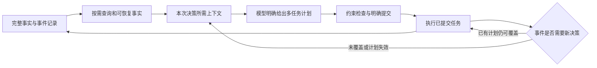

# 排程 harness 效率与系统设计调研

调研日期：2026-10-16（Asia/Shanghai）。独立评审状态：**APPROVED**。

截至2026-10-16，已有材料支持优先研究事实访问、有限多任务计划、覆盖驱动的重排和质量成本联合评价。八项关键命题的支持均限于其原有限定范围，不能推出本厂节省。当前最明确的本地观察是读取停滞、输入超字符上限及计划覆盖不足；这些来自继承记录，尚未通过完整同条件回放验证因果。以下改变均为候选与后续最小消融建议，本次未实施。

## 调研范围与事实边界

这轮回答如何组织信息、计划、执行、触发和反馈。外部机制是设计先验，本厂收益仍需完成同条件回放验证。执行者说明：当前 B 未修改，没有重启已冻结的三组实验，也没有新跑工厂模拟；这是执行范围记录，不是独立评审对整个运行环境的完整认证。

本地背景来自既有隔离实验的[阶段报告](<__PROJECT_ROOT__/analysis/B_coverage_ablation_20261015/阶段结果与中断说明.txt>)：两个改动组的74次成功调用均为读取，其中56次为artifact翻页；尚未提案。完整事实输入约14.7–20.1万字符，超过12万字符上限。字符不是token。等长配对尚未完成，不能报告节省比例或质量非退化。这些是继承证据，不是本轮重新运行结果。

## 别人的系统怎样做

| 来源 | 机制 | 能借鉴的部分 | 不能据此假定 |
|---|---|---|---|
| Anthropic代码执行与PTC | HE-C01：在执行环境处理工具结果，仅显式输出进入模型；工具定义按需加载解决另一类开销。[官方原文](https://www.anthropic.com/engineering/code-execution-with-mcp)、[PTC原文](https://www.anthropic.com/engineering/advanced-tool-use)。 | 批量遍历、投影、聚合，并保留结果出处和例外。 | 模型往返减少不等于底层工具调用减少；还存在执行设施开销。 |
| Deep Agents | HE-C02：外置原文、路径预览、摘要和定向重读配合，以目标延续及指定事实恢复评价。[官方文章](https://www.langchain.com/blog/context-management-for-deepagents)。 | 将事实保存契约、实际检索路径、正确使用事实分别验证。 | 文件存在或答案包含目标词不能证明完成了历史搜索；旧文阈值不能直接设为本厂默认。 |
| LLMCompiler | HE-C03：Planner生成依赖图，执行侧按就绪状态派发并绑定结果引用。[论文v3](https://arxiv.org/html/2312.04511v3)、[调度源码](https://raw.githubusercontent.com/SqueezeAILab/LLMCompiler/main/src/llm_compiler/task_fetching_unit.py)。 | 执行模型已决定的独立读取及依赖步骤。 | 工具、汇总和重规划均无模型调用，或长计划必然正确、更快。 |
| Anthropic长任务harness | HE-C04：完整需求清单、进度记录和完成标准支持接续，结构随模型能力调整。[早期案例](https://www.anthropic.com/engineering/effective-harnesses-for-long-running-agents)、[后续案例](https://www.anthropic.com/engineering/harness-design-long-running-apps)。 | 保留全部待完成需求，记录实际进展与验收状态。 | 增加agent或评审降低总成本；已有评审漏检、额外开销和多轮返工。 |
| Vieira等制造重排框架 | HE-C05：触发政策与生成、修补方法分别描述。[作者实验室稿](https://isr.umd.edu/Labs/CIM/projects/jos-rescheduling.pdf)。 | 分别比较何时更新、更新范围及计划变动代价。 | 混合触发天然只修局部，或不同设计维度意味着效果完全独立。 |
| Nexperia光刻CP/DES案例 | HE-C06：状态快照、静态求解、按视野内开工门槛部署，再滚动更新。[论文原文](https://link.springer.com/article/10.1007/s10696-026-09666-5)。 | 区分视野、更新周期、部署门槛，并分别评价效率与延期。 | 静态改善可直接迁移到动态现场；案例中EDD的延期表现胜过CP，CP也实际承担具体排程决定。 |
| 指定隔离B副本 | HE-C07：合格读取计数、按需记忆候选、容量回退；eq/contains按原目录顺序过滤，contains为列表成员匹配。 | 保留现有定向读取能力，定位其未被有效使用的原因。 | 第二次读取必然全量内联，或隔离副本行为代表live B及系统全部决策路径。 |
| 持久session与LangGraph | HE-C08：持久日志与上下文分离；已完成结果可复用，未完成task可能重跑。[session原文](https://www.anthropic.com/engineering/managed-agents)、[恢复文档](https://github.com/langchain-ai/docs/blob/main/src/oss/langgraph/functional-api.mdx#idempotency)。 | 支持读取进度及未知结果核对，作为主线评价的辅助记录。 | 日志或checkpoint保证外部动作恰好一次，或保证决策事实始终可见。 |

表中工程文章、论文和代码的证据强度不同；精确引用与反证见下面的关键论断。性能数字若未列为关键论断，仅是作者案例背景，不作为本厂投资或质量判断依据。

下图是由本轮机制研究推导的职责划分，用于讨论和后续消融，尚未实施：

这里的查询和执行节点不得暗中评分选取、补排或修复具体生产安排。事件判定也需保留响应时效与质量约束，不能以少调用为唯一目标。

## 四个问题的结论

### HE-Q01

默认信息应围绕当前决策窗口组织：近期资源状态、可开始及条件可开始的需求、剩余承诺、资格与依赖、确切约束、数据版本及缺项。精确值应可按需访问，摘要不能补造事实。本地已有多查询、字段投影、明确ID及JSON路径读取能力，问题不能表述为缺少批量读取。本轮对隔离源码的静态核验确认：同context中至少两次合格read_entities才有资格生成记忆候选；单动作多查询只计一次，artifact翻页不计。即使达到门槛，完整事实已可见时会跳过，容量不足仍会外置或失败。外部材料支持环境内过滤、投影、聚合以及原文外置后定向恢复，但指针存在不证明模型实际找回事实。

依据：HE-C01, HE-C02, HE-C07。边界：14.7至20.1万是字符，超过12万字符上限；不能换算为token节省。移除新增概览仍超限，说明单删概览不足。分页、记忆门槛、容量回退与提示策略共同作用，现有证据不能确定唯一根因。缺失、未请求、显式null及不确定状态必须分别保留。

### HE-Q02

模型可一次明确给出多个动作及依赖，由执行器消费已承诺步骤；独立读取可以批量执行，已知依赖可以等待就绪后执行。LLMCompiler支持这一编排机制，但工具内部、Joiner汇总及重规划仍可能调用模型。参数值尚未知可以用结果引用绑定；观察结果改变后续任务图、约束失效或出现未声明冲突等情况，可能需要进一步推理；这不是穷尽所有触发条件。本地单动作schema已经允许多机组、多任务，单任务计划不能归因于单动作限制。编码案例的一次实现一个功能也不能成为生产计划只能含一个任务的依据。

依据：HE-C01, HE-C03, HE-C04, HE-C07。边界：函数调用DAG没有证明工厂计划可行。资源占用、资格、批次兼容、顺序和等待仍须由模型明确决定；执行器不得自行补排。条件计划接口支持程度未知。原论文报告错误依赖映射、工具及回答失败，WebShop还存在规划开销导致更慢的反例。

此处区分多任务生产计划与工具步骤编排。当前单动作协议仍是一次一个业务动作；一次propose_delta可包含多机组、多任务，不能据外部DAG机制直接改成一轮提交多个业务动作。

### HE-Q03

应分别定义规划视野、实际部署集合、不可撤销的承诺语义、剩余覆盖及更新触发。制造重排框架区分周期、事件、混合触发与右移、局部修补、完整再生成；但广义政策也可以规定按情境选择方法，两者效果并非互不影响。光刻案例采用1.5小时视野、1小时重排，只部署视野内开始的任务，不能改写为只承诺到下次重排，也不能扩写为跨重排永久冻结。本地在名义有效期前因未覆盖需求重新入模，首先提示需检查任务覆盖；普通完工若已有合法后继，可推进既定计划，真正未覆盖需求或重大扰动才可能要求模型更新。

依据：HE-C04, HE-C05, HE-C06。边界：延长有效期不会填补未安排任务，人为等待也可能损害质量。周期更新可能延迟紧急需求响应，局部修补可能遗漏跨范围影响。论文参数没有完整敏感性优化，不能直接作为本厂配置；减少重排次数本身不是优越性证据。

### HE-Q04

评价需同时覆盖信息体积、模型往返、生产重排三个层面，并把合法性、需求覆盖、完成量、等待及加权延期与成本并列。继承记录截至中断共112次调用，111次有用量、1次未知；两个改动组74次成功调用均为读取，其中56次翻页，尚无提案。现状组已执行9个计划未见拒绝，但三组300秒窗口均未完成，无法证明改动质量非退化。短窗口可定位首次提案和上下文失效，较长窗口才能区分首次取数与持续成本。恢复记录仅作支持：保存历史与当次上下文可以分离，未完成任务恢复时仍可能重跑。

依据：HE-C02, HE-C04, HE-C06, HE-C07, HE-C08。边界：比较须使用相同底层状态、需求事件、推进长度及一致失败规则，保留无提案、超限、中断和重试分母。未知用量不得记零属于审计推论，并非文档计费承诺。检查点不保证外部副作用恰好一次；厂商首token延迟也不能代替调用数或总费用。

## 优先验证的改变

以下是由证据推导的本地候选与最小验证建议，尚未实施；建议优先级不是已经测得的收益排序。

### 1. 建立质量与成本并列的同条件评价及读取进展反馈；以下仅为后续设计建议。

优先级：P0：先约定评价口径。对应问题：未完成窗口、无提案和未知用量容易造成虚假低成本；硬性迫使提交也可能损害质量。

决策归属：先使用现有确定性约束检查报告问题；不自动修复，也不默认新增在线评审agent。

最小对照：固定底层输入、模型版本、预算、事件及随机条件，单因素配对比较；先定位短窗口失效，再评估相同较长推进长度，并分别报告首次与持续成本。

指标：逐轮读取及重复读取、事实可见性、首次合法提案时间；覆盖、合法率、完成、等待、加权延期；模型与工具调用、token、延迟、执行及失败费用。未知用量单列。

否证条件：调用下降但覆盖不足、等待或延期超出预设容差，或计入失败、返工后收益消失，则效率改善主张不成立；推进长度不等时不判胜负。依据：HE-C02, HE-C04, HE-C06, HE-C07, HE-C08。

### 2. 评估取消第二次读取资格门槛，使首读事实可保留、按需可见，并保留外置原文及来源。

优先级：P1：首次有效读取即可复用。对应问题：大批量首读后持续翻页不会推进记忆门槛，已知事实可能仍需反复获取。

决策归属：只复用同context、相容版本的事实；未请求或缺失字段不得填补，不无条件全量内联。

最小对照：保持查询范围、提示及计划策略不变，仅改变首读记忆资格；分别核对保存成功、所需值可见和模型正确使用。

指标：重复读取、翻页、字符峰值、来源一致性、关键事实恢复、首次提案及质量成本。

否证条件：若增加上下文挤占、跨版本混用或遗漏约束，或重复读取没有减少，则该门槛不是主要瓶颈，不能归因其为有效改进。依据：HE-C02, HE-C07。

### 3. 先评估既有多查询、字段投影、ID和JSON路径的使用；再考虑带明确语义的范围查询、聚合及缺项提示。

优先级：P1：按窗口取数并保留约束。对应问题：完整输入超字符上限，eq/contains又不能直接表达时间数值区间，可能迫使过宽遍历。

决策归属：模型声明查询窗口与条件；确定性投影不自动越界。若评分、截断或过滤实质决定执行哪些lot，须披露具体决策规则。

最小对照：先只改变既有查询用法，再单独评估范围谓词；固定记忆与计划策略，对照完整事实核查资格、依赖和例外是否可恢复。

指标：匹配与返回数量、输入字符及token、额外恢复调用、漏候选、约束遗漏、提案覆盖及延期。

否证条件：若输入缩小却隐藏必要候选或约束，或恢复调用抵消收益，则拒绝该投影；不能只凭字符下降判断成功。依据：HE-C01, HE-C02, HE-C07。

### 4. 模型一次提交有限范围的任务、顺序、依赖、等待和失效条件；执行器按明确条件消费。

优先级：P2：有限多机组多任务计划。对应问题：单任务计划覆盖短，但现有schema已允许多任务；仅扩大提示曾出现持续读取而无提案。

决策归属：具体lot、机台、批次、顺序、等待由模型决定；条件不满足时反馈，执行器不得选择替代任务或自动补排。

最小对照：先核对条件计划接口；保持事实访问相同，仅比较有限多任务与当前计划策略，单独记录规划失败及动态失效。

指标：合法任务覆盖、可连续推进时长、模型往返、依赖错误、资源冲突、等待、延期及规划开销。

否证条件：若长计划提高冲突、过期事实或返工，或多排任务但实际推进不增、总成本更高，则不支持扩大计划。依据：HE-C03, HE-C04, HE-C07。

### 5. 有可执行计划后，区分已有覆盖的普通完工、真正未覆盖需求、重大扰动、周期检查及到期。

优先级：P2：覆盖与重排触发分别调整。对应问题：名义有效期尚未结束仍因需求未覆盖重入模，单延长期限无法解决。

决策归属：触发判断可确定性实现；局部或整体更新的具体安排仍由模型决定，不用人为等待压低调用。

最小对照：先固定触发策略检验覆盖，再固定覆盖比较触发；保持事件序列一致，分别统计局部更新与整体重算。

指标：剩余可执行覆盖、各原因重入模、事件响应延迟、计划改动量、机台空闲、完成、延期及总成本。

否证条件：若重排减少伴随漏响应、无覆盖等待、更多延期或承诺破坏，则否定改进；触发与覆盖同时改变时不能单独归因。依据：HE-C04, HE-C05, HE-C06。

不能仅延长 valid_until、插入无必要等待或压低触发频率来获得更少调用；应在相同输入与推进长度下，同时检查任务完成、等待、延期、约束合法性和完整成本。先分离首次取数成本与持续运行成本，再判断更长窗口的净收益。

## 关键论断与对抗核验

8条原命题各有3个独立核验角色：原源核对、主动证伪、迁移审计。票数只是整理结果，不是来源独立性或实证复现；同一项目的论文和代码不算两次独立实验。下面保留原命题，不以改写后支持覆盖原始反对或弃权。

### HE-C01

**原命题：** Anthropic 的代码执行/PTC 机制允许在执行环境中完成工具结果的过滤、字段投影、聚合和控制流，只把显式结果返回模型，从而避免所有中间数据逐项经过模型；工具定义按需加载是另一个机制。这些工程材料不构成本厂总调用、总费用或排程质量必然改善的证据。

核验整理：confirmed；支持3，反驳0，弃权/失败0。confidence=high。

provenance: source=auto-research；origin_tier=B；hit_sources=[B]。

citations：

- [https://www.anthropic.com/engineering/code-execution-with-mcp](<https://www.anthropic.com/engineering/code-execution-with-mcp>)；kind=external；accessed=2026-10-16；锚点：发布日及工具定义开销、结果过滤/聚合、代码执行额外复杂度：第13–22、49–73、123–149、225行；访问层级=full
- [https://www.anthropic.com/engineering/advanced-tool-use](<https://www.anthropic.com/engineering/advanced-tool-use>)；kind=external；accessed=2026-10-16；锚点：发布日、PTC机制、内部评测数字、适用场景与限制：第13–27、119–187、189–278行；访问层级=full

adversarial_check.method=falsification。trace：

- 角色1：supported/high；[完整核验](<__PROJECT_ROOT__/research_harness_efficiency_20261016/m0.5_research/evidence/verify-v1/agents/0001/result.json>)。实际检索：限定检索：site.anthropic.com/engineering "programmatic tool calling" limitations token consumption；打开：https://www.anthropic.com/engineering/code-execution-with-mcp；打开：https://www.anthropic.com/engineering/advanced-tool-use；定向打开：code-execution-with-mcp，第35行附近；定向打开：advanced-tool-use，第170行附近；定向打开：code-execution-with-mcp，第225行附近；定向打开：advanced-tool-use，第13行附近
  限定/反例处置：无需缩窄原限定命题；支持范围为信息路径、机制区分及证据适用边界，不延伸为本厂收益结论或当前API版本兼容性结论。
- 角色2：supported/high；[完整核验](<__PROJECT_ROOT__/research_harness_efficiency_20261016/m0.5_research/evidence/verify-v1/agents/0002/result.json>)。实际检索：site.anthropic.com/engineering programmatic tool calling limitations overhead code execution tool results filtering
  限定/反例处置：无需收窄；保留原命题的机制能力及本厂效果未知限定，分别统计模型调用、底层工具调用和端到端费用。
- 角色3：supported/high；[完整核验](<__PROJECT_ROOT__/research_harness_efficiency_20261016/m0.5_research/evidence/verify-v1/agents/0003/result.json>)。实际检索：限定检索：site.anthropic.com/engineering "programmatic tool calling" limitations token tools；打开：https://www.anthropic.com/engineering/code-execution-with-mcp；打开：https://www.anthropic.com/engineering/advanced-tool-use；定向打开：code-execution-with-mcp，lineno=35；定向打开：advanced-tool-use，lineno=195；定向打开：code-execution-with-mcp，lineno=218；定向打开：advanced-tool-use，lineno=13
  限定/反例处置：无需缩窄原命题；保留机制存在与本厂收益尚未证实的限定。

adversarial_check.explicit_not_found=true。not_found_note：已找到机制的直接原文支持；两篇指定来源未报告本厂总调用、总费用或排程质量对照，也未在所引37%段落报告评测样本量。此处未报告不等于其他地方不存在证据。；在已核读的两篇指定原文中，未发现本厂总调用、总费用、返工或排程质量的实测数据；此结论仅限定于这些材料，不表示其他地方不存在证据。；在已读取的两篇原文中未发现针对本厂总调用、总费用或排程质量的验证；此结论仅限本次来源范围，不表示其他证据不存在。任务未明确列出可读本地文件，未进行本地rg分支核验；内部背景仅作为用户提供的迁移条件。

### HE-C02

**原命题：** Deep Agents 2026-01-28 工程文章把大结果外置、可搜索/定向重读的原文保留和摘要配合使用，并以目标延续与指定事实恢复做定向评估；文件或指针存在本身不保证模型成功恢复所需事实。文章阈值不能未经版本核对就作为当前 main 或本厂默认值。

核验整理：confirmed；支持3，反驳0，弃权/失败0。confidence=high。

provenance: source=auto-research；origin_tier=B；hit_sources=[B]。

citations：

- [https://www.langchain.com/blog/context-management-for-deepagents](<https://www.langchain.com/blog/context-management-for-deepagents>)；kind=external；accessed=2026-10-16；锚点：「Offloading large tool results」「Summarization」「Targeted evals」；文章日期 2026-01-28；访问层级=full
- [https://github.com/langchain-ai/deepagents/blob/main/libs/deepagents/deepagents/middleware/filesystem.py](<https://github.com/langchain-ai/deepagents/blob/main/libs/deepagents/deepagents/middleware/filesystem.py>)；kind=external；accessed=2026-10-16；锚点：main 分支 filesystem.py；仓库页面未显示可核验的 commit SHA，属于动态分支锚点；访问层级=partial
- [https://github.com/langchain-ai/deepagents/blob/main/libs/deepagents/CHANGELOG.md](<https://github.com/langchain-ai/deepagents/blob/main/libs/deepagents/CHANGELOG.md>)；kind=external；accessed=2026-10-16；锚点：版本记录；F02误记顶部为0.7.22，三路核验已更正为本次所见0.7.25（2026-10-13）；main仍未锁定SHA，不能绑定发布版。原始提取保留。；访问层级=partial
- [https://github.com/langchain-ai/deepagents/blob/main/libs/evals/tests/evals/test_summarization.py](<https://github.com/langchain-ai/deepagents/blob/main/libs/evals/tests/evals/test_summarization.py>)；kind=external；accessed=2026-10-16；锚点：test_summarize_continues_task；test_summarization_offloads_to_filesystem；历史引用与logging答案断言；访问层级=partial
- [https://raw.githubusercontent.com/langchain-ai/deepagents/main/libs/deepagents/deepagents/middleware/filesystem.py](<https://raw.githubusercontent.com/langchain-ai/deepagents/main/libs/deepagents/deepagents/middleware/filesystem.py>)；kind=external；accessed=2026-10-16；锚点：TOOLS_EXCLUDED_FROM_EVICTION；FilesystemMiddleware.__init__；_create_read_file_tool中的截断分支；动态main，未固定SHA；访问层级=partial

adversarial_check.method=falsification。trace：

- 角色1：supported/high；[完整核验](<__PROJECT_ROOT__/research_harness_efficiency_20261016/m0.5_research/evidence/verify-v1/agents/0004/result.json>)。实际检索：site.github.com/langchain-ai/deepagents "summarization" "needle" "fail"
  限定/反例处置：无需缩窄原命题；引用时修正CHANGELOG顶部版本备注，并继续保留动态main、模型恢复行为及本厂效果均需另行验证的限制。
- 角色2：supported/high；[完整核验](<__PROJECT_ROOT__/research_harness_efficiency_20261016/m0.5_research/evidence/verify-v1/agents/0005/result.json>)。实际检索：site.github.com/langchain-ai/deepagents summarization needle haystack failure recovery；site.github.com/langchain-ai/deepagents "tool_token_limit_before_evict" "20000"
  限定/反例处置：命题无需改写；来源记录应把CHANGELOG顶部版本更新为本次所见0.7.25，并继续保留动态main未绑定发布版本的限制。
- 角色3：supported/high；[完整核验](<__PROJECT_ROOT__/research_harness_efficiency_20261016/m0.5_research/evidence/verify-v1/agents/0006/result.json>)。实际检索：限定检索：site.langchain.com/blog/context-management-for-deepagents "targeted" "2026"；打开指定文章、filesystem.py GitHub页面、CHANGELOG GitHub页面及filesystem.py原始源码；原文定位：Targeted evals；源码反向查找：tool_token_limit:、20000、20_000、def _intercept_large_tool_result；版本定位：Latest commit、0.7.22
  限定/反例处置：原限定命题无需缩窄；应更新来源说明中的CHANGELOG顶部版本，并继续保留动态main、字符与token单位以及本厂收益未证的限制。

adversarial_check.explicit_not_found=true。not_found_note：本轮未取得所读main文件的固定commit SHA、事实恢复成功率或额外调用与返工的净成本；未命中不表示不存在，未执行复现。

### HE-C03

**原命题：** LLMCompiler v3 的 Planner 输出依赖任务图，Task Fetching Unit 按依赖就绪派发并替换结果引用，Executor 执行已规划任务，无须每个函数间额外调用 LLM；依赖未知中间结果的复杂分支仍可重规划，且论文 WebShop 案例有规划开销令其略慢于 ReAct 的结果。

核验整理：confirmed；支持3，反驳0，弃权/失败0。confidence=high。

provenance: source=auto-research；origin_tier=B；hit_sources=[B]。

采纳时的限定：“略慢”是论文作者措辞。核验的WebShop表3中，500条指令的GPT-3.5为10.48秒对5.98秒，GPT-4-0613为26.73秒对19.90秒，不能将其解读为固定的小幅差异。省去逐函数间编排推理不等于工具内部、汇总和重规划没有模型调用。

citations：

- [https://arxiv.org/html/2312.04511v3](<https://arxiv.org/html/2312.04511v3>)；kind=external；accessed=2026-10-16；锚点：arXiv:2312.04511v3, 2024-06-05；§3.1–3.4、§5.1–5.4、附录A/B；访问层级=full
- [https://github.com/SqueezeAILab/LLMCompiler](<https://github.com/SqueezeAILab/LLMCompiler>)；kind=external；accessed=2026-10-16；锚点：官方仓库 README 与 main 分支；仓库页面列出 src 目录；访问层级=partial
- [https://github.com/SqueezeAILab/LLMCompiler/tree/main/src](<https://github.com/SqueezeAILab/LLMCompiler/tree/main/src>)；kind=external；accessed=2026-10-16；锚点：官方 src 目录；页面显示 llm_compiler、executors 等子目录，但代码文件内容未加载；访问层级=partial
- [https://raw.githubusercontent.com/SqueezeAILab/LLMCompiler/main/src/llm_compiler/task_fetching_unit.py](<https://raw.githubusercontent.com/SqueezeAILab/LLMCompiler/main/src/llm_compiler/task_fetching_unit.py>)；kind=external；accessed=2026-10-16；锚点：L17–36 参数替换；L94–125 就绪判断、工具调用及调度循环；访问层级=full
- [https://raw.githubusercontent.com/SqueezeAILab/LLMCompiler/main/src/llm_compiler/llm_compiler.py](<https://raw.githubusercontent.com/SqueezeAILab/LLMCompiler/main/src/llm_compiler/llm_compiler.py>)；kind=external；accessed=2026-10-16；锚点：L185–209 Joiner模型调用与最终轮分支；L224–290 规划、执行及重规划循环；访问层级=full

adversarial_check.method=falsification。trace：

- 角色1：supported/high；[完整核验](<__PROJECT_ROOT__/research_harness_efficiency_20261016/m0.5_research/evidence/verify-v1/agents/0007/result.json>)。实际检索：site:arxiv.org/html/2312.04511v3 LLMCompiler WebShop slower replanning；site:github.com/SqueezeAILab/LLMCompiler "task_fetching_unit.py"；site:github.com/SqueezeAILab/LLMCompiler "dependencies" "schedule"
  限定/反例处置：无需改写命题；引用时注明v3为论文版本，并同时呈现WebShop延迟数值，避免将作者“略慢”的措辞理解为固定的小幅差异。
- 角色2：supported/high；[完整核验](<__PROJECT_ROOT__/research_harness_efficiency_20261016/m0.5_research/evidence/verify-v1/agents/0008/result.json>)。实际检索：LLMCompiler WebShop slower ReAct planning overhead replanning unknown dependencies；site:github.com/SqueezeAILab/LLMCompiler "max_replans" "joinner"；site:github.com/SqueezeAILab/LLMCompiler "dependencies" "task_fetching_unit"
  限定/反例处置：无需缩窄原限定命题；保留逐函数间编排调用、复杂分支可重规划及WebShop特定结果的适用范围。
- 角色3：supported/high；[完整核验](<__PROJECT_ROOT__/research_harness_efficiency_20261016/m0.5_research/evidence/verify-v1/agents/0009/result.json>)。实际检索：限定检索：site:arxiv.org/html/2312.04511v3 LLMCompiler WebShop planning overhead ReAct replan；反向检索："LLMCompiler" "WebShop" "slightly" "ReAct"；打开原论文：https://arxiv.org/html/2312.04511v3；页内查找：§3.1、§5.4、附录B；定向打开：原论文行145、行262；点击§3.4链接并读取原文
  限定/反例处置：原命题无需缩窄；支持范围限于论文所述机制及WebShop结果，不包含本厂适配完成或收益已证。

adversarial_check.explicit_not_found=false。限定检索及访问限制保留在各原始核验中。

### HE-C04

**原命题：** Anthropic 的长任务编码案例使用完整功能清单、进度记录和可检查的完成标准接续工作；2026 文章又随模型能力调整上下文重置和评审结构。这里的 one feature at a time 是编码工作单元，不支持生产排程一次只能安排一个任务，也不证明增加 agent/评审会降低总成本。

核验整理：confirmed；支持3，反驳0，弃权/失败0。confidence=high。

provenance: source=auto-research；origin_tier=B；hit_sources=[B]。

citations：

- [https://www.anthropic.com/engineering/effective-harnesses-for-long-running-agents](<https://www.anthropic.com/engineering/effective-harnesses-for-long-running-agents>)；kind=external；accessed=2026-10-16；锚点：Published Nov 26, 2025; “Feature list,” “Incremental progress,” “Testing,” and “Getting up to speed” (lines 13–17, 39–80)；访问层级=full
- [https://www.anthropic.com/engineering/harness-design-long-running-apps](<https://www.anthropic.com/engineering/harness-design-long-running-apps>)；kind=external；accessed=2026-10-16；锚点：Published Mar 24, 2026; “The architecture,” “Iterating on the harness,” and “Results from the updated harness” (lines 13–23, 59–70, 127–181)；访问层级=full

adversarial_check.method=falsification。trace：

- 角色1：supported/high；[完整核验](<__PROJECT_ROOT__/research_harness_efficiency_20261016/m0.5_research/evidence/verify-v1/agents/0010/result.json>)。实际检索：限定反向检索：site:anthropic.com/engineering/harness-design-long-running-apps cost reset reviewer Opus；打开：https://www.anthropic.com/engineering/effective-harnesses-for-long-running-agents；打开：https://www.anthropic.com/engineering/harness-design-long-running-apps；定向重开2025原文：lineno=20；定向重开2026原文：lineno=55；定向重开2026原文：lineno=133
  限定/反例处置：原命题无需缩窄；若进一步主张降本，应另核同模型、同规格、同质量门槛的对照及完整成本口径。
- 角色2：supported/high；[完整核验](<__PROJECT_ROOT__/research_harness_efficiency_20261016/m0.5_research/evidence/verify-v1/agents/0011/result.json>)。实际检索：site:anthropic.com/engineering/harness-design-long-running-apps reviewer cost context reset Opus；site:anthropic.com/engineering/harness-design-long-running-apps "unnecessary overhead" "expensive"
  限定/反例处置：无需改写原限定命题；应用时继续保留编码场景、模型能力、规格差异及未复现限制。
- 角色3：supported/high；[完整核验](<__PROJECT_ROOT__/research_harness_efficiency_20261016/m0.5_research/evidence/verify-v1/agents/0012/result.json>)。实际检索：限定反向检索：site:anthropic.com/engineering/harness-design-long-running-apps "cost" "review"；打开：https://www.anthropic.com/engineering/effective-harnesses-for-long-running-agents；随后定位第30行，读取功能清单、增量推进、测试、恢复状态及脚注；打开：https://www.anthropic.com/engineering/harness-design-long-running-apps；随后分别定位第120行和第50行，读取架构演化、成本表、评审限制及更新结果；本地rg：仅将题给脱敏背景经标准输入匹配“多个机组与任务|不能把单动作|尚无提案|翻页不触发|第二次read_entities|同长度回放未完成|超12万字符|eq/contains”；首次here-document因只读限制失败，改用printf管道后成功；未读取本地文件
  限定/反例处置：保留原限定命题；迁移建议仅作为机制假设，本厂收益须待同长度回放及成本、覆盖和质量对照完成后判断。

adversarial_check.explicit_not_found=false。限定检索及访问限制保留在各原始核验中。

### HE-C05

**原命题：** Vieira、Herrmann、Lin 的制造重排框架把预测-响应式调度的触发政策（周期、事件驱动、混合）与排程生成/修补方法（如右移、局部修补、完整再生成）分列。因此触发政策与修补范围是不同设计维度；图示分类本身不证明某一组合在本厂质量或调用成本上更优。

核验整理：confirmed；支持3，反驳0，弃权/失败0。confidence=high。

provenance: source=auto-research；origin_tier=B；hit_sources=[B]。

citations：

- [https://cepac.cheme.cmu.edu/pasi2011/library/henning/ReschedulingFramework-VieiraHerrmannLin.pdf](<https://cepac.cheme.cmu.edu/pasi2011/library/henning/ReschedulingFramework-VieiraHerrmannLin.pdf>)；kind=external；accessed=2026-10-16；锚点：图1及第5–7页（策略、方法和稳定性讨论）；第21页参考文献；访问层级=partial
- [https://link.springer.com/article/10.1023/A:1022235519958](<https://link.springer.com/article/10.1023/A:1022235519958>)；kind=external；accessed=2026-10-16；锚点：摘要与访问说明（全文订阅限制）；访问层级=abstract
- [https://isr.umd.edu/Labs/CIM/projects/jos-rescheduling.pdf](<https://isr.umd.edu/Labs/CIM/projects/jos-rescheduling.pdf>)；kind=external；accessed=2026-10-16；锚点：作者实验室39页稿：第3.1节（PDF第7页）；图1、表1（PDF第9–10页）；第5节及第6.2节；访问层级=full

adversarial_check.method=falsification。trace：

- 角色1：supported/high；[完整核验](<__PROJECT_ROOT__/research_harness_efficiency_20261016/m0.5_research/evidence/verify-v1/agents/0013/result.json>)。实际检索：Vieira Herrmann Lin 2003 rescheduling framework policies methods periodic event driven hybrid right shift partial complete rescheduling；site.isr.umd.edu "Rescheduling manufacturing systems" "policy" "method"
  限定/反例处置：无需修改原限定命题；使用时保留广义policy可以包含方法选择的限定，不将“不同维度”解释为完全独立。
- 角色2：supported/high；[完整核验](<__PROJECT_ROOT__/research_harness_efficiency_20261016/m0.5_research/evidence/verify-v1/agents/0014/result.json>)。实际检索：Vieira Herrmann Lin rescheduling framework periodic event driven hybrid right shift partial complete rescheduling limitations stability；"Vieira" "Herrmann" "Lin" "rescheduling" "right-shift" "poor"；"Rescheduling Manufacturing Systems" "stability" "periodic" "performance"
  限定/反例处置：无需修改原限定命题；引用时保留“触发政策”这一限定，避免将不同设计维度解释为政策定义排除方法选择或效果完全独立。
- 角色3：supported/high；[完整核验](<__PROJECT_ROOT__/research_harness_efficiency_20261016/m0.5_research/evidence/verify-v1/agents/0015/result.json>)。实际检索：Vieira Herrmann Lin rescheduling framework periodic event driven hybrid right shift partial complete rescheduling stability；site:isr.umd.edu "Rescheduling manufacturing systems" "policies" "methods" stability optimal
  限定/反例处置：维持原命题的分类与证据边界，不扩展为具体触发—修补组合的优越性或本厂节省结论。

adversarial_check.explicit_not_found=false。限定检索及访问限制保留在各原始核验中。

### HE-C06

**原命题：** 光刻 CP/DES 论文案例将排程视野设为1.5小时、重排间隔设为1小时，并以任务是否在视野 h 内开始作为部署承诺门槛；这一表述不能改写为只承诺到下次重排。视野、重排周期和承诺语义在该案例中不同，数值不是本厂通用配置。

核验整理：confirmed；支持3，反驳0，弃权/失败0。confidence=high。

provenance: source=auto-research；origin_tier=B；hit_sources=[B]。

citations：

- [https://link.springer.com/article/10.1007/s10696-026-09666-5](<https://link.springer.com/article/10.1007/s10696-026-09666-5>)；kind=external；accessed=2026-10-16；锚点：§3.2.1–3.2.2、§4.1、§6.1–6.2、§7；行128–178、195–208、443–474、486–518；访问层级=full

adversarial_check.method=falsification。trace：

- 角色1：supported/high；[完整核验](<__PROJECT_ROOT__/research_harness_efficiency_20261016/m0.5_research/evidence/verify-v1/agents/0016/result.json>)。实际检索："10.1007/s10696-026-09666-5" horizon rescheduling；site:link.springer.com/article/10.1007/s10696-026-09666-5 "committed" "rescheduling"
  限定/反例处置：无需缩窄原命题；继续保留案例限定，并避免延伸为跨重排不可撤销的冻结承诺。
- 角色2：supported/high；[完整核验](<__PROJECT_ROOT__/research_harness_efficiency_20261016/m0.5_research/evidence/verify-v1/agents/0017/result.json>)。实际检索："10.1007/s10696-026-09666-5" "rescheduling" "committed"；"Scheduling with constraint programming" "horizon" "one hour"；"photolithography" "Deenen" "only" "next rescheduling"；"photolithography" "Deenen" "committed" "horizon"
  限定/反例处置：保留原限定命题；“承诺部署”不应扩写为跨后续重排永久冻结，也不应缩写为仅承诺至下一次重排。
- 角色3：supported/high；[完整核验](<__PROJECT_ROOT__/research_harness_efficiency_20261016/m0.5_research/evidence/verify-v1/agents/0018/result.json>)。实际检索：检索："s10696-026-09666-5" scheduling horizon reoptimization；限定检索：site:link.springer.com/article/10.1007/s10696-026-09666-5 "committed" "rescheduling"；打开：https://link.springer.com/article/10.1007/s10696-026-09666-5；定向打开同一原文：行184；定向打开同一原文：行443；定向打开同一原文：行486；定向打开同一原文：行203；定向打开同一原文：行470
  限定/反例处置：原命题无需缩窄；保留“该案例”“视野内开始的部署承诺门槛”及“非本厂通用配置”的限定，不外推为跨重排冻结保证或本厂收益已证。

adversarial_check.explicit_not_found=false。限定检索及访问限制保留在各原始核验中。

### HE-C07

**原命题：** 指定隔离副本的 prompt_variants 只统计同 context 中 processed 且成功的 read_entities；至少两次才有资格生成事实记忆候选，一次动作含多查询仍只算一次，read_artifact 不计入。两次读取并不保证内联：已完整可见时可跳过，超容量时可回退目录或引用。FactReader 的 where 目前仅支持 eq/contains，按原目录顺序过滤。

核验整理：confirmed；支持3，反驳0，弃权/失败0。confidence=high。

provenance: source=auto-research；origin_tier=A；hit_sources=[A]。

citations：

- [__PROJECT_ROOT__/analysis/B_coverage_ablation_20261015/workspace/src/smt_fullfab/harness/fact_memory.py](<__PROJECT_ROOT__/analysis/B_coverage_ablation_20261015/workspace/src/smt_fullfab/harness/fact_memory.py>)；kind=internal；accessed=2026-10-16；锚点：INSTRUCTIONS; FactMemory.add; prompt_variants, especially len(memory.reads) < 2 and rendering/capacity fallback；访问层级=full；fallback=rg
- [__PROJECT_ROOT__/analysis/B_coverage_ablation_20261015/workspace/src/smt_fullfab/harness/facts.py](<__PROJECT_ROOT__/analysis/B_coverage_ablation_20261015/workspace/src/smt_fullfab/harness/facts.py>)；kind=internal；accessed=2026-10-16；锚点：FactReader.read: where predicates, eq/contains matching, source-order filtering, fields projection and pagination；访问层级=full；fallback=rg
- [__PROJECT_ROOT__/analysis/B_coverage_ablation_20261015/workspace/src/smt_fullfab/harness/transport.py](<__PROJECT_ROOT__/analysis/B_coverage_ablation_20261015/workspace/src/smt_fullfab/harness/transport.py>)；kind=internal；accessed=2026-10-16；锚点：prompt() 构造入口与 fit_prompt() 容量回退；F07原提取将入口误记为build_context，三路源码核验已更正。；访问层级=partial（按三路核验的定向读取口径；F07初步精读曾标full，原标记保留，不据此声称三路均全文审计）；fallback=rg

adversarial_check.method=falsification。trace：

- 角色1：supported/high；[完整核验](<__PROJECT_ROOT__/research_harness_efficiency_20261016/m0.5_research/evidence/verify-v1/agents/0019/result.json>)。实际检索：本地原源读取：fact_memory.py，sed -n '1,320p'，限定用户指定绝对路径。；本地原源读取：facts.py，nl -ba 后 sed -n '1,380p'，限定用户指定绝对路径。；本地原源读取：transport.py，nl -ba 后 sed -n '1,440p'，限定用户指定绝对路径。；本地反向分支检索：对上述三个文件执行 rg -n，检查 attempt.get、action.get、response.get、len(memory.reads)、self.reads.append、return []、base_chars <=、catalog_inline、reference_only、fit_prompt、context_capacity、谓词算子、原序过滤、分页及 matching_total 分支。
  限定/反例处置：无需缩窄原命题；支持范围限于指定隔离副本本轮读取的代码。
- 角色2：supported/high；[完整核验](<__PROJECT_ROOT__/research_harness_efficiency_20261016/m0.5_research/evidence/verify-v1/agents/0020/result.json>)。实际检索：本地 rg -n -C 4 'INSTRUCTIONS|def add|def prompt_variants|len\(memory\.reads\)|processed|read_entities|read_artifact|context|inline|capacity|fallback|visible'：限定 fact_memory.py；本地 rg -n -C 5 'class FactReader|def read|where|contains|\beq\b|selected|offset|fields|cursor|sort'：限定 facts.py；本地 rg -n -C 5 'def build_context|def fit_prompt|prompt_variants|context_chars|compact|artifact|fact_memory|def render'：限定 transport.py
  限定/反例处置：维持原命题范围；成功读取明确指顶层响应 status=ok，结论仅适用于本次读取的指定隔离副本，不外推运行效果或节省。
- 角色3：supported/high；[完整核验](<__PROJECT_ROOT__/research_harness_efficiency_20261016/m0.5_research/evidence/verify-v1/agents/0021/result.json>)。实际检索：本地限定检索：rg -n -C 5，fact_memory.py，检查 INSTRUCTIONS、add、prompt_variants、processed、read_entities、read_artifact、两次门槛与容量回退分支。；本地定向读取：sed -n '20,98p;203,293p'，fact_memory.py。；本地限定检索：rg -n -C 5，facts.py，检查 where、eq、contains、fields、分页及排序分支。；本地限定检索：rg -n -C 6，transport.py，检查 prompt_variants、fit_prompt、反馈压缩及容量处理。；本地定向读取：sed -n '106,186p'，facts.py。；本地定向读取：sed -n '15,47p;185,252p;300,405p'，transport.py。
  限定/反例处置：适用范围保持为指定隔离副本的静态机制；收益与质量结论须等待同长度回放及相应运行证据。

adversarial_check.explicit_not_found=true。not_found_note：transport.py 的定向检索未命中名为 build_context 的定义；对应提示构造逻辑实际位于 prompt。此锚点差异不推翻机制命题，也不代表其他文件不存在同名函数。

### HE-C08

**原命题：** 持久 session/检查点与每次送给模型的上下文可以分离；但 LangGraph Functional API 文档明确未完成 task 在恢复时可能重跑，外部副作用需幂等键或结果核对。仅有检查点或日志不能推出外部动作恰好一次，也不能把没有返回用量的调用记为零成本。

核验整理：confirmed；支持3，反驳0，弃权/失败0。confidence=high。

provenance: source=auto-research；origin_tier=B；hit_sources=[B]。

citations：

- [https://www.anthropic.com/engineering/managed-agents](<https://www.anthropic.com/engineering/managed-agents>)；kind=external；accessed=2026-10-16；锚点：“The session is not Claude’s context window”；session/event log、独立 harness 恢复及 TTFT 报告（2026-04-08）；访问层级=full
- [https://docs.langchain.com/oss/python/langgraph/persistence](<https://docs.langchain.com/oss/python/langgraph/persistence>)；kind=external；accessed=2026-10-16；锚点：Persistence；Checkpointer vs. store；故障、内存检查点与无界增长问题；访问层级=full
- [https://github.com/langchain-ai/docs/blob/main/src/oss/langgraph/functional-api.mdx](<https://github.com/langchain-ai/docs/blob/main/src/oss/langgraph/functional-api.mdx>)；kind=external；accessed=2026-10-16；锚点：Functional API 文档当前 main；Determinism、Idempotency 与 side-effect handling（约 L843–L937）；访问层级=full

adversarial_check.method=falsification。trace：

- 角色1：supported/high；[完整核验](<__PROJECT_ROOT__/research_harness_efficiency_20261016/m0.5_research/evidence/verify-v1/agents/0022/result.json>)。实际检索：site.docs.langchain.com/oss/python/langgraph/functional-api "task" "re-executed" "idempotent"；site:docs.langchain.com/oss/python/langgraph/functional-api "idempotency" "did not finish"
  限定/反例处置：保留原命题；引用时明确“未知用量不能记零”为审计推论，并将文档结论限定于访问日main，不据此断言当前B实现或本厂节省。
- 角色2：supported/high；[完整核验](<__PROJECT_ROOT__/research_harness_efficiency_20261016/m0.5_research/evidence/verify-v1/agents/0023/result.json>)。实际检索：site.docs.langchain.com langgraph functional API pending task resume idempotency side effects failed tasks；site:docs.langchain.com/oss/python/langgraph "exactly once" "side effects"；site:github.com/langchain-ai/docs "functional-api.mdx" "completed" "may run again"
  限定/反例处置：无需改写原命题；引用时继续明确：重跑针对未完成任务，未知用量不记零属于审计规则，外部恰好一次需另行验证。
- 角色3：supported/high；[完整核验](<__PROJECT_ROOT__/research_harness_efficiency_20261016/m0.5_research/evidence/verify-v1/agents/0024/result.json>)。实际检索：site:docs.langchain.com/oss/python/langgraph "functional" "idempotent" "resume"；site:docs.langchain.com/oss "functional" "idempotency" "tasks"；site:github.com/langchain-ai/docs "functional-api.mdx" "completed" "re-executed"
  限定/反例处置：无需修改原命题；保留未知用量不得记零属于审计推论、本厂实现与收益尚未验证的限定。

adversarial_check.explicit_not_found=true。not_found_note：第二次限定检索未命中，但直接打开的原项目文档明确包含相关条款，故未命中不构成不存在证据。已读原源未提供缺失用量调用应计零的依据；Anthropic文章未报告TTFT样本量和统计窗口；本次未取得固定提交版本。

## 矛盾、未知与适用边界

核验包未记录否定八项限定命题的裁决，但不能用一致裁决替代独立来源。保留证据差异：LLMCompiler部分核验未取得代码，另一条取得原始源码；WebShop同500指令延迟为10.48对5.98秒、26.73对19.90秒，明确存在更慢反例，不能传播固定小幅延迟差。Deep Agents版本记录顶部应更正为0.7.25，仍无法绑定main提交。制造框架原PDF乱码、截图失败和出版全文受限继续保留；作者实验室稿补足分类核验，与期刊版同源。隔离源码入口应为prompt，contains是列表成员匹配。视野内开工的部署门槛既非只承诺至下次重排，也未证明永久冻结。
本轮完成了公开检索与原源核对，并对指定隔离源码进行了新的静态核验；既有运行数字来自中断报告，未重新回放。综合模型只阅读已生成的研究材料，其原始输出中的“本次未重读源码/未派生agent/未修改文件”描述的是综合这个单一会话，不能当成整个研究流程的记录。Owner将其统一为本段口径，原始输出保留。执行者说明：研究中新建了研究资料与编排脚本，并按已确认配置派发子会话；没有修改当前B、运行工厂测试或排程、读取live B或联系他人。该声明不等于独立全程合规认证；execution-audit-notes.json的人工抽查仅覆盖其写明的阶段与命令，源文件哈希不变也只证明列出的文件未变。独立评审核查的是研究产物与抽样证据，不认证全部进程、环境副作用或live B运行状态。同机构文章、同项目论文代码及同论文不同版本不是独立重复实证。所有迁移建议待验证，不承诺节省百分比。

所有本地候选改变均缺完成的质量—成本配对。动态图、条件任务、时间不确定性、超限后的事实可见性仍需分别验证。当前代码静态结论限于已哈希的隔离副本，不能代表未读取的 live B 部署版本。动态 main 页面不能充当固定发布版本证据。

## 三源处置

### A 项目内

source_type=A；coverage=covered。wiki/ 与 wiki-background/ 目录不存在，使用 rg 回退定位原报告和隔离源码。原文件路径、SHA256与大小见[内部来源清单](<__PROJECT_ROOT__/research_harness_efficiency_20261016/inputs/internal-source-manifest.json>)；该清单不记录读取范围。实际定向读取范围见HE-C07三路票据及对应events.jsonl的命令记录；初步精读与核验的访问层级分别保留。本轮只做静态核验；旧报告中的运行结果保留继承来源标识。

### B 外部

source_type=B；coverage=covered。原作者论文、官方工程文档和原项目代码按拆题、检索、精读、反证分阶段处理。来源访问日期与锚点随论断记录。乱码PDF、未读取的实现文件、动态分支版本缺口保留，不把页面可打开等同全文核实。

### C 人工策展

source_type=C；coverage=explicit_na；na_reason=本轮无新增人工策展资料，用户指向的前轮研究按A源继承；corpus_write=none。

## 模型、流程与调用台账

用户确认深入档上限42个子会话（含失败和重试），基础39，预留3，并发2。Scope/Search/Fetch 用 gpt-6-luna / medium；Verify/Synthesize 用 gpt-6.1-sol / high；独立 Review 用 gpt-6.1-sol / xhigh。使用原 L2 runner 的新目录分阶段运行，effort 通过本次进程参数设置，未改共享 runner 或账户配置。

本快照已启动40个子会话；状态分布{"completed": 40}；阶段分布{"Fetch": 8, "Review": 2, "Scope": 1, "Search": 4, "Synthesize": 1, "Verify": 24}。已知用量：输入6,982,695，输出102,360 tokens。缓存输入是输入子集，推理输出是输出子集，不重复相加。

子会话数不等于底层模型推理次数；CLI日志未提供精确推理请求总数。Owner直接阅读、检索和协调另行发生，精确用量不可得；账户金额未知，未报告为零。失败若缺用量记未知。

[完整台账](<__PROJECT_ROOT__/research_harness_efficiency_20261016/m0.5_research/evidence/usage-summary.json>) · [用户确认](<__PROJECT_ROOT__/research_harness_efficiency_20261016/inputs/confirmation.json>) · [执行配置](<__PROJECT_ROOT__/research_harness_efficiency_20261016/inputs/engine-binding.json>) · [预算预留](<__PROJECT_ROOT__/research_harness_efficiency_20261016/inputs/session-reservations.json>) · [问题与后续去向](<__PROJECT_ROOT__/research_harness_efficiency_20261016/m0.5_research/open-questions.md>)

独立评审：[APPROVED](<__PROJECT_ROOT__/research_harness_efficiency_20261016/m0.5_research/review.md>)。评审对象与最终计账更新的关系见review-freshness.json。
