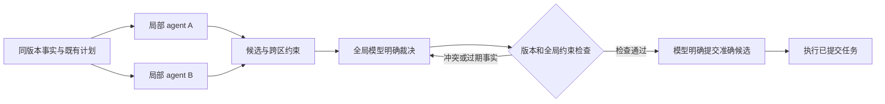

# 多 agent 排程 harness：分工、共享信息、全局冲突与单 agent 对照

调研日期：2026-10-16（Asia/Shanghai）。独立评审状态：**APPROVED_WITH_CONDITIONS**。

截至2026-10-16，已有材料支持借鉴多agent的职责分离、版本化交接和显式冲突协调，但不足以判定其在本厂优于单agent。建议先完善单agent信息访问，再比较少量只读分析子agent；局部提案与分布式协商后续分别验证。该顺序是验证优先级，不是收益排名。本地旧观察、外部机制和本厂待验证假设分开处理；独立综合子会话只综合前序证据；本次M0.5的实际检索与精读记录见证据目录，未启动排程实验。

## 范围与结论边界

本轮补充 M0.5 研究，产出机制对照和后续验证设计；没有运行单/多 agent 排程对照。执行者说明：仅新建本研究目录内资料与编排文件，没有访问运行中的 B、修改其代码/数据库/进程，也没有恢复此前冻结的回放。这是执行范围记录，不是对整个机器运行环境的独立认证。

历史隔离实验中两个改动组的74次成功调用均为读取、没有提案，且等长窗口未完成。这是继承观察，不能证明多 agent 能解决问题。局部源码只定向读取了 transport.py 的 schema 及相关匹配行；一次 propose_delta 可含多机多任务，不代表现有运行时已经支持多个排程者并发提交。

[前轮研究](<__PROJECT_ROOT__/research_harness_efficiency_20261016/m0.5_research/dossier.md>) · [历史中断报告](<__PROJECT_ROOT__/analysis/B_coverage_ablation_20261015/阶段结果与中断说明.txt>) · [本轮读取范围](<__PROJECT_ROOT__/research_harness_multiagent_20261016/preflight/source-disposition.json>)
## 外部机制如何回答四个问题

### MA-Q01

按职能拆分最容易明确读取、约束分析、提案和裁决责任，但建模→编码或分析→裁决可能形成串行管线。按机组/区域拆分适合跨区依赖稀少、资源相对独立的场景；按订单拆分必须暴露共用机器、批次及工具；按资源拆分必须处理订单跨资源工序；按时间窗拆分必须携带跨窗占用、冻结承诺和后继依赖。低耦合例是设备不共享、工艺链不跨区的独立任务群；高耦合例是共用瓶颈设备、跨区批次、紧密先后关系及跨窗长任务。应依据共享约束划分，不能按机台数量直接决定agent数量。

依据：MA-C01, MA-C04, MA-C06, MA-C07。适用边界：MA-C01只支持委派与控制权机制；MA-C04是经典非LLM协调；MA-C06是LLM生成模型后调用求解器；MA-C07显示任务结构相关收益与退化。它们均未验证本厂分工粒度。先比较固定2个子agent，4个仅作敏感性分析。

### MA-Q02

共享工件应引用不可变事实快照，而非把聊天摘要当事实权威。建议契约包含fact_version、plan_version、simulated_time、source_ref/hash；委派注明owner、范围、依赖、预算和截止时间；分析返回事实来源、跨范围约束及missing/truncated标记；提案注明基础版本、具体任务、受影响资源和有效条件。摘要须能追溯原字段，缺项不能默认为无约束。事实冲突应保留来源及版本并请求核对，不靠追加顺序决定真伪。CoMemBench支持实体范围、版本和验证状态的重要性，也显示扩大上下文存在领域差异。

依据：MA-C01, MA-C02, MA-C03, MA-C05。适用边界：上述本厂契约是待测设计。MA-C02支持默认isolated对话隔离、共享键或显式映射；runtime context和工具仍可能传播，fork另有继承行为。append reducer仅合并数据。MA-C03的隔离指标有条件分母；更宽上下文并非各领域均改善进度或均损害隔离。

### MA-Q03

两个区域各自合法的候选仍可能占用同一批次或同一机台时段。M2中，局部模型提出具体候选，全局模型决定保留、调整或等待；检查器只返回违规项、冲突集合和版本，不暗选赢家。提交建议采用唯一入口：检查当前版本、全局约束和幂等键；基础事实变化、相关承诺变化或超时结果使候选失效，返回模型重决策。M3须明确资源申请、暂留、承诺、释放、撤销、协商轮限与最终提交权，并检测等待环和反复改约。限轮退出只是终止机制，不能保证找到可行解；已执行动作也不能靠撤销聊天回滚。

依据：MA-C02, MA-C04, MA-C05, MA-C06。适用边界：这些提交协议尚未实现或验证。MA-C04支持传统算法确实分配资源、选择时段，同时记录局部修订振荡及不保证收敛。评分选取、补排、优化或求解修复只要决定具体lot、机台、批次、顺序、等待，就须披露；非模型组件作此决定会改变纯B边界。

### MA-Q04

四路应比较S1改良单agent、M1只读分析、M2分区提案统一裁决、M3分布式协商；S0旧B仅作保存状态诊断参照。预算匹配分别固定总调用、总token、费用或墙钟上限，看质量；质量匹配预先规定合法性与目标容差，看达到标准的最低总成本。使用相同保存状态、RNG、事件序列、模型/effort、工具能力、触发策略及推进时长，先控制模型能力，再另测异构模型。逐请求记录所有角色、尝试、父调用、用量、缓存、状态和延迟；失败、重试、校验、修复、汇总及未覆盖重入均进入分母。并行费用/token求和，延迟取真实关键路径，另记慢分支等待和协商闲等。

依据：MA-C03, MA-C05, MA-C06, MA-C07, MA-C08。适用边界：同时评价硬约束及冻结承诺违规、加权延期、完成量、ready等待面积、机台空闲、故障响应、覆盖和首次合法提案时间；少重排、更多计划条数或non-N/A均不能单独代表好。暂停虚拟时钟与计入实际决策延迟须分报。按状态/事件seed配对，报告差值区间，失败和零提案不能剔除；样本量由pilot方差与预设非劣界决定。

## 他人的系统怎样分工与协调

下表区分框架接口、工程经验和论文实验；可借鉴机制不等于已证明适合本厂。

| 来源与证据 | 分工/协调机制 | 可借鉴内容 | 不可据此推定 |
|---|---|---|---|
| Anthropic / OpenAI：MA-C01；原核验支持限定机制；工程经验与官方指导。[Anthropic](https://www.anthropic.com/engineering/multi-agent-research-system)、[OpenAI](https://developers.openai.com/api/docs/guides/agents/orchestration)。 | 明确委派和工件引用；manager保留最终答复责任，handoff交出分支控制。 | 窄职责、输出契约、独立上下文和可追溯工件。 | 答复责任不等于生产裁决；15倍token相对聊天，未建立等预算单agent比较。 |
| Deep Agents / LangGraph：MA-C02；原核验支持官方接口描述。[子agent](https://docs.langchain.com/oss/python/deepagents/subagents)、[子图](https://docs.langchain.com/oss/python/langgraph/use-subgraphs)、[并发更新](https://docs.langchain.com/oss/python/langgraph/errors/INVALID_CONCURRENT_GRAPH_UPDATE)。 | 隔离上下文、共享state keys或映射；reducer规定同键并发更新语义。 | 明确输入输出字段、私有状态和持久化范围。 | 列表追加不检查机台互斥；持久子图并发还可能出现checkpoint冲突。 |
| CoMemBench / DeLM：MA-C03；原限定句获支持，补核另列支持。[CoMemBench v2](https://arxiv.org/html/2609.32192v2)、[DeLM作者页](https://yuzhenmao.github.io/DeLM/)。 | 带范围、版本和验证要求的交接；追加共享日志与任务认领。 | 区分事实、失败尝试和完成信息；成本按整项任务统计。 | DeLM各agent分别提交完整解；Cost/Submission较低不能证明Cost/Task较低，均非生产排程实测。 |
| PLOS / CORA：MA-C04；原核验支持经典非LLM机制及收敛限制。[PLOS](https://journals.plos.org/plosone/article?id=10.1371/journal.pone.0205445)、[CORA](https://publications.ri.cmu.edu/storage/publications/pub_files/pub3/liu_jyi_shane_1996_1/liu_jyi_shane_1996_1.pdf)。 | 局部排程后协调共享资源；候选评价、博弈或局部修订实际选择时段。 | 显式定位共享冲突；把协商轮数与计算代价一起评价。 | 传统算法质量或CPU结果不是LLM调用节省证据；振荡示例最终求解，不等于永久循环。 |
| ALAS：MA-C05；原核验支持v1限定描述。[ALAS v1](https://arxiv.org/html/2511.03094v1)。 | 隔离validator、版本日志、局部修复后重验，必要时扩大范围。 附录C算法4的LocalRepairTools延迟操作、交换顺序，§3.5按makespan选方案；修复、优化和选取均参与具体决定。 | 分开提案、检查、修复和提交，记录失败与回退。 | 83.7%为逐数据集跨配置择优的non-N/A汇总；60.9%为相对聚合MAS的估算费用下降，非单agent或本厂收益。 论文算法行为已明确，运行代码及实际执行主体未核验；迁移须披露算法决策权。 |
| CP模型生成研究：MA-C06；原核验支持：各54次生成，正确率59.3%/33.3%/14.8%。[论文v1](https://arxiv.org/html/2610.10184v1)。 | LLM建模→编码并检索MCP文档，CP求解器决定具体排程。 | 区分建模正确、原样执行正确及最终约束有效。 | 双agent比带MCP单agent多66%token、43%时间；五条token缺失记录被排除。此为模型生成实证，不是LLM直接滚动排程。 |
| Agent Scaling与预算反证：MA-C07、MA-C08；原核验支持限定结论。[Scaling v3](https://arxiv.org/html/2512.08296v3)、[进化调用研究](https://arxiv.org/html/2609.04217v1)、[请求预算研究](https://arxiv.org/html/2604.02460v2)。 | 任务结构决定协作效果；调用池、请求推理上限与实际成本分别计量。 | 保留可分解任务获益、顺序规划退化及上下文受损时协作反超的条件性结果。 | ALFWorld团队32.2对单体18次调用，成功率差异不显著不代表等效；请求thinking上限不等于实际token、实价或时延匹配。 |

## 本厂候选分工：待测设计，不是已验证架构

| 路线 | 分工和最终决定者 | 共享内容 | 主要成本与风险 |
|---|---|---|---|
| S1 改良单 agent | 同一个模型取数、分析、形成完整多任务计划 | 可恢复的同版本事实与既有计划 | 没有跨模型协调；可能仍受上下文和读取负担限制 |
| M1 只读分析子 agent | 少量子 agent 查找/整理事实，全局模型决定全部具体安排 | 有出处的事实、约束、缺项与跨区依赖 | 多出委派与汇总调用；摘要遗漏、重复取数。若子 agent 排序挑选具体任务，应归为 M2 |
| M2 局部提案＋统一裁决 | 子模型提出完整局部候选，全局模型明确取舍、合并和调整 | 精确候选、所依据版本、资源占用与边界依赖 | 冲突与裁决可能反复；主模型仍需要足够的全局信息 |
| M3 分布式协商 | 订单/资源等模型按声明协议协商具体安排，明确最终提交权 | 申请、暂定承诺、撤销、版本及失效状态 | 协商不收敛、死锁/饥饿、消息放大与过期承诺；不能靠聊天一致就判定可行 |

S0 原状只作诊断参照。主要架构比较应是 S1 对 M1/M2/M3：查询、事实保留、校验、执行与重排触发保持一致，防止把信息访问改进误计为多 agent 收益。先同模型/effort比较架构，再单独比较不同能力或价格的主从模型组合。

能由现有批量查询、字段投影等确定性工具完成的读取，先保留在S1；子agent应承担需要独立上下文和推理的分析，并证明其贡献。仅把一次简单工具请求包装成模型会话，不能算已经解决读取负担。

分工依据应是约束耦合程度：按职能分工容易限定分析与决策责任；按区域/资源分工必须暴露共享机台、批次、辅助资源和跨区先后关系；按订单分工会竞争资源；按时间窗分工必须带上跨窗占用、冻结承诺和后继依赖。可从2个工作者试起，再独立测4个的粒度影响；这只是实验起点，不是最优数量。

下图表示 M2 的候选职责划分；M1 使用同一提交路径，但子 agent 只交事实包：

这里的检查器只返回冲突事实，不替模型选择赢家、改变顺序或补排。若采用拍卖、启发式或求解器作出具体选择，须列为另一个具有该决策能力的对照，不再把它的收益全部归于 B 的模型排程。

## 信息交接与全局冲突协议候选

下表是由 MA-C01 至 MA-C05 推导的设计建议，不表示所读框架已经实现本厂业务协议。

| 工件 | 最小应表达的内容 | 目的 |
|---|---|---|
| 任务委派 | task_id、负责人、范围、目标、输入引用、预算/期限、依赖、输出格式 | 避免重复工作和责任遗漏 |
| 事实包 | 状态/计划版本、模拟时刻、实体ID、精确值、来源、完整/缺失/截断状态 | 摘要可导航，原始事实可恢复；不同版本不可悄悄拼接 |
| 局部候选 | proposal_id、依据版本、具体任务/顺序/等待、受影响资源、跨区依赖、适用条件 | 让裁决者看到局部选择对其他区域的影响 |
| 冲突记录 | 冲突实体/时间段、违反约束、相关候选与版本、受影响范围 | 支持模型有针对性地重决策，而非再读全厂 |
| 提交记录 | 明确选中的完整候选、当前版本校验、请求标识、成功/拒绝/未知结果 | 区分暂定方案、已检查候选、已提交承诺与实际执行 |

例：两个局部 agent 各自选择同一批物料，或占用同一共享资源的重叠时段。单份提案可行不代表合并可行。全局模型需看到两份请求、资格、先后关系及目标代价，明确决定保留、调整或等待；检查器报告冲突，再检查裁决后的完整计划。

候选返回时已过期、上下游依赖改变或冻结任务被触及，应拒绝或限定重新读取/提案范围；不能默默接受旧摘要。局部修复范围可逐步扩大，但扩大和改排的具体决策者必须明确。为协商设置轮次和时间上限；超限记录失败或交给声明的裁决路径，不能无界讨论或偷偷运行备用调度器。

调用频率也需作为设计变量：按已声明依赖判断哪些事实包仍相容，只刷新受影响的分析分支；共享资源变化必须传播给依赖它的区域，不能把跨区影响错误局限在本区。已提交计划能合法覆盖的普通完工继续执行，真正未覆盖或失效才进入新决策。该增量复用策略应同时提供给S1与多agent组，再单独测其作用，不能用少唤醒agent掩盖未响应需求。

提交幂等和冲突拒绝属于协议设计：相同请求标识须对应相同载荷，重复请求不能重复生产动作；未知结果先核对。写入成功、日志回滚、补偿和现场动作撤销不能混同。该方案尚未实现，不能声称已有 exactly-once 或无死锁保证。

## 成本与质量：已有数字能说明什么

以下均为原作者报告，非本厂复现。详细限制及核验见 MA-C03、MA-C05、MA-C06、MA-C08。

| 研究/比较 | 质量口径 | 总量或开销 | 可支持的结论 |
|---|---|---|---|
| CP建模：无工具单次 LLM | 原样脚本无错且达到参考目标：14.8% | 约12k tokens、142秒/次 | 是较弱的无工具基线，不能代表改良单 agent |
| CP建模：单 agent＋MCP | 同口径33.3% | 约0.44M tokens、258秒/次 | 与下一行有同类文档工具，比较更接近职责拆分 |
| CP建模：多 agent＋MCP | 同口径59.3% | 约0.73M tokens、370秒/次 | 作者汇总为多66%token、多43%时间，质量提高约26个百分点；五条不完整多 agent token记录排除 |
| ALAS v1 | 表3 success=non-N/A；83.7%是跨模型/变体逐数据集择优 | 表14：聚合 MAS→ALAS 估算token费用降60.9%、token量降52.3%、时间比1.82 | 不等于固定模型相对单 agent 的硬约束质量及成本增益 |
| 等调用反证（2609.04217，冻结Qwen2.5-7B） | ALFWorld单体0.754、团队0.769；差异不显著，非等效证明 | 测试约18.0对32.2调用/任务；等调用预算约束的是提示进化阶段 | 训练/搜索与部署预算须分开；本结果不证明排程多 agent 必败 |

来源：[CP建模 v1](https://arxiv.org/html/2610.10184v1)、[ALAS v1](https://arxiv.org/html/2511.03094v1)、[等调用研究 v1](https://arxiv.org/html/2609.04217v1)。CP研究由求解器生成实际排程，衡量的是建模代码正确性；上述论文没有给出本厂动态加权延期或同等推进量的成本对照。

CP表内是三模型、六个合成问题、每设置三次生成的汇总，每条路线54次；各模型取数行为差异很大，不能把聚合均值当作任一固定模型的预期。所列时间是生成工作流时间，不等于生产现场的全程决策和执行时延；五条缺失只影响token统计分母，正确率仍按54次计。

DeLM 的共享日志和任务认领值得作为信息流参考，但每个 agent 最终各自交完整解；每提交成本低不代表每任务总支出低。CoMemBench 则把必要交接与过期/不适用信息隔离分开测试。它们都不能直接给出本厂节省比例。[CoMemBench v2](https://arxiv.org/html/2609.32192v2)；[DeLM 作者页](https://yuzhenmao.github.io/DeLM/)。

### 本厂总账与对照方法（尚未运行）

模型调用总数应覆盖委派、所有工作者、全局裁决、模型评审、摘要、修复和重试；确定性校验不算模型调用，工具调用与生产重排次数另记。统计每一次实际请求，不能用 agent 数、子会话数或工具调用数替代。

总账应把首次计划和后续维护分开：一次多agent规划可以更贵，但若后续合法覆盖更长，整段运行仍可能更便宜；反之，每次事件都重新唤起全部工作者可能放大开销。盈亏以相同推进长度与质量门槛下的全程总账判断，不能只看首轮或主agent。

费用为所有请求的实际输入/输出/缓存计费与工具、求解、执行费用之和。缓存输入是输入子集，推理输出是输出子集，不能重复相加。费用、token在并行分支间求和；延迟记录实际关键路径、等待与尾部时延。失败、无提案、超时、协调返工都入分母，未知用量单列，不填零。来源论文未披露的费用不能从调用数直接补算。

| 比较层 | 保持一致/分开报告 | 判断标准 |
|---|---|---|
| 配对输入 | 同一保存状态、私有/RNG状态、事件序列、需求、推进时长、模型及工具能力 | 不拿不同推进量的窗口比较质量或成本 |
| 预算匹配 | 总请求、实际token、金额、墙钟是不同维度，分别绘制预算曲线 | 同调用不等同费用；名义thinking上限不等实际消耗 |
| 质量匹配 | 预先约定硬约束与质量容差，比较达到同一标准的最低完整成本 | 不是看某组少调用但根本没有提案 |
| 生产质量 | 硬约束/冻结承诺、加权延期、完成量、ready等待面积、空闲与响应、计划变动 | 不能用non-N/A、代码可运行或任务条数代替 |
| 过程诊断 | 首次合法提案、可执行覆盖、重复读取、遗漏、冲突/修复、协商轮次、过期结果 | 说明收益或退化发生在哪里 |
| 动态场景 | 低/高耦合、瓶颈争用、跨区批次与依赖、急单/故障、超时/重复提交 | 同事件成对比较，不只挑可并行的易例 |
| 统计 | 按状态/事件seed成对重复，报告差值与区间；pilot估计样本需求 | 不显著不是非劣；质量非劣界与停止规则事先确定 |
| 时钟 | 推理时暂停虚拟时钟与计入决策延迟的仿真分别报告 | 加速推理才可能减少真实响应损失，不能混报 |

先固定事实层比较 S1→M1，再固定预算比较 M1→M2；M3 需先把收敛与提交协议定义清楚。异构模型、不同工作者数量、在线评审频率各自单独消融。现有未知用量冻结实验不在本轮恢复，后续实验属于独立交接事项。

## 综合建议与否证条件

下列优先级是验证顺序，不是已经测出的收益排名。

### P0：建立公平对照：先定义S1共同信息接口和完整调用账本。

继承背景有宽读取、74次成功调用全为读取且零提案，等长回放未完成；不能将其直接归因于架构。

决策边界：批量查询和投影不自动改变B边界；工具不得暗中挑选任务或修复安排。

最小对照：后续只比较同一单agent有/无改良信息访问，再让各多agent路线共享相同能力；当前不启动。

指标与否证：约束保真、覆盖、读取及重入、全角色调用/token/实价、首次合法提案时间和目标质量。；若接口遗漏约束或未改善成本—质量关系，则不支持该改变；若S1已消除问题，增加分析agent的必要性降低。。依据：MA-C01, MA-C08。

### P1：优先验证M1：固定2个只读分析子agent，使用版本化输入与带来源、缺项标记的输出。

信息拥挤可能影响主模型，但重复读取、摘要遗漏与慢分支等待可能抵消收益。

决策边界：子agent仅提供分析；候选评分、排序或局部任务选择即归M2。简单确定性查询留在S1。

最小对照：后续S1对M1；低/高耦合分层，注入过期返回、缺项和超时；4子agent仅检验粒度敏感性。

指标与否证：相同预算质量、相同质量成本、遗漏与过期采纳率、重复调用、尾延迟及等待时间。；若优势不能优于同接口S1，或质量下降、约束丢失、等待成本抵消收益，则不支持优先采用M1。。依据：MA-C01, MA-C02, MA-C03, MA-C08。

### P2：条件性验证M2：局部候选使用统一版本和全局模型裁决，提交前检查全局约束。

跨区资源争用使局部可行候选合并后失效。

决策边界：披露提案与裁决模型；检查器只报告冲突，任何自动补排或求解修复另列决策者。

最小对照：后续固定输入与预算比较S1、M2，并比较资源独立与共享瓶颈场景；加入过期版本、重复提交和故障。

指标与否证：残余冲突、承诺违规、重提与失效率、可执行覆盖、延期、完成量及完整成本。；若局部并行被裁决和重提成本抵消，或仅以遗漏需求换取少重排，则不支持M2。。依据：MA-C02, MA-C04, MA-C05, MA-C06。

### P3：延后验证M3：先设计可审计的有限轮申请—承诺—释放协议，再考虑分布式协商。

自治决策可能引入死锁、振荡、重复承诺和协商闲等。

决策边界：逐项声明冲突规则、具体决定者和最终提交权；超时回退的决定者也需披露。

最小对照：后续在相同预算下比较M2与M3，分别加入高争用、跨区依赖、等待环及参与者超时。

指标与否证：协商轮数、闲等、超时/死锁、承诺撤销、可行率、目标质量与总费用。；若协调开销上升而质量无稳定改善，或无法维持唯一有效承诺，则不支持采用；低耦合无收益不否定其他场景。。依据：MA-C03, MA-C04, MA-C07, MA-C08。

## 关键论断与三路对抗核验

保留原命题及所有支持、反对、弃权/失败。三次模型核验不是三份独立实证；同论文不同版本、作者页和代码不是独立重复实验。投票状态只整理证据，不能代替判断。

### MA-C01

Anthropic Research工程案例用lead明确委派目标、输出与边界，子agent独立检索后交回结果或工件引用；OpenAI文档区分manager保留最终答复责任与handoff转交分支控制。这些是职责/信息流机制，不提供生产资源冲突自动裁决或本厂节省保证；Anthropic的15倍token分母是普通聊天。

status=confirmed；supported=3；refuted=0；abstained/failed=0；confidence=high。

provenance: source=auto-research；origin_tier=B；hit_sources=[B]。
citations：

- [https://www.anthropic.com/engineering/multi-agent-research-system](<https://www.anthropic.com/engineering/multi-agent-research-system>)；kind=external；accessed=2026-10-16；anchor=“Architecture overview for Research”; “Effective evaluation of agents”; “Production reliability and engineering challenges”; appendix on context management and subagent artifacts；access_level=full（精读者报告，实际工具访问另存原始事件）。
- [https://developers.openai.com/api/docs/guides/agents/orchestration](<https://developers.openai.com/api/docs/guides/agents/orchestration>)；kind=external；accessed=2026-10-16；anchor=“Orchestration and handoffs,” lines 942–1082: handoffs versus agents as tools, bounded specialist calls, and criteria for adding agents；access_level=full（精读者报告，实际工具访问另存原始事件）。

adversarial_check.method=falsification；trace：

- 角色1：supported/high；[核验原文、反证与处置](<__PROJECT_ROOT__/research_harness_multiagent_20261016/m0.5_research/evidence/verify-v1/agents/0001/result.json>)；实际检索：site:anthropic.com/engineering/multi-agent-research-system "15" "chat" token；site:openai.github.io/openai-agents-python "manager" "handoffs" "final"；本地项目指令文件定位：rg --files -g 'AGENTS.md' -g '!node_modules' -g '!live*' -g '!B/**'；未命中
- 角色2：supported/high；[核验原文、反证与处置](<__PROJECT_ROOT__/research_harness_multiagent_20261016/m0.5_research/evidence/verify-v1/agents/0002/result.json>)；实际检索：site:developers.openai.com/api/docs/guides/agents/orchestration handoffs manager agents tools；site:anthropic.com/engineering/multi-agent-research-system failures coordination 15 times chat；site:anthropic.com/engineering/multi-agent-research-system "failures" "coordination"；site:developers.openai.com/api/docs/guides/agents/orchestration "Splitting too early"
- 角色3：supported/high；[核验原文、反证与处置](<__PROJECT_ROOT__/research_harness_multiagent_20261016/m0.5_research/evidence/verify-v1/agents/0003/result.json>)；实际检索：site:developers.openai.com/api/docs/guides/agents/orchestration handoffs manager agents tools；site:anthropic.com/engineering/multi-agent-research-system "15" "coordination"

adversarial_check.explicit_not_found=true；not_found_note：所读两源未报告本厂节省或生产资源冲突自动裁决保证；Anthropic的15倍统计未提供样本量及完整比较口径。未报告不等于不存在。；在实际阅读的两份指定原文中，未见生产机台或批次资源冲突的自动裁决方案，也未见本厂节省及返工、质量净代价数据；这是限定来源内未报告，不代表其他来源不存在。；已读两份原源未报告生产排程资源冲突自动裁决或本厂节省证据；此结论仅限指定来源，未命中不代表其他研究不存在相关机制。本厂效果未知、此次未复现。
### MA-C02

Deep Agents默认isolated子agent只见委派任务，结果返回父agent；LangGraph支持子图共享state keys或显式映射，并要求为并发更新定义合并语义。append reducer解决数据合并，不构成共享机台、订单或批次约束的业务可行性保证。

status=confirmed；supported=3；refuted=0；abstained/failed=0；confidence=high。

provenance: source=auto-research；origin_tier=B；hit_sources=[B]。
citations：

- [https://docs.langchain.com/oss/python/deepagents/subagents](<https://docs.langchain.com/oss/python/deepagents/subagents>)；kind=external；accessed=2026-10-16；anchor=Subagents; Configuration; Forked subagents; How it works; crawled 2026-10-16；access_level=full（精读者报告，实际工具访问另存原始事件）。
- [https://docs.langchain.com/oss/python/langgraph/use-subgraphs](<https://docs.langchain.com/oss/python/langgraph/use-subgraphs>)；kind=external；accessed=2026-10-16；anchor=Different state schemas; Add a subgraph as a node; Subgraph persistence; crawled 2026-10-16；access_level=full（精读者报告，实际工具访问另存原始事件）。
- [https://docs.langchain.com/oss/python/langgraph/errors/INVALID_CONCURRENT_GRAPH_UPDATE](<https://docs.langchain.com/oss/python/langgraph/errors/INVALID_CONCURRENT_GRAPH_UPDATE>)；kind=external；accessed=2026-10-16；anchor=Concurrent updates and reducer example; crawled 2026-10-16；access_level=full（精读者报告，实际工具访问另存原始事件）。

adversarial_check.method=falsification；trace：

- 角色1：supported/high；[核验原文、反证与处置](<__PROJECT_ROOT__/research_harness_multiagent_20261016/m0.5_research/evidence/verify-v1/agents/0004/result.json>)；实际检索：限定检索：site:docs.langchain.com/oss/python/deepagents/subagents forked isolated default task context；打开：https://docs.langchain.com/oss/python/deepagents/subagents；打开：https://docs.langchain.com/oss/python/langgraph/use-subgraphs；打开：https://docs.langchain.com/oss/python/langgraph/errors/INVALID_CONCURRENT_GRAPH_UPDATE；页内核对：isolated、Forked subagents、How it works、final、Different state schemas、Subgraph persistence、reducer、operator.add、same；定点重开：subagents第120行附近；INVALID_CONCURRENT_GRAPH_UPDATE全文及第20行附近
- 角色2：supported/high；[核验原文、反证与处置](<__PROJECT_ROOT__/research_harness_multiagent_20261016/m0.5_research/evidence/verify-v1/agents/0005/result.json>)；实际检索：搜索：site.docs.langchain.com/oss/python/langgraph "INVALID_CONCURRENT_GRAPH_UPDATE" reducer overwrite；搜索：site:docs.langchain.com/oss/python/deepagents/subagents isolated fork overhead context；打开：https://docs.langchain.com/oss/python/deepagents/subagents；打开：https://docs.langchain.com/oss/python/langgraph/use-subgraphs；打开：https://docs.langchain.com/oss/python/langgraph/errors/INVALID_CONCURRENT_GRAPH_UPDATE；定点打开：https://docs.langchain.com/oss/python/langgraph/use-subgraphs，lineno=120；定点打开：https://docs.langchain.com/oss/python/langgraph/errors/INVALID_CONCURRENT_GRAPH_UPDATE，lineno=20；打开：https://docs.langchain.com/oss/python/langgraph/use-subgraphs.md；工具返回不支持text/markdown；已打开错误页内查找：operator.add；Troubleshooting；已打开子图页内查找：Different state schemas；Add a subgraph as a node；checkpointer=True；transform
- 角色3：supported/high；[核验原文、反证与处置](<__PROJECT_ROOT__/research_harness_multiagent_20261016/m0.5_research/evidence/verify-v1/agents/0006/result.json>)；实际检索：site.docs.langchain.com/oss/python/deepagents/subagents isolated forked context parent task subagent；site:docs.langchain.com/oss/python/langgraph "INVALID_CONCURRENT_GRAPH_UPDATE" "reducer"；site:docs.langchain.com/oss/python/deepagents/subagents "runtime context" "isolated"

adversarial_check.explicit_not_found=false；访问限制和限定检索见各票据；未命中不表示不存在。
### MA-C03

CoMemBench v2把交接的实体范围、版本和验证状态纳入共享/隔离测试，其固定执行器比较展示扩大上下文可改善部分进度却降低隔离表现；DeLM作者页的追加共享日志和任务认领仍由各agent各自提交完整解，因此Cost/Task与Cost/Submission不能混用。两类结果均不是生产排程实测。

status=confirmed；supported=2；refuted=0；abstained/failed=1；confidence=medium。

provenance: source=auto-research；origin_tier=B；hit_sources=[B]。
citations：

- [https://arxiv.org/html/2609.32192v2](<https://arxiv.org/html/2609.32192v2>)；kind=external；accessed=2026-10-16；anchor=v2，§3.1–3.5、§4–5.5、附录F–G；arXiv:2609.32192v2，2026-09-29；access_level=full（精读者报告，实际工具访问另存原始事件）。
- [https://yuzhenmao.github.io/DeLM/](<https://yuzhenmao.github.io/DeLM/>)；kind=external；accessed=2026-10-16；anchor=Shared Context、Task Queue、Experiments、Cost/Task 与 Cost/Submission 表；页面 BibTeX 指向 arXiv:2606.10662；access_level=full（精读者报告，实际工具访问另存原始事件）。

adversarial_check.method=falsification；trace：

- 角色1：supported/high；[核验原文、反证与处置](<__PROJECT_ROOT__/research_harness_multiagent_20261016/m0.5_research/evidence/verify-v1/agents/0007/result.json>)；实际检索：WebSearch: site:arxiv.org "2609.32192" "CoMemBench"；WebSearch: site:yuzhenmao.github.io/DeLM/ "Cost/Submission"；WebFetch: https://arxiv.org/html/2609.32192v2；WebFetch: https://yuzhenmao.github.io/DeLM/；WebFetch: https://arxiv.org/html/2609.32192v2，定位第88行；WebFetch: https://arxiv.org/html/2609.32192v2，定位第300行；WebFetch: https://yuzhenmao.github.io/DeLM/，定位第78行；WebFetch: https://arxiv.org/html/2609.32192v2，定位第187行；原页定向查找：eligible；fixed executor；### 5.3；Full Context improves
- 角色2失败/弃权；[原始会话目录](<__PROJECT_ROOT__/research_harness_multiagent_20261016/m0.5_research/evidence/verify-v1/agents/0008>)；未补作支持。
- 角色3：supported/high；[核验原文、反证与处置](<__PROJECT_ROOT__/research_harness_multiagent_20261016/m0.5_research/evidence/verify-v1/agents/0009/result.json>)；实际检索：site:arxiv.org/html/2609.32192v2 "Full Context" "ICS"；site:yuzhenmao.github.io/DeLM/ "Cost/Task" "Cost/Submission"；"CoMemBench" ("manufacturing" OR "production scheduling" OR "scheduling benchmark")

超时补核（同模型/effort，独立主动证伪）：supported/high；[补核原始结果](<__PROJECT_ROOT__/research_harness_multiagent_20261016/m0.5_research/evidence/verify-repair-v2/result.json>)。实际检索："CoMemBench" v2 isolation context executor；DeLM "Cost/Submission" "Cost/Task"；site:arxiv.org/html/2609.32192v2 "Full Context" "isolation"；site:yuzhenmao.github.io/DeLM/ "complete" "submission"。原始三票及失败未被覆盖，以上计数仍是原批次；补核结果单列。

adversarial_check.explicit_not_found=true；not_found_note：生产排程限定反向检索未命中；两处已读原源未报告本厂B实测或全局排程冲突消解收益。未命中不等于相关研究不存在。
### MA-C04

PLOS 2018两阶段多项目调度由局部算法先排、协调代理识别全局资源冲突并通过顺序博弈/候选评价分配资源，再更新局部计划；这些算法实际决定时段和资源。CMU CORA研究还记录局部修订可循环且不保证收敛。传统非LLM代理协调可作为结构先验，不能当成LLM调用节省证据。

status=confirmed；supported=3；refuted=0；abstained/failed=0；confidence=high。

provenance: source=auto-research；origin_tier=B；hit_sources=[B]。
citations：

- [https://journals.plos.org/plosone/article?id=10.1371/journal.pone.0205445](<https://journals.plos.org/plosone/article?id=10.1371/journal.pone.0205445>)；kind=external；accessed=2026-10-16；anchor=§4 sequential game negotiation and conflict elimination, lines 298–305, 320–371; §6 MPSPLIB evaluation, lines 429–465, 513–547；access_level=full（精读者报告，实际工具访问另存原始事件）。
- [https://publications.ri.cmu.edu/storage/publications/pub_files/pub3/liu_jyi_shane_1996_1/liu_jyi_shane_1996_1.pdf](<https://publications.ri.cmu.edu/storage/publications/pub_files/pub3/liu_jyi_shane_1996_1/liu_jyi_shane_1996_1.pdf>)；kind=external；accessed=2026-10-16；anchor=CMU-RI-TR-96-16 (1996), §2.2, §2.5–2.6 and §3.1; PDF pages 55–92, 94–95；access_level=full（精读者报告，实际工具访问另存原始事件）。

adversarial_check.method=falsification；trace：

- 角色1：supported/high；[核验原文、反证与处置](<__PROJECT_ROOT__/research_harness_multiagent_20261016/m0.5_research/evidence/verify-v1/agents/0010/result.json>)；实际检索：site:journals.plos.org/plosone/article "0205445" "game"；site:ri.cmu.edu "CORA" "convergence" scheduling Liu；site:ri.cmu.edu "liu_jyi_shane_1996_1" "convergence" "not"；site:ri.cmu.edu "liu_jyi_shane_1996_1" "cyclic"
- 角色2：supported/high；[核验原文、反证与处置](<__PROJECT_ROOT__/research_harness_multiagent_20261016/m0.5_research/evidence/verify-v1/agents/0011/result.json>)；实际检索："10.1371/journal.pone.0205445" conflict negotiation limitations；CORA "Liu" scheduling "cycle" convergence 1996；CMU原文反向查找：cycling、guarantee、convergence is、oscillat、cycle；PLOS原文限定查找：randomized、Step 1、increasing of iterations；实际打开两份指定原源，并定向打开PLOS第215、451行附近及CMU第1983行附近；共5次打开
- 角色3：supported/high；[核验原文、反证与处置](<__PROJECT_ROOT__/research_harness_multiagent_20261016/m0.5_research/evidence/verify-v1/agents/0012/result.json>)；实际检索：site.ri.cmu.edu "CORA" "convergence" scheduling；site.journals.plos.org "0205445" "sequential"

adversarial_check.explicit_not_found=false；访问限制和限定检索见各票据；未命中不表示不存在。
### MA-C05

ALAS v1提出隔离validator、版本日志和局部修复；其表3的83.7%是逐数据集跨模型/变体择优汇总，success定义为non-N/A，不能等同固定配置的硬约束合法率；表14的60.9%是聚合MAS对ALAS的估算token费用下降，token数量下降为52.3%、时间比为1.82，均不是相对单agent的本厂收益。

status=confirmed；supported=3；refuted=0；abstained/failed=0；confidence=high。

provenance: source=auto-research；origin_tier=B；hit_sources=[B]。
citations：

决策边界补充（原主动证伪票及独立评审抽查；不改写原命题与投票）：ALAS v1附录C算法4的LocalRepairTools会延迟操作、按时序修复机台冲突，并尝试和提交改善makespan的相邻交换；§3.5按makespan选择方案。这些是论文明确描述的具体排程决策，不是纯校验。实际代码由何种模型/工具执行、行为与伪码是否一致，以及样本级费用和质量，仍未独立核验。本厂未实现或运行这些机制；若引入，须声明算法的改排和选取权，不能归入仅模型决定的B而漏报。 [原文§3.5及附录C算法4](https://arxiv.org/html/2511.03094v1)。

- [https://arxiv.org/html/2511.03094v1](<https://arxiv.org/html/2511.03094v1>)；kind=external；accessed=2026-10-16；anchor=§3.1–3.7、§4.1–4.2、表3–5、附录A.3/A.11、B.5–B.6；arXiv:2511.03094v1；access_level=full（精读者报告，实际工具访问另存原始事件）。

adversarial_check.method=falsification；trace：

- 角色1：supported/high；[核验原文、反证与处置](<__PROJECT_ROOT__/research_harness_multiagent_20261016/m0.5_research/evidence/verify-v1/agents/0013/result.json>)；实际检索："2511.03094" "83.7" "60.9"；site:arxiv.org/html/2511.03094v1 "success" "non-N/A" "Best Variant"
- 角色2：supported/high；[核验原文、反证与处置](<__PROJECT_ROOT__/research_harness_multiagent_20261016/m0.5_research/evidence/verify-v1/agents/0014/result.json>)；实际检索：ALAS 2511.03094 validator "83.7" "60.9" success N/A；site:arxiv.org/html/2511.03094v1 "failure" "repair"；site:arxiv.org/html/2511.03094v1 "aggregated" "best" "cost"；原文find定位：Table 14、non-N/A、B.6、A.11、Table 5；实际打开原文及定向位置：全文入口、行400、550、2650、1380、2720
- 角色3：supported/high；[核验原文、反证与处置](<__PROJECT_ROOT__/research_harness_multiagent_20261016/m0.5_research/evidence/verify-v1/agents/0015/result.json>)；实际检索：限定检索：site:arxiv.org/html/2511.03094v1 ALAS "83.7" "60.9"；核验检索："ALAS" "2511.03094" "success" "validator"；实际打开：https://arxiv.org/html/2511.03094v1；随后定向打开原文行355、541、2670、1381、1130，共6次打开；原文定位：83.7、60.9、non-N/A、Table 14、estimated、§3.3、§3.5、§3.7、A.3、A.11、B.6；未读取本地文件

adversarial_check.explicit_not_found=false；访问限制和限定检索见各票据；未命中不表示不存在。
### MA-C06

2610.10184v1比较多agent建模→编码+MCP、单agent+同类MCP、无工具单次LLM，最终由CP求解器排程。原样脚本无错且目标等于参考值的正确率分别59.3%、33.3%、14.8%；作者报告多agent比带工具单agent约多66%token和43%时间，五条多agent不完整token记录被排除。此为模型生成实验，不是LLM直接滚动排程的质量/成本结论。

status=confirmed；supported=3；refuted=0；abstained/failed=0；confidence=high。

provenance: source=auto-research；origin_tier=B；hit_sources=[B]。
citations：

- [https://arxiv.org/html/2610.10184v1](<https://arxiv.org/html/2610.10184v1>)；kind=external；accessed=2026-10-16；anchor=arXiv:2610.10184v1；页面标注2026-10-07；§3.1、§4.1–4.3.3、表8/9、§6；access_level=full（精读者报告，实际工具访问另存原始事件）。

adversarial_check.method=falsification；trace：

- 角色1：supported/high；[核验原文、反证与处置](<__PROJECT_ROOT__/research_harness_multiagent_20261016/m0.5_research/evidence/verify-v1/agents/0016/result.json>)；实际检索："2610.10184" "59.3" scheduling；site:arxiv.org/html/2610.10184v1 "incomplete" "token"
- 角色2：supported/high；[核验原文、反证与处置](<__PROJECT_ROOT__/research_harness_multiagent_20261016/m0.5_research/evidence/verify-v1/agents/0017/result.json>)；实际检索："2610.10184" multi agent token incomplete scheduling；"2610.10184" "correction" "incomplete" "60"；打开 https://arxiv.org/html/2610.10184v1，并定向打开行140、300、440、160、420，共6次打开；在已打开原文中查找 five runs、from the reception、best-known values
- 角色3：supported/high；[核验原文、反证与处置](<__PROJECT_ROOT__/research_harness_multiagent_20261016/m0.5_research/evidence/verify-v1/agents/0018/result.json>)；实际检索："2610.10184" "single" "token"；site:arxiv.org/html/2610.10184v1 "excluded" "tokens"

adversarial_check.explicit_not_found=false；访问限制和限定检索见各票据；未命中不表示不存在。
### MA-C07

Agent Scaling的arXiv v3为260配置、六基准；其结果随任务结构变化，含可分解任务获益及PlanCraft顺序规划退化，不能把多agent或约45%单体能力阈值当通用准则。作者仓库v2.2.x修正分析脚本误纳10个样本外配置，维护者称更正后才复现已发表回归值；本轮未独立复现实验。

status=confirmed；supported=3；refuted=0；abstained/failed=0；confidence=high。

provenance: source=auto-research；origin_tier=B；hit_sources=[B]。
citations：

- [https://arxiv.org/html/2512.08296v3](<https://arxiv.org/html/2512.08296v3>)；kind=external；accessed=2026-10-16；anchor=§4.1–4.4; Appendix E.4; arXiv v3 dated 2026-04-08；access_level=full（精读者报告，实际工具访问另存原始事件）。
- [https://github.com/ybkim95/agent-scaling](<https://github.com/ybkim95/agent-scaling>)；kind=external；accessed=2026-10-16；anchor=README: publication title and manuscript/release tags；access_level=full（精读者报告，实际工具访问另存原始事件）。
- [https://github.com/ybkim95/agent-scaling/blob/main/CHANGELOG.md](<https://github.com/ybkim95/agent-scaling/blob/main/CHANGELOG.md>)；kind=external；accessed=2026-10-16；anchor=CHANGELOG 2.2.0–2.2.3；access_level=full（精读者报告，实际工具访问另存原始事件）。

adversarial_check.method=falsification；trace：

- 角色1：supported/high；[核验原文、反证与处置](<__PROJECT_ROOT__/research_harness_multiagent_20261016/m0.5_research/evidence/verify-v1/agents/0019/result.json>)；实际检索：site:github.com/ybkim95/agent-scaling "2.2.3" "10"；site:arxiv.org/html/2512.08296v3 "45" "PlanCraft"
- 角色2：supported/high；[核验原文、反证与处置](<__PROJECT_ROOT__/research_harness_multiagent_20261016/m0.5_research/evidence/verify-v1/agents/0020/result.json>)；实际检索："agent-scaling" "45%" threshold limitations correction out-of-sample；"agent-scaling" "2.2.3" "10"
- 角色3：supported/high；[核验原文、反证与处置](<__PROJECT_ROOT__/research_harness_multiagent_20261016/m0.5_research/evidence/verify-v1/agents/0021/result.json>)；实际检索：site:github.com/ybkim95/agent-scaling "out-of-sample" "2.2"；site:arxiv.org/html/2512.08296v3 "45" "PlanCraft"

adversarial_check.explicit_not_found=false；访问限制和限定检索见各票据；未命中不表示不存在。
### MA-C08

2609.04217v1匹配的是提示进化阶段模型调用池，部署测试团队仍可用更多调用，ALFWorld差异不显著不代表等效；2604.02460v2主要匹配请求thinking-token上限且报告API实际计数偏差。因此这些反证只支持严分调用、实际token、费用与时延预算，不证明多agent在本厂必然更差。

status=confirmed；supported=3；refuted=0；abstained/failed=0；confidence=high。

provenance: source=auto-research；origin_tier=B；hit_sources=[B]。
citations：

- [https://arxiv.org/html/2609.04217v1](<https://arxiv.org/html/2609.04217v1>)；kind=external；accessed=2026-10-16；anchor=arXiv:2609.04217v1；HTML §§III–VII，特别是§V–VI及表II–IV；access_level=full（精读者报告，实际工具访问另存原始事件）。
- [https://arxiv.org/html/2604.02460v2](<https://arxiv.org/html/2604.02460v2>)；kind=external；accessed=2026-10-16；anchor=arXiv:2604.02460v2；HTML §§3–5、附录C及G；access_level=full（精读者报告，实际工具访问另存原始事件）。

adversarial_check.method=falsification；trace：

- 角色1：supported/high；[核验原文、反证与处置](<__PROJECT_ROOT__/research_harness_multiagent_20261016/m0.5_research/evidence/verify-v1/agents/0022/result.json>)；实际检索："2609.04217" "ALFWorld"；"2604.02460" "token" budget API；site:arxiv.org/html/2609.04217v1 "equivalence" "budget"；site:arxiv.org/html/2604.02460v2 "requested" "limitations"
- 角色2：supported/high；[核验原文、反证与处置](<__PROJECT_ROOT__/research_harness_multiagent_20261016/m0.5_research/evidence/verify-v1/agents/0023/result.json>)；实际检索："2609.04217" "evaluation" "limitations"；"2604.02460" "actual" "budget"
- 角色3：supported/high；[核验原文、反证与处置](<__PROJECT_ROOT__/research_harness_multiagent_20261016/m0.5_research/evidence/verify-v1/agents/0024/result.json>)；实际检索："2609.04217" "2604.02460" budget tokens calls；site:arxiv.org/html "Single-Agent LLMs Outperform" "actual" "budget"；site:arxiv.org/html "At Equal Inference Cost" "evolution" "evaluation"

adversarial_check.explicit_not_found=false；访问限制和限定检索见各票据；未命中不表示不存在。
## 矛盾与未决边界

限定句获支持不代表没有反例：ALAS固定GPT-4o行66.7%低于单agent的68.9%；CoMemBench检索域隔离表现反而改善，代码域节点完成率下降。MA-C08另保留进化阶段调用仅近似匹配、实际2448与2673的核验限定。F06末尾将MCP与分工同时变化概括过宽：该问题适用于相对Direct，双agent与单agent均有MCP。F03的SWE-bench模型名按guidance纠正为Gemini 3 Flash，不沿用GPT-6-Flash。Scaling采用v3的260配置、六基准；[维护日志](https://github.com/ybkim95/agent-scaling/blob/main/CHANGELOG.md)更正误纳10个样本外配置，维护者称更正后才复现回归值，本次未独立复现，也不采用约45%为通用阈值。
原核验对MA-C01至C08的限定命题均有支持记录，无实质refuted记录；这不以票数代替来源。MA-C03原主动证伪超时、verdict=null及用量未知仍保留，verify-repair-v2的支持单列，不能覆盖失败。同项目网页、论文与仓库不算独立实证。ADACOR全文打开受限，仅有部分原文摘录，不据此推断性能；ALAS论文已明确算法4改时序/换顺序及§3.5按makespan选取；实际代码/模型/工具执行主体、实现与伪码一致性、费用聚合权重和样本级合法性尚未独立核验。独立综合子会话沿用前序检索和核验的原源链接，没有再次打开网页；框架动态文档未锁定提交。本地观察仅为继承背景，source-disposition是执行者声明而非独立认证。所有本厂节省、四路成本和排程质量均未知、未复现；未报告或未命中不等于不存在。

本轮未运行来源代码、工厂仿真或基准复现；来源性能均为作者报告。动态官方文档/main分支只锚定访问日期，不能冒充固定发布版。Scaling采用arXiv v3，不混入旧180配置/四基准口径；仓库分析修正由维护者记录，本轮未重算。ALAS择优汇总及费用分母限制保留，不能因标题或摘要宣传数值推定部署收益。

原始Fetch输出全部保留；Owner补充纠正：DeLM作者页SWE-bench行是Gemini 3 Flash，F03曾误记GPT-6-Flash；F06“工具和分工同时改变”只适用于与无工具Direct比较，WA与WB均有MCP。源文完整可访问不表示已经独立核验所有实验数据。原始角色边界与评价汇总的更多疑点见三路票据。

## 三源处置

### A 项目内

source_type=A；coverage=covered。本轮检查wiki/与wiki-background/不存在，以rg回退前轮研究、历史中断报告及指定隔离transport.py。既有运行数字标为继承，本轮仅对schema及相关行定向静态读取，没有导入或执行。哈希清单只记录路径/大小/完整性，不证明读取范围。

[来源哈希清单](<__PROJECT_ROOT__/research_harness_multiagent_20261016/inputs/internal-source-manifest.json>) · [读取与探查范围](<__PROJECT_ROOT__/research_harness_multiagent_20261016/preflight/source-disposition.json>)

### B 外部

source_type=B；coverage=covered。四题检索、八组原源精读、八命题各三路核验。官方文档、作者工程案例、预印本与传统调度研究分别标明证据类型；ADACOR全文访问受限，MASC/MAEF等出版商检索线索未升级为性能证据。没有找到本厂同状态、同质量的多 agent 成本实测，不表示外部不存在其他研究。

### C 人工策展

source_type=C；coverage=explicit_na；na_reason=无新增人工投喂原源，前轮研究按A源继承；corpus_write=none。

## 执行配置与用量记录

沿用用户已确认深入档偏好，本补充实例上限42子会话（含失败重试），基础39、保留3，并发2。Luna/medium：Scope1、Search4、Fetch8；Sol/high：Verify24、Synthesize1；Sol/xhigh：独立Review及必要整改复核。使用既有L2 runner，每次仅传对应问题/来源/命题与简要背景，不继承整段会话、不再派生子agent。共享runner、账号配置与运行B未修改。

本快照已启动41个子会话；状态{"completed": 40, "failed": 1}；阶段{"Fetch": 8, "Review": 2, "Scope": 1, "Search": 4, "Synthesize": 1, "VerifyRepair": 1, "Verify": 24}。已知输入9,562,647、输出107,474 tokens。

子会话数不是底层推理请求数；CLI日志不单独暴露准确的模型请求总数。缓存输入与推理输出是子集，不能再加一次。Owner检索/阅读/协调另外发生，精确token不可得，账户金额未知；本研究用量不是未来排程运行成本。重复的pencil.type配置警告属于诊断条目，不直接等于研究会话失败。

[用量与失败台账](<__PROJECT_ROOT__/research_harness_multiagent_20261016/m0.5_research/evidence/usage-summary.json>) · [预算台账](<__PROJECT_ROOT__/research_harness_multiagent_20261016/inputs/session-reservations.json>) · [配置与授权依据](<__PROJECT_ROOT__/research_harness_multiagent_20261016/inputs/confirmation.json>) · [后续未决问题](<__PROJECT_ROOT__/research_harness_multiagent_20261016/m0.5_research/open-questions.md>)

MA-C03主动证伪原会话达到900秒超时，无turn.completed用量；未知部分没有记零，已知用量只是下界。在原批次结束后用保留额度补跑同一角色，未覆盖失败。第一次补核入口在启动子会话前因局部脚本变量缺失失败，实际启动0个模型会话；其1个预算预留仍保守计入上限，故预留数与实际会话数不同。修正入口后的补核已单列。原research.js保持冻结，只新增单角色补核入口并扩展本目录launch.py；共享runner未改。[超时与补核记录](<__PROJECT_ROOT__/research_harness_multiagent_20261016/m0.5_research/evidence/timeout-repair-plan.json>)

独立评审：[APPROVED_WITH_CONDITIONS](<__PROJECT_ROOT__/research_harness_multiagent_20261016/m0.5_research/review.md>)；审查范围是研究产物与抽样证据，不是全部运行环境认证。 六项门禁由独立评审判定通过；封账条件已由Owner完成，保留原评审结论。[条件落实证据](<__PROJECT_ROOT__/research_harness_multiagent_20261016/m0.5_research/evidence/review-condition-resolutions.json>)