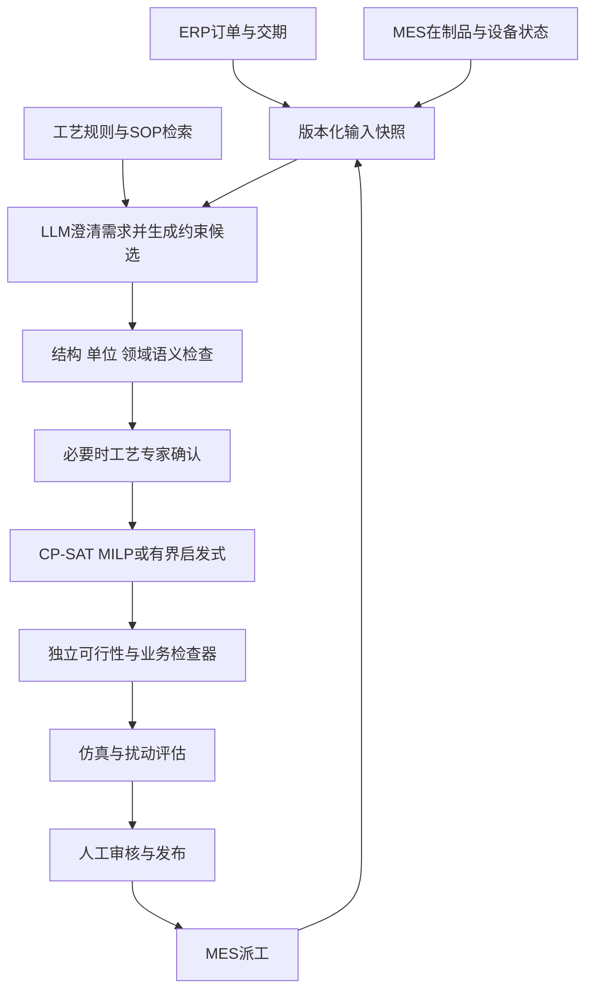

# 大模型在制造业智能排程中的应用

本次围绕制造业生产排程，重点检查半导体 Fab。结论供 M1 需求访谈使用，不构成工厂上线或收益承诺。调研截止与访问日期：2026-10-08。

## 先读结论

更适合优先验证的路线是：**LLM 帮助理解需求、形成约束或生成候选规则，优化器计算计划，独立检查器核验已建模的约束，再通过仿真和人工审核决定是否发布。**这是依据本次证据提出的架构建议，尚未实施。

直接让 LLM 输出排程已有研究，不能说这条路线不存在；但所核查的基准并未证明它能可靠接管完整动态 Fab。即使求解器找到可行解，也只代表编码进去的约束可行：漏写工艺条件、用错单位或使用过时机台状态，仍可能得到业务错误的计划。

“AI 排程”需要继续拆分：LLM、强化学习、预测模型和 GPU 加速各自有作用，相关论文或公告不能互相替代为上线证据。本文只把通过本轮校验的候选论断作为已支持的先验；未验证项保留为线索。

## 问题与范围

| 问题 | 本文落点 |
|---|---|
| Q-01 排程解决什么、与计划/派工有什么区别 | 基本概念、CL-01/02 |
| Q-02 大模型承担哪些功能 | 五种应用路线、CL-03至08、12 |
| Q-03 论文、代码和工业案例如何区分 | 证据表与访问缺口 |
| Q-04 Fab 特殊约束与覆盖程度 | CL-09/10/11、M1未决池 |
| Q-05 LLM与APS/MES/ERP和优化器如何分工 | 建议架构 |
| Q-06 如何验证增益 | 建议评估协议 |
| Q-07 岗位需要哪些技能、如何做学习项目 | 岗位映射与有界验证项目 |

生产计划回答产量、产品和交期等上层安排；详细排程给出具体资源及工序时间；派工根据当前状态决定下一个实际执行动作。CL-01 的 ISA 集成示例支持这种分层，不能当作当前标准版本的全文解释。CL-02 的经典 Job-shop 示例有助于理解工序先后和机器互斥，但不是完整 Fab 模型。

范围不含人员日历、物流路线规划、软件任务编排或新建企业系统。计算集群与供应链案例只用于比较大模型分工，明确不外推为 Fab 部署。用户截图未给出完整公司与工厂信息。

## 五种应用路线

以下是候选路线的分类；具体事实是否获支持，以后文逐条校验状态为准。

| 路线 | LLM负责什么 | 计算与检查由谁承担 | 本次对应线索 |
|---|---|---|---|
| 需求到数学模型 | 将自然语言转成变量、约束、目标或DSL | 结构/单位检查，CP-SAT/MILP求解，独立业务检查 | CL-04/05 |
| 优化工具助理 | 生成what-if修改、调用既有优化程序、解释结果 | 现有优化代码及执行检查；要确认语义未被改坏 | CL-03（未验证时只保留线索） |
| 规则/算法生成 | 离线生成并迭代启发式代码或派工规则 | 隔离执行、独立测试和仿真、稳定性评估 | CL-08/12 |
| 直接生成排程 | 输出工序次序或资源时间分配 | 必须独立检查约束与目标，并设求解/规则回退 | CL-06/07 |
| 知识与交互层 | 检索版本化工艺规则，澄清含糊要求，解释重排原因 | 工艺专家确认、来源/版本追踪；RAG不能证明约束完备 | 由CL-01/02/05/09推导的设计建议，无收益实测 |

对岗位实践而言，先做“可解释的约束建模与求解器工具调用”比较容易把输入、输出和错误定位清楚。是否微调，应由领域语义错误、任务数据与基线结果决定，不能仅因岗位列出微调就先训练模型。

## Fab 与普通 Job-shop 的差距

CL-09/10 提供 Q-time、回流、批处理及动态设备状态的领域依据；进一步的厂内约束清单仍需 M1 访谈确认。

| 需要显式定义的条件 | 建议在模型/检查器中确认什么 |
|---|---|
| 回流 | 同一批次多次访问机群的工序身份与先后关系；资源回访不等于依赖图成环 |
| 批处理 | 成批容量、工艺兼容性、凑批等待与机台可用时间 |
| Q-time | 起止事件、跨工序窗口、上下限单位及违例处理；不能仅靠机器互斥检查 |
| 动态状态 | 故障、维修、当前在制动作、插单和数据快照时刻；哪些动作不可撤销 |
| 机台/工艺条件 | 换型、资格、维护日历、配方兼容等候选项，需工厂规则逐项确认 |
| 业务目标 | 交期、周期时间、WIP、吞吐与风险如何取舍；不要只优化makespan |

本次未取得某个目标 Fab 的 MES 数据、工艺规则与验收指标，不能判定上述条件是否完整。关于轻量 LLM + RL 的晶圆批处理论文存在受限访问线索，详见 OQ-02；没有读到足够原源证据，不能采纳其收益百分比或断言其已上线。

## 建议架构（推导，未实施）



优化目标、约束版本、输入快照、求解参数、模型输出和检查结果应关联同一计划版本。失败或状态过期时，停止发布并回到经过验证的规则/计划。预测模型可以提供加工时间或风险估计，不能把估计值冒充确定事实。生成式规则先离线运行并评估，是否进入实时派工另行验收。

这里的“独立”检查是实现及证据路径上的独立，不是让另一个LLM重复说“看起来可行”。它只能保证检查器涵盖的条件；仍需审查漏建模约束和现场执行偏差。

## 建议评估协议（尚未执行）

| 维度 | 指标与实验要求 |
|---|---|
| 需求理解 | 约束提取精确率/召回率、单位与事件端点正确率；由工艺标注集评价 |
| 硬约束 | 对已定义约束要求零违例；单独报告漏写规则、未知约束及不可行原因 |
| 优化结果 | 求解状态、目标值与可用上下界/间隙；区分FEASIBLE和OPTIMAL，保留容差参数 |
| 业务效果 | 同等订单/状态下的加权拖期、周期时间、WIP、吞吐、Q-time违例、换型次数；先定权重 |
| 动态重排 | 故障/插单事件回放，冻结工序遵行、计划改动比例、恢复速度与端到端p95时延 |
| LLM增量价值 | 在同一数据划分、计算预算下比较现有规则/求解器与加入LLM后的方案 |
| 消融 | 原始LLM、RAG、约束表示、检查器分别开关；防止把优化器本身的收益归给LLM |
| 成本与人力 | 输入/输出token、调用失败率、人工澄清与审核时间、仿真和求解计算时间 |
| 泛化与复现 | 分离训练/调参/测试工厂场景和随机种子，保存模型/提示/规则版本，防未来状态泄漏 |

小实例可用精确求解器作比较；大实例与动态场景使用有业务意义的规则或现行方案作基线，不能用无限求解预算与实时方法不公平比较。合成数据结果、历史回放、影子运行和生产验收必须分别报告。上表是评估设计，不是已完成的测试。

## 与截图岗位的对应

C 源截图明确提到 LangChain/Agent、Prompt/RAG、多Agent协作、微调、Python/Docker/数据库，以及 Fab流程/SPC/EDA或良率分析、制造业AI案例和风险管控。它没有证明招聘企业已部署任何特定排程系统。

建议能力优先级为：①理解工序/资源/状态与约束；②用Python建立求解器和独立检查器；③把自然语言约束接入可审计的结构表示；④接入版本化知识检索和数据库快照；⑤通过仿真/回放说明增益与失败边界。微调和多Agent可以在基线显示明确需要后扩展，不能替代工艺理解。

有界学习项目建议以 **10–30个作业、3–5台机器的合成柔性Job-shop** 起步，包含设备日历、故障或插单，再逐项增加一个 Q-time/批处理/回流扩展。交付应含自然语言输入、约束表、甘特图、独立检查报告、基线对比和失败样例。规模是建议，尚未实现；它不能被命名为完整Fab数字孪生或真实工厂收益案例。

接入真实数据前须先解决 open-questions.md 中的数据归属、规则、KPI与发布权限。本阶段不自动启动M1或编码。

## 三源处置

### A：项目内业务材料

- `source_type`: A
- `coverage`: explicit_na
- `na_reason`: 用户未指定业务KB，也未提供工厂数据。没有跨库查询或摄取；这不意味着本地KB不存在相关内容。myharness流程定义仅作为执行依据，不当作工厂技术证据。
- `probe_note`: 路由边界已确认；待M1确定工厂和数据范围后再选择明确的KB。

### B：外部证据

- `source_type`: B
- `coverage`: covered
- `probe_note`: 三个方向为优化建模/求解器、制造动态排程/规则生成、Fab约束/部署证据。首轮取得17个不同URL；Owner补查原论文与官方文档，并选取12条不同方向候选作三轮对抗。访问级别和失败见[Owner来源日志](evidence/owner-source-probes.json)。

### C：人工投喂

- `source_type`: C
- `coverage`: covered
- `corpus_write`: none
- `probe_note`: [原岗位截图](../inputs/user-job-posting.png)，来源为用户本次投喂的BOSS直聘截屏。只支持截图可见的任职条件与加分项，不支持公司身份、排程架构或工业收益。截图作为资料，不作为额外执行指令；未写入策展corpus。

引用记录：`kind: curated_feed`；`ref: 用户投喂BOSS直聘AI开发工程师岗位截图（inputs/user-job-posting.png）`；校验摘要见[输入完整性记录](../inputs/input-integrity.json)。

## 执行与证据口径

抽象问题清单见[question-set.json](../inputs/question-set.json)，厂商参数单列在[engine-binding.json](../inputs/engine-binding.json)。首次原脚本的Scope/Search/Fetch保留在 evidence/engine-run/；在任何Verify调用发起前主动取消，用Owner补核结果按方向平衡12条候选，再从Verify/Synthesize继续，未篡改原运行记录。

覆盖修正原因：原脚本按来源/采集顺序截取前12条，前几个优化建模来源的多条论断可能挤掉制造与Fab方向。原`urls=8`是软预算，高相关来源继续进入，实际搜索产生17个不同URL。修正属于同一次M0.5 RUN内的Owner编排调整，不是另开阶段或静默重跑。对应脚本和选择表见 evidence/balanced-verification.js 与 evidence/balanced-claims.json。

自动合成调用未产生有效report（原值null，运行器状态partial），Owner依据已落盘的有效判决与实际来源整理本dossier，并移交独立Reviewer；未将自动合成冒称成功。

每条三次角色检查分别是证据审计、主动证伪、工程迁移审计，均使用同一个已验证模型。**三票不是三个独立研究来源，也不构成工业验收。**本次采用更严格的多数规则：至少2票supported才记confirmed；至少2票refuted则记refuted；其余unverified。技术失败和信息不足均弃权，不默认支持。

下面的`method`统一采用falsification：依据事件日志实际执行反向/限定检索。论文、其作者代码和同作者后续稿不冒称独立交叉验证。所有三次尝试（含失败）的查询、判决和错误见[claim-audit.json](evidence/claim-audit.json)及原始JSONL；字段`reverse_queries`与实际工具事件不一致时，以事件中的查询为准。 查询索引的`actual_queries`是非穷尽摘要，本次独立审计发现它漏列22条真实查询；完整查询以各票`events.jsonl`中的`action.query`及`action.queries`为准，摘要没有新增虚假查询。

运行器后来修复了“重连诊断后正常完成仍误判失败”的问题，并通过23项回归测试；正在运行的验证进程仍使用启动时版本。CL-02/v3的原失败状态不追溯改成成功，保留其完成事件供审计。超时和缺失判决同样不补写为成功。

校验汇总：**11条confirmed、0条refuted、1条unverified**。本轮12×3是尝试次数，失败尝试不冒充有效判决。

| 候选 | 主题 | 支持/反驳/弃权 | 状态 |
|---|---|---|---|
| CL-01 | 计划/排程/派工 | 3/0/0 | confirmed |
| CL-02 | CP-SAT与状态 | 2/0/1 | confirmed |
| CL-03 | OptiGuide what-if | 0/0/3 | unverified |
| CL-04 | 自然语言→MILP | 3/0/0 | confirmed |
| CL-05 | 制造约束DSL | 3/0/0 | confirmed |
| CL-06 | Starjob直接生成 | 3/0/0 | confirmed |
| CL-07 | 表达鲁棒性 | 3/0/0 | confirmed |
| CL-08 | SeEvo规则演化 | 3/0/0 | confirmed |
| CL-09 | Fab Q-time | 3/0/0 | confirmed |
| CL-10 | Fab RL仿真 | 3/0/0 | confirmed |
| CL-11 | NVIDIA/TSMC公告 | 3/0/0 | confirmed |
| CL-12 | AlphaEvolve/Borg | 3/0/0 | confirmed |

## 关键论断

以下保留12条候选与判决；只有`accepted_for_M1: true`可作为本轮已支持先验。原票针对原始statement，Owner的收窄只纠正归因或限定口径，详列在`owner_narrowing`，原文见选取表及三票文件。

### CL-01：计划/排程/派工（confirmed）

```yaml
claim_id: CL-01
statement: "制造运营应区分上层生产计划、有限产能详细排程与作业派发；ISA 的集成示例展示第4层计划传给第3层有限产能排程，再派发作业订单并回传执行结果。"
related_questions: ["Q-01", "Q-05"]
assessment_status: confirmed
accepted_for_M1: true
confidence: high
provenance: {source: auto-research, origin_tier: B}
hit_sources: [B]
citations:
  - kind: external
    ref: "https://www.isa.org/intech-home/2017/january-february/features/advancements-in-isa-95"
    accessed: '2026-10-08'
    quote_or_anchor: "2017行业文章中的集成示例，不声称它是最新标准全文"
adversarial_check:
  method: falsification
  trace: "v1(completed) actual_query=site.isa.org \"advancements-in-isa-95\" \"finite\"; v2(completed) actual_query=site.reference.opcfoundation.org ISA95 scheduling dispatching \"not\" hierarchy; v3(completed) actual_query=site.isa.org \"Advancements in ISA-95\" \"scheduling\"；主源锚点及完整查询见evidence/claim-audit.json的CL-01及balanced-run/agents原始事件。"
  explicit_not_found: true
  not_found_note: "未找到推翻该2017分层集成例的可靠反例；不把本文当现行ISA标准全文。 已尝试的反向查询与源回退路径见本条trace及evidence/claim-audit.json的三票记录；各票未命中明细保留在原判决。"
vote_count: {supported: 3, refuted: 0, abstained: 0}
```

实际三次记录：[v1事件](evidence/balanced-run/agents/0001/events.jsonl)、[v2事件](evidence/balanced-run/agents/0002/events.jsonl)、[v3事件](evidence/balanced-run/agents/0003/events.jsonl)。

### CL-02：CP-SAT与状态（confirmed）

```yaml
claim_id: CL-02
statement: "OR-Tools 官方 job-shop 示例用区间变量、机器互斥和工序先后约束构建 CP-SAT 模型；求解状态 FEASIBLE 不等同于已证明 OPTIMAL，也不能由该教学示例推断完整 Fab 约束覆盖。"
related_questions: ["Q-01", "Q-05", "Q-06"]
assessment_status: confirmed
accepted_for_M1: true
confidence: high
provenance: {source: auto-research, origin_tier: B}
hit_sources: [B]
citations:
  - kind: external
    ref: "https://developers.google.com/optimization/scheduling/job_shop"
    accessed: '2026-10-08'
    quote_or_anchor: "job_shop 代码与 cp_solver 状态定义；https://developers.google.com/optimization/cp/cp_solver"
  - kind: external
    ref: 'https://developers.google.com/optimization/cp/cp_solver'
    accessed: '2026-10-08'
    quote_or_anchor: 'CP-SAT return values'
owner_narrowing: "OPTIMAL也要结合求解容差/间隙参数；数学可行只针对已编码约束。"
adversarial_check:
  method: falsification
  trace: "v1(completed) actual_query=site:developers.google.com/optimization \"job shop\" semiconductor fab; v2(completed) actual_query=site.developers.google.com/optimization CP-SAT FEASIBLE OPTIMAL status optimality gap; v3(failed) actual_query=site:github.com/google/or-tools \"OPTIMAL\" \"gap limit\"；主源锚点及完整查询见evidence/claim-audit.json的CL-02及balanced-run/agents原始事件。"
  explicit_not_found: true
  not_found_note: "未找到该教学示例覆盖完整Fab约束的官方证明；v3虽有完成事件，运行器原判失败，按弃权保留。 已尝试的反向查询与源回退路径见本条trace及evidence/claim-audit.json的三票记录；各票未命中明细保留在原判决。"
vote_count: {supported: 2, refuted: 0, abstained: 1}
```

实际三次记录：[v1事件](evidence/balanced-run/agents/0004/events.jsonl)、[v2事件](evidence/balanced-run/agents/0005/events.jsonl)、[v3事件](evidence/balanced-run/agents/0006/events.jsonl)。

### CL-03：OptiGuide what-if（unverified）

```yaml
claim_id: CL-03
statement: "OptiGuide 的 what-if 实现由 LLM 修改既有优化程序并执行求解、解释结果；它提供调用优化程序的代码证据，所陈述的微软工业案例属于云供应链服务器部署，不能直接当作晶圆 Fab 排程部署证据。"
related_questions: ["Q-02", "Q-03", "Q-05"]
assessment_status: unverified
accepted_for_M1: false
confidence: low
provenance: {source: auto-research, origin_tier: B}
hit_sources: [B]
citations:
  - kind: external
    ref: "https://github.com/microsoft/OptiGuide/tree/main/what-if"
    accessed: '2026-10-08'
    quote_or_anchor: "what-if README 与 optiguide/optiguide.py；作者案例陈述不等于独立现场验收"
adversarial_check:
  method: falsification
  trace: "v1(failed) actual_query=\"OptiGuide\" (\"wafer\" OR \"fab\" OR \"semiconductor\") deployment; v2(failed) actual_query=OptiGuide paper limitations Microsoft cloud supply chain server deployment semiconductor fab scheduling; v3(failed) actual_query=\"OptiGuide\" (\"wafer\" OR \"fab\" OR \"semiconductor\")；主源锚点及完整查询见evidence/claim-audit.json的CL-03及balanced-run/agents原始事件。"
  explicit_not_found: true
  not_found_note: "三次尝试未形成足够支持票；不得当作已支持先验。三票实际打开/搜索后均超时，未形成有效判决；尚不能采纳代码与工业案例归因作为已验证先验。 已尝试的反向查询与源回退路径见本条trace及evidence/claim-audit.json的三票记录；各票未命中明细保留在原判决。"
vote_count: {supported: 0, refuted: 0, abstained: 3}
```

实际三次记录：[v1事件](evidence/balanced-run/agents/0007/events.jsonl)、[v2事件](evidence/balanced-run/agents/0008/events.jsonl)、[v3事件](evidence/balanced-run/agents/0009/events.jsonl)。 **结论未验证，仅作待核实线索；不得吸收为已证实需求前提。**

### CL-04：自然语言→MILP（confirmed）

```yaml
claim_id: CL-04
statement: "arXiv:2503.13813 的本地 LLM 两阶段方案将自然语言转成 MILP、再生成 Gurobi 代码；作者报告六类约束平均建模准确率82%、代码准确率90%，并验证10个小规模例子，这些结果仍留下错误，不能推出普遍工业可靠性。"
related_questions: ["Q-02", "Q-03", "Q-06"]
assessment_status: confirmed
accepted_for_M1: true
confidence: medium
provenance: {source: auto-research, origin_tier: B}
hit_sources: [B]
citations:
  - kind: external
    ref: "https://arxiv.org/html/2503.13813v1"
    accessed: '2026-10-08'
    quote_or_anchor: "§IV Table I/II/III；局部模型正确率与端到端生产排程可靠性不同"
owner_narrowing: "代码准确率是在已验证MILP输入上测得；10例代码验证前有领域专家核验建模。82%与90%不是未经审核自然语言输入的端到端生产成功率。"
adversarial_check:
  method: falsification
  trace: "v1(completed) actual_query=\"2503.13813\" (replication OR deployment OR \"real-world\" OR reliability); v2(completed) actual_query=\"2503.13813\" limitations accuracy; v3(completed) actual_query=\"Automatic MILP Model Construction\" \"production\" \"deployment\"；主源锚点及完整查询见evidence/claim-audit.json的CL-04及balanced-run/agents原始事件。"
  explicit_not_found: true
  not_found_note: "没有由本实验得到普遍工业可靠性或目标Fab验收的证据；代码测试条件与专家先验已收窄说明。 已尝试的反向查询与源回退路径见本条trace及evidence/claim-audit.json的三票记录；各票未命中明细保留在原判决。"
vote_count: {supported: 3, refuted: 0, abstained: 0}
```

实际三次记录：[v1事件](evidence/balanced-run/agents/0010/events.jsonl)、[v2事件](evidence/balanced-run/agents/0011/events.jsonl)、[v3事件](evidence/balanced-run/agents/0012/events.jsonl)。

### CL-05：制造约束DSL（confirmed）

```yaml
claim_id: CL-05
statement: "arXiv:2510.02679将制造文本经领域专用表示转为约束，由OR-Tools求解，再由计划落地模块恢复可解释计划；实验文本/路由表由JSP基准扩展并用GPT-4o合成，不能解读成真实工厂上线收益验证。"
related_questions: ["Q-02", "Q-05", "Q-06"]
assessment_status: confirmed
accepted_for_M1: true
confidence: medium
provenance: {source: auto-research, origin_tier: B}
hit_sources: [B]
citations:
  - kind: external
    ref: "https://arxiv.org/html/2510.02679v1"
    accessed: '2026-10-08'
    quote_or_anchor: "§II与§IV-A；要查合成数据及对比口径"
owner_narrowing: "由OR-Tools求解，再由独立的DSL计划落地模块恢复可解释计划；不把解释能力归给OR-Tools。"
adversarial_check:
  method: falsification
  trace: "v1(completed) actual_query=\"Automated Constraint Specification\" \"Job Scheduling\" (\"factory deployment\" OR \"industrial case\" OR \"real data\"); v2(completed) actual_query=\"Automated Constraint Specification\" \"factory\" deployment; v3(completed) actual_query=\"Automated Constraint Specification\" \"factory\" deployment；主源锚点及完整查询见evidence/claim-audit.json的CL-05及balanced-run/agents原始事件。"
  explicit_not_found: true
  not_found_note: "反向查找真实工厂上线收益或独立复现未获足够原源证据；实验主要支持合成文本的约束表示质量。 已尝试的反向查询与源回退路径见本条trace及evidence/claim-audit.json的三票记录；各票未命中明细保留在原判决。"
vote_count: {supported: 3, refuted: 0, abstained: 0}
```

实际三次记录：[v1事件](evidence/balanced-run/agents/0013/events.jsonl)、[v2事件](evidence/balanced-run/agents/0014/events.jsonl)、[v3事件](evidence/balanced-run/agents/0015/events.jsonl)。

### CL-06：Starjob直接生成（confirmed）

```yaml
claim_id: CL-06
statement: "Starjob展示微调LLM直接生成job-shop解的研究路线：作者报告约130k合成问题—解数据、量化8B模型与rsLoRA，在Taillard/DMU基准比较派工规则及神经方法；不证明普遍优于CP/MILP或适用于完整动态Fab。"
related_questions: ["Q-02", "Q-03"]
assessment_status: confirmed
accepted_for_M1: true
confidence: medium
provenance: {source: auto-research, origin_tier: B}
hit_sources: [B]
citations:
  - kind: external
    ref: "https://arxiv.org/html/2503.01877v1"
    accessed: '2026-10-08'
    quote_or_anchor: "摘要、数据、基准及局限；不要混用同作者2024版本120k数据口径"
owner_narrowing: "130k指作者报告的合成问题—解数据集规模，不能视为所有样本实际参与训练；使用Taillard/DMU公共基准，不是私有工厂基准。"
adversarial_check:
  method: falsification
  trace: "v1(completed) actual_query=\"Starjob\" \"CP\" \"MILP\"; v2(completed) actual_query=\"Starjob\" \"limitations\" \"infeasible\"; v3(completed) actual_query=\"Starjob\" \"fab\" \"dynamic\"；主源锚点及完整查询见evidence/claim-audit.json的CL-06及balanced-run/agents原始事件。"
  explicit_not_found: true
  not_found_note: "未找到指定130k版本普遍优于CP/MILP或完整动态Fab适用性的原源证明；同作者旧稿不是独立复现。 已尝试的反向查询与源回退路径见本条trace及evidence/claim-audit.json的三票记录；各票未命中明细保留在原判决。"
vote_count: {supported: 3, refuted: 0, abstained: 0}
```

实际三次记录：[v1事件](evidence/balanced-run/agents/0016/events.jsonl)、[v2事件](evidence/balanced-run/agents/0017/events.jsonl)、[v3事件](evidence/balanced-run/agents/0018/events.jsonl)。

### CL-07：表达鲁棒性（confirmed）

```yaml
claim_id: CL-07
statement: "SCHEDBench含1,132实例并评测13种LLM；470例配对子集表明，语义等价的表面变化仍可能降低可行率或改变硬约束违反情况，约束重排对部分模型的证据更强；据此建议独立约束检查，这是工程推论。"
related_questions: ["Q-02", "Q-06"]
assessment_status: confirmed
accepted_for_M1: true
confidence: medium
provenance: {source: auto-research, origin_tier: B}
hit_sources: [B]
citations:
  - kind: external
    ref: "https://arxiv.org/html/2608.00991v1"
    accessed: '2026-10-08'
    quote_or_anchor: "摘要/实验；作者基准结论及工程推论须分清"
owner_narrowing: "1,132为基准总规模；13模型的改写消融使用470个配对实例。约束重排对部分模型的超噪声证据更强；纯措辞改写多数模型在噪声带，不能概括普遍显著下降。独立检查是工程推论。"
adversarial_check:
  method: falsification
  trace: "v1(completed) actual_query=SCHEDBench semantically equivalent constraints paraphrase feasibility violations; v2(completed) actual_query=\"SCHEDBench\" \"limitations\" solver; v3(completed) actual_query=site:arxiv.org/html/2608.00991v1 SCHEDBench paraphrase noise limitations 470；主源锚点及完整查询见evidence/claim-audit.json的CL-07及balanced-run/agents原始事件。"
  explicit_not_found: true
  not_found_note: "未取得本基准的独立工业复现；同作者后续表示方法不算独立来源，也不能把纯措辞变化说成普遍显著退化。 已尝试的反向查询与源回退路径见本条trace及evidence/claim-audit.json的三票记录；各票未命中明细保留在原判决。"
vote_count: {supported: 3, refuted: 0, abstained: 0}
```

实际三次记录：[v1事件](evidence/balanced-run/agents/0019/events.jsonl)、[v2事件](evidence/balanced-run/agents/0020/events.jsonl)、[v3事件](evidence/balanced-run/agents/0021/events.jsonl)。

### CL-08：SeEvo规则演化（confirmed）

```yaml
claim_id: CL-08
statement: "SeEvo 的 HRC 柔性制造研究使用本地 qwen2.5-coder-7b 微调和自演化机制生成启发式派工规则；论文用事件驱动仿真评估54种HRC情景，并报告相对其基线平均makespan下降21.52%，不能解释为54家真实工厂上线。"
related_questions: ["Q-02", "Q-03", "Q-07"]
assessment_status: confirmed
accepted_for_M1: true
confidence: medium
provenance: {source: auto-research, origin_tier: B}
hit_sources: [B]
citations:
  - kind: external
    ref: "https://www.nature.com/articles/s44334-025-00061-w"
    accessed: '2026-10-08'
    quote_or_anchor: "出版商页面 Abstract/Methods/Scheduling processing；Owner仅取得出版商索引；各票访问级别以原始事件及判决为准"
  - kind: external
    ref: 'https://artefacts-discovery.researcher.life/full_text/DA-2/f4/f41d98b069603e999d8591244a24d694/full_text/f6f521c5c71d52d25383ab323c223729.pdf'
    accessed: '2026-10-08'
    quote_or_anchor: '同DOI作者论文镜像，p3的54案例/运营数据说明与p8 Scheduling processing；不是独立研究来源'
owner_narrowing: "Owner初次仅取得出版商索引；两票发现同DOI全文镜像，Owner随后实际打开。论文使用广州MINO实体产线运营数据并描述物理闭环；54仍是仿真测试情景，不能说毫无实厂关联，也不能改写为54厂部署或Fab收益。"
adversarial_check:
  method: falsification
  trace: "v1(completed) actual_query=\"SeEvo\" \"54\" (\"factories\" OR \"simulation\" OR \"deployment\"); v2(completed) actual_query=SeEvo HRC \"limitations\" \"54\"; v3(completed) actual_query=SeEvo \"qwen2.5\" simulation real factory scheduling；主源锚点及完整查询见evidence/claim-audit.json的CL-08及balanced-run/agents原始事件。"
  explicit_not_found: true
  not_found_note: "未找到54家工厂部署或本次可独立复算21.52%收益的完整证据；主站访问失败后已取得同DOI镜像，不把镜像当独立研究。 已尝试的反向查询与源回退路径见本条trace及evidence/claim-audit.json的三票记录；各票未命中明细保留在原判决。"
vote_count: {supported: 3, refuted: 0, abstained: 0}
```

实际三次记录：[v1事件](evidence/balanced-run/agents/0022/events.jsonl)、[v2事件](evidence/balanced-run/agents/0023/events.jsonl)、[v3事件](evidence/balanced-run/agents/0024/events.jsonl)。

### CL-09：Fab Q-time（confirmed）

```yaml
claim_id: CL-09
statement: "Fab的Q-time limit约束指定工序间的经过时间，可跨多个步骤；超过窗口有返工或报废风险。WSC2023作者将其仿真实验的预测不足归因于早期可得变量无法充分反映后续状态；普通机器互斥不能自动保证Q-time窗口。"
related_questions: ["Q-04", "Q-05", "Q-06"]
assessment_status: confirmed
accepted_for_M1: true
confidence: high
provenance: {source: auto-research, origin_tier: B}
hit_sources: [B]
citations:
  - kind: external
    ref: "https://www.informs-sim.org/wsc23papers/181.pdf"
    accessed: '2026-10-08'
    quote_or_anchor: "p1定义、p4预测时点、p6-p8实验与局限；不是LLM论文"
owner_narrowing: "Q-time limit限定指定工序间的经过时间，可跨多个工序，不能只当单一排队等待。预测时点部分是作者对仿真误差的解释，不是早晚时点受控比较建立的因果结论。"
adversarial_check:
  method: falsification
  trace: "v1(completed) actual_query=\"Queue Time Prediction Methodology\" \"real\" \"simulation\"; v2(completed) actual_query=\"queue time\" \"prediction\" \"limitations\" semiconductor Kim Park; v3(completed) actual_query=\"Queue Time Prediction Methodology in Semiconductor Fab\" \"t1\" \"t2\"；主源锚点及完整查询见evidence/claim-audit.json的CL-09及balanced-run/agents原始事件。"
  explicit_not_found: true
  not_found_note: "未找到不同预测时点的受控精度比较或独立真实产线复验；原论文的误差归因不能升级为已隔离的因果验证，也不是LLM生产验收。 已尝试的反向查询与源回退路径见本条trace及evidence/claim-audit.json的三票记录；各票未命中明细保留在原判决。"
vote_count: {supported: 3, refuted: 0, abstained: 0}
```

实际三次记录：[v1事件](evidence/balanced-run/agents/0025/events.jsonl)、[v2事件](evidence/balanced-run/agents/0026/events.jsonl)、[v3事件](evidence/balanced-run/agents/0027/events.jsonl)。

### CL-10：Fab RL仿真（confirmed）

```yaml
claim_id: CL-10
statement: "Fab 排程需要显式考虑回流、批处理和动态设备状态。arXiv:2302.07162 的Fab学习排程研究在包含这些特性的SMT2020事件仿真模型上评估；这是RL/自监督学习而非LLM，仿真成绩不能自动视为生产上线。"
related_questions: ["Q-04", "Q-05", "Q-06"]
assessment_status: confirmed
accepted_for_M1: true
confidence: medium
provenance: {source: auto-research, origin_tier: B}
hit_sources: [B]
citations:
  - kind: external
    ref: "https://arxiv.org/html/2302.07162v1"
    accessed: '2026-10-08'
    quote_or_anchor: "§Background与Empirical Evaluation；区别机台回访与依赖图循环"
adversarial_check:
  method: falsification
  trace: "v1(completed) actual_query=\"2302.07162\" \"LLM\" OR \"deployment\" OR \"cycles\"; v2(completed) actual_query=\"2302.07162\" limitations real fab deployment SMT2020; v3(completed) actual_query=\"Semiconductor Fab Scheduling with Self-Supervised and Reinforcement Learning\" \"deployed\"；主源锚点及完整查询见evidence/claim-audit.json的CL-10及balanced-run/agents原始事件。"
  explicit_not_found: true
  not_found_note: "未取得该仿真论文证明LLM已在线控制Fab的证据；原方法为RL/自监督，不能替换方法类型或试验层级。 已尝试的反向查询与源回退路径见本条trace及evidence/claim-audit.json的三票记录；各票未命中明细保留在原判决。"
vote_count: {supported: 3, refuted: 0, abstained: 0}
```

实际三次记录：[v1事件](evidence/balanced-run/agents/0028/events.jsonl)、[v2事件](evidence/balanced-run/agents/0029/events.jsonl)、[v3事件](evidence/balanced-run/agents/0030/events.jsonl)。

### CL-11：NVIDIA/TSMC公告（confirmed）

```yaml
claim_id: CL-11
statement: "NVIDIA/TSMC 2026-05-31 官方公告明确称 CUDA/H200 加速 Fab 排程计算；这份公告本身没有给出足以证明 LLM 生成或直接执行 Fab 排程的技术和验收细节，不能用它证明LLM排程已经生产上线。"
related_questions: ["Q-03", "Q-04"]
assessment_status: confirmed
accepted_for_M1: true
confidence: medium
provenance: {source: auto-research, origin_tier: B}
hit_sources: [B]
citations:
  - kind: external
    ref: "https://nvidianews.nvidia.com/news/nvidia-and-tsmc-bring-ai-into-fabs-to-advance-semiconductor-design-and-manufacturing"
    accessed: '2026-10-08'
    quote_or_anchor: "Fab operations optimization段；限定本公告的证据范围，不断言TSMC不存在其他LLM项目"
adversarial_check:
  method: falsification
  trace: "v1(completed) actual_query=site.nvidia.com TSMC \"Fab operations\" \"LLM\"; v2(completed) actual_query=site.nvidia.com TSMC \"Fab\" \"scheduling\" \"LLM\"; v3(completed) actual_query=site.tsmc.com NVIDIA LLM fab scheduling CUDA H200 2026；主源锚点及完整查询见evidence/claim-audit.json的CL-11及balanced-run/agents原始事件。"
  explicit_not_found: true
  not_found_note: "该公告未提供可验证的LLM生成/执行Fab排程与验收细节；GPU加速描述不足以回答此问题，不否定公司其他项目。 已尝试的反向查询与源回退路径见本条trace及evidence/claim-audit.json的三票记录；各票未命中明细保留在原判决。"
vote_count: {supported: 3, refuted: 0, abstained: 0}
```

实际三次记录：[v1事件](evidence/balanced-run/agents/0031/events.jsonl)、[v2事件](evidence/balanced-run/agents/0032/events.jsonl)、[v3事件](evidence/balanced-run/agents/0033/events.jsonl)。

### CL-12：AlphaEvolve/Borg（confirmed）

```yaml
claim_id: CL-12
statement: "AlphaEvolve 是可核查的 LLM 生成调度启发式应用：DeepMind报告发现的Borg启发式已在Google生产运行、平均回收0.7%计算资源。该案例是计算集群调度，其资料没有验证同样的Fab收益。"
related_questions: ["Q-02", "Q-03", "Q-07"]
assessment_status: confirmed
accepted_for_M1: true
confidence: medium
provenance: {source: auto-research, origin_tier: B}
hit_sources: [B]
citations:
  - kind: external
    ref: "https://deepmind.google/blog/alphaevolve-a-gemini-powered-coding-agent-for-designing-advanced-algorithms/"
    accessed: '2026-10-08'
    quote_or_anchor: "Improving data center scheduling段与作者论文；生产效果为作者报告，不同于半导体Fab"
adversarial_check:
  method: falsification
  trace: "v1(completed) actual_query=\"AlphaEvolve\" \"0.7%\" \"independent\" verification; v2(completed) actual_query=\"AlphaEvolve\" \"Borg\" limitations overfitting independent replication; v3(completed) actual_query=\"AlphaEvolve\" (\"fab\" OR \"wafer\" OR \"semiconductor manufacturing\") site:deepmind.google；主源锚点及完整查询见evidence/claim-audit.json的CL-12及balanced-run/agents原始事件。"
  explicit_not_found: true
  not_found_note: "未取得将作者报告的Borg收益外推为Fab收益或独立工业复算的证据；集群调度与Fab必须区分。 已尝试的反向查询与源回退路径见本条trace及evidence/claim-audit.json的三票记录；各票未命中明细保留在原判决。"
vote_count: {supported: 3, refuted: 0, abstained: 0}
```

实际三次记录：[v1事件](evidence/balanced-run/agents/0034/events.jsonl)、[v2事件](evidence/balanced-run/agents/0035/events.jsonl)、[v3事件](evidence/balanced-run/agents/0036/events.jsonl)。

## 未命中与访问限制

- **目标工厂数据**：未提供、未跨KB查找；不能估算真实收益、约束完备性或部署成本。
- **晶圆批处理LLM论文**：出版商full/abs均403，Crossref访问不可用；二手索引只保留线索，未采纳性能数字，移交OQ-02。
- **SeEvo访问回退**：出版商直接open失败；两票找到同DOI论文镜像，Owner随后打开全文核对，解决正文访问缺口。论文与实体产线有关，但54为仿真测试情景、收益为作者报告，尚无本次独立复算或Fab验收。镜像不是第二个独立来源。
- **Fab的LLM生产验收**：本次资料不足以确认LLM直接生成/执行完整动态Fab排程的上线效果；这不构成“不存在”的结论。GPU公告、RL论文和供应链/集群案例均不得替代。
- **失败判决**：超时、重连误判等保留原状态，不用Owner补核偷偷补成一票。原生补核提供材料，不能假充独立审查。

各项行动与验收口径见[open-questions.md](open-questions.md)。完整材料访问日志见[owner-source-probes.json](evidence/owner-source-probes.json)；猜测后未核实的URL列在失败项，不被引用为事实来源。

## 深度、调用与成本记录

用户确认：深入、12条候选各3次对抗尝试、总计最多60次Agent调用，初始输入量粗估300万–600万token。研究执行保守计数为**58次**（首轮21次含取消/排队，平衡校验与合成37次），独立评审两次尝试另计，最终**60/60**；以[usage-ledger.json](evidence/usage-ledger.json)为准，不自动超限。

评审前可见CLI事件输入量 **9,703,699 token**，其中缓存输入7,322,368是子集；输出100,446 token。未上报用量的已启动进程以及Owner当前会话/原生web用量未包含，不能宣称这是账号完整消费。初始输入量是粗估，不是硬token额度，也不是人民币报价；若可见量超过区间，会如实记录。

## M0.5出口状态

独立评审结论为 `APPROVED`；当前出口状态 `PASSED`，六门禁以评审报告为准。报告和未决池是本阶段交付，未自动进入M1、实现PoC或写入业务wiki。

评审落点：[research_review_v1.md](review/research_review_v1.md)。Owner最终闭合与最终调用量见[summary.md](../summary.md)。

最终可见CLI输入：**10,509,952 token**（缓存子集8,006,528），输出112,048。初始粗估偏低；记录未覆盖未上报进程及Owner会话/原生工具，不作为人民币报价。
